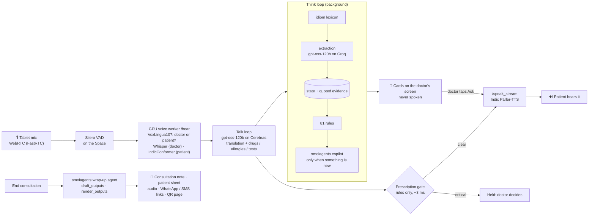

<div align="center">

# بيان · Bayan AI

**An ambient interpreter and clinical safety net for the patients Qatar's clinics struggle to hear.**

*Bayan* (بيان) is the Arabic word for clarity, eloquence and illumination.

Qai × Hugging Face Hackathon O1 · Team **QH-129** · Doha, 5–7 Nov 2026

[▶️ Try the Space](https://huggingface.co/spaces/dullgrey/team-qh-129-bayan-app) · [🎬 Demo video](#links) (pending) · [📖 Docs](#documentation)

</div>

---

## In 30 seconds

Roughly **9 in 10 people living in Qatar are not Qatari** (an estimate; no official nationality breakdown is published). Much of the migrant workforce speaks Nepali, Hindi, Urdu, Bengali, Malayalam or Filipino. Their doctors mostly speak English and Arabic.

**Bayan AI is one tablet on the consultation desk that listens, talks and thinks.**

- 🎧 **Listens.** No push-to-talk. Voice activity detection cuts each utterance; a language-ID model decides whether the doctor or the patient spoke.
- 🗣️ **Talks.** It speaks the doctor's words to the patient in Nepali (also Hindi, Urdu, Bengali, Malayalam) and shows the patient's words to the doctor in English.
- 🧠 **Thinks.** Beside the conversation, a deterministic safety spine (81 cited rules, a 59-entry idiom lexicon) and a **smolagents** copilot on `gpt-oss-120b` put cards on the doctor's screen only:
  - an idiom note, e.g. a Nepali worker's *"gyastrik"* (ग्यास्ट्रिक, "gastric") chest burning, which can hide cardiac pain;
  - a held sentence: the doctor prescribes amoxicillin after the patient reported a penicillin allergy, and Bayan does not speak it until the doctor chooses;
  - missing workup, e.g. chest pain with no ECG or troponin before discharge;
  - the next question worth asking, spoken to the patient with one tap.

When the consultation ends:
- **For the doctor:** a "Consultation note" PDF plus a plain-text copy for the hospital record (EMR).
- **For the patient:** a medicine and care sheet in their own language (English beneath) as a PDF, an on-screen QR code to an expiring web page with the same plan and a PDF download, and a prefilled WhatsApp link. (Reading the plan aloud as audio is built but off by default.)

What is deployed, what is integrated locally but not yet deployed, and what is only designed: [Live today vs designed](#live-today-vs-designed).

> Most medical AI saves the doctor time. **Bayan AI protects the patient**: their safety, their understanding and their dignity.

---

## Why Qatar needs this

| | Evidence |
|---|---|
| 🇶🇦 **The state has already named the languages** | The MoPH **Patients' Bill of Rights** is published in **Arabic, English, Bengali, Filipino, Hindi, Malayalam, Nepali and Urdu**. It says patients should get information they can understand, that an interpreter can be provided when needed, and that consent should be in an understandable language. [MoPH](https://dhp.moph.gov.qa/en/Pages/FTPDownloads.aspx) |
| 🏥 **Interpreters exist, but not in every room** | HMC offers professional interpreters on request ([HMC](https://hamad.qa/EN/Patient-Information/Interpreter-Services/)) and Sidra Medicine runs a 24/7 phone and video line in 66 languages ([Sidra](https://www.sidra.org/patients-visitors/your-visit/during-your-visit-2/medical-interpreters/)). The gap is the workers' health centres, the ambulance and the many visits where whoever is around interprets. |
| 🗣️ **Language barriers are documented at Hamad** | In a study of 84 outpatients at Hamad General Hospital, most had experienced or witnessed language barriers and relied on incidental interpreters. Hindi and Urdu speakers met barriers more often. [J Health Commun, 2017](https://doi.org/10.1080/10810730.2017.1296507) |
| 🚑 **…and on the ambulance** | Among 312 HMC Ambulance Service staff, **65%** face language-related communication difficulties at least occasionally. Only **37%** say the information they get from patients is sufficient. [Qatar Med J, 2025](https://pmc.ncbi.nlm.nih.gov/articles/PMC12127531/) |
| ⚠️ **Ad hoc interpretation causes harm** | A mean of **31 interpreter errors per encounter**, 63% of them with potential clinical consequences. Errors by ad hoc interpreters were consequential **77%** of the time. [Flores et al., Pediatrics 2003](https://pubmed.ncbi.nlm.nih.gov/12509547/) |
| 🫀 **"Gastric" can be a heart attack** | In a Nepali study of STEMI patients, **87.9%** had typical chest pain but only **23.8%** thought it was cardiac. Bayan's lexicon flags *gyastrik* for exactly this. [Prajapati et al., JNHRC 2022](https://jnhrc.com.np/index.php/jnhrc/article/view/1217) |
| 📈 **The scale is real** | Qatar Red Crescent's Workers' Health Centres logged **1,460,696 visits in 2025**. [Qatar Tribune](https://www.qatar-tribune.com/article/247543/nation/qrcs-medical-affairs-division-getsaccreditation-canada-diamond-tag) |

Full evidence, personas and competitor comparison: [01 · Problem & Impact](docs/01-problem-and-impact.md).

---

## The golden path

Ram, a 29-year-old construction worker (an illustrative persona), sees an English-speaking doctor.

1. **Consent.** Bayan explains itself in Nepali and asks for consent.
2. **Allergy.** The doctor asks about allergies; Ram says his body swelled up after a penicillin injection. The allergy goes into the clinical state with his words as evidence.
3. **Idiom.** Ram says his chest burns "like *gyastrik*" and it gets worse at work. The doctor sees the English, the idiom note (usually dyspepsia; can mask cardiac pain) and an "Ask next" card. One tap and Bayan asks about spread to the arm or jaw, in Nepali.
4. **Held sentence.** The doctor says "Amoxicillin 500 three times a day, and you can go home." The prescription gate (rule `ALG-PEN-01`, no LLM) holds the sentence. The doctor picks **Say something else** or **Speak it anyway** (logged). A chest-pain workup card (`WORK-CHEST-01…04`) flags discharge with no ECG or troponin.
5. **Correction.** The doctor switches to paracetamol and orders an ECG and a blood test. The cards resolve themselves.
6. **"End consultation."** The wrap-up agent drafts the note and the Nepali care plan, re-checks every medicine against the rules and renders the PDFs.

Steps 2–6 run on the clinical brain, which is now wired into the Space code; `scripts/smoke_e2e.py` passes 17/17 live on the merged code. This state is not yet deployed (see [Live today vs designed](#live-today-vs-designed)).

Script, shot list and judge Q&A: [09 · Pitch & Demo](docs/09-pitch-and-demo.md).

---

## How it works



**Code map.** The UI shell (`app.py`, `bayan/ui.py` screens, `bayan/consult.py` state machine, `bayan/talk.py` voice and translation) drives the product. Clinical logic lives in `bayan/brain/` (rules, idioms, extraction, state merge, checklist, cards, the two smolagents agents, wrap-up) and `bayan/outputs/` (PDFs, delivery links, retention). `bayan/copilot.py` adapts brain cards to the Notes panel; `bayan/careplan.py` serves the care plan page. Speech models run on a separate GPU Space (`voice_worker/`).

**Why a cascade, not one speech-to-speech model?** No open end-to-end model speaks Nepali or Malayalam, and the text in the middle is what makes the safety checks, idiom notes, audit trail and notes possible.

| Loop | When it runs | What runs | Measured |
|---|---|---|---|
| **Talk** | Every utterance | `/hear` → translation (reasoning low) → prescription gate → streaming TTS | Worker TTS first audio ~2.2–3.1 s (from Doha). End-to-end target ≤ 3 s, **not yet measured** |
| **Think** | Background, debounced ~1.2 s, one run in flight | Idioms → extraction → merge → 81 rules → copilot agent (reasoning medium) | Extraction ~1.1 s; agent ~1.2–1.6 s, 1 step |
| **Wrap-up** | "End consultation" | Wrap-up agent: note + care plan in parallel, rule re-check, render | ~6–8 s |

Deep dive: [03 · Architecture](docs/03-architecture.md) · [11 · Copilot Agent](docs/11-clinical-copilot-agent.md) · [04 · Models](docs/04-models-and-languages.md).

---

## Built with Hugging Face

| Layer | What we use today |
|---|---|
| App | **Gradio Space** `dullgrey/team-qh-129-bayan-app` with FastRTC (WebRTC, Silero VAD) and a FastAPI route for the care plan page |
| LLM | `openai/gpt-oss-120b` via **Inference Providers**: Cerebras for translation and both agents, Groq for background extraction (same model, cheaper input) |
| Agents | **smolagents** 1.26.0 `ToolCallingAgent`, twice: the clinical copilot (`lookup_idiom`, `lookup_drug`, `check_safety_rules`, `final_answer(cards)`) and the wrap-up agent (`draft_outputs`, `render_outputs`) |
| GPU voice worker | A private **L4 GPU Space** (`voice_worker/`) called with `gradio_client`: `openai/whisper-large-v3-turbo` (doctor ASR), `speechbrain/lang-id-voxlingua107-ecapa` (who is speaking), `ai4bharat/indic-conformer-600m-multilingual` (patient ASR), `ai4bharat/indic-parler-tts` (streaming patient-language speech) |
| Doctor voice (optional) | `hexgrad/Kokoro-82M` via Inference Providers, off by default |

No closed frontier model sits in the runtime path. A coding assistant (Claude Code) helped write code and docs during the build, as the commit trailers show.

**Roadmap, not in the runtime:** `QCRI/Fanar` for Arabic grounding, `Voxtral-Mini-4B-Realtime-Arabic` for Gulf Arabic ASR, MMS-TTS / Chatterbox / OmniVoice for more voices, omniASR for long-tail languages, pyannote for same-language diarization, a LoRA fine-tune on HF Jobs ([06](docs/06-fine-tuning-plan.md); not trained), and the idiom lexicon as a Hub dataset (not published yet).

---

## Languages

| | Today | Notes |
|---|---|---|
| **Nepali** | Voice in and out | The demo language and the most tested |
| **Hindi · Urdu · Bengali · Malayalam** | Voice in and out | Same models; less tested |
| **Filipino (Tagalog)** | Speech in (Whisper), text out | No voice yet |
| **Doctor side** | English or Arabic speech in | Patient replies are shown in English; no Arabic voice yet |

More languages (Tamil, Telugu, Sinhala, Swahili, Amharic and others) are mapped in [04 · Models & Languages](docs/04-models-and-languages.md), with the model and licence for every cell.

---

## Efficiency

Measured live on the 9-turn golden path (text turns through `scripts/smoke_e2e.py`, 2026-11-07):

| Step | Latency | Cost for the consultation |
|---|---|---|
| Background extraction (Groq) | ~1.1 s per call | ≈ $0.015 together |
| Copilot agent (Cerebras) | ~1.2–1.6 s per run, 1 step (p50 ~1.8 s on the merged code) | |
| Wrap-up: note, care plan, PDFs | ~6–8 s | ≈ $0.004 |

A 40-turn consultation is **estimated** at ≈ $0.06. These numbers exclude the talk-loop translation calls and the GPU worker's hours.

What keeps it cheap: extraction runs on Groq (input $0.15/1M vs $0.35 on Cerebras), a doctor's plain question is batched with the patient's answer into one extraction call, courtesy turns skip extraction, and the agent runs only when the deterministic steps found something new and usually finishes in one step. Rules run on CPU at no cost. Two things we measured and dropped: reasoning "high" (empty replies, ~12 s) and agent tool calling on Groq (the model called a tool that does not exist), so both agents run on Cerebras.

Budget and provider routing: [07 · Compute Budget](docs/07-compute-budget-and-efficiency.md).

---

## Safety, privacy & honesty

- **Decision support, not diagnosis.** Bayan never prescribes or diagnoses. The doctor decides, acts on each card and approves the care plan before it goes to the patient.
- **Rules are the authority.** 81 deterministic rules (37 critical, 35 caution, 9 info), each citing an FDA label or a guideline (NICE, AHA/ACC, ESC, WMS and others). Only the rule engine can raise a critical alert; agent cards are capped at caution and must cite real utterances and an existing rule, idiom or checklist id. If the agent fails or times out, deterministic fallback cards take over.
- **The note stays the doctor's.** The Assessment section holds only the clinician's own words; a code-level guard drops diagnostic claims nobody stated. Every care-plan medicine is re-checked against the rules.
- **Privacy.** Outputs live in a per-consultation temp folder, deleted on reset and swept after 24 h; the care plan page lives in memory and expires after 24 h; PDFs are served only under an unguessable token with whitelisted file names; phone numbers are never stored. The voice worker deletes each uploaded utterance right after loading it, and the consent line says the voice is processed, not stored. The Space sits behind an access code. Tests make no paid calls (`tests/conftest.py`). Synthetic consultations only; no real patient data.
- **Known gaps:**
  - **Nepali → English translation quality is unverified.** In a live check, `gpt-oss-120b` turned "जिउ सुन्निएको थियो" ("my body swelled") into "my tongue swelled". The patient's own words are always shown next to the English, a native-speaker review is needed before any real use, and a dedicated MT model (e.g. AI4Bharat IndicTrans2) is a roadmap option.
  - The idiom lexicon (59 entries) and the rules are literature-sourced, **not yet clinician-reviewed**.
  - Nepali lines (including the consent line) are machine drafts; **no native-speaker review yet**.
  - Copying Nepali text out of the PDF gives broken characters (the printed page is correct).

Details: [05 · Clinical Safety & Cultural Intelligence](docs/05-clinical-safety-and-cultural-intelligence.md).

---

## Live today vs designed

| | Status |
|---|---|
| Ambient talk loop (WebRTC, VAD, doctor/patient ID, ASR, translation, streaming Nepali voice), spoken consent, held sentence, idiom "Ask next", no-mic demo, care plan page by QR | **Deployed** in the Space (earlier UI shell) |
| Clinical brain wired into that UI: intent-aware rule-engine prescription gate ("Say something else" withdraws the turn and rolls the state back, "Speak it anyway" is audited), idiom, rule and copilot cards in the Notes panel, wrap-up agent, review with an editable "Doctor's note" tab, both PDFs at `/files/<token>/`, `/plan/<id>` with PDF download, WhatsApp link | **Done in the local code** (269 offline tests, live smoke run 17/17); **not yet deployed** to the Space |
| Care-plan audio (WAV) | Built, off by default (`BAYAN_PLAN_AUDIO=1`) |
| Voices for Filipino and Arabic, more languages, Fanar / Voxtral, fine-tune, Hub dataset, automatic WhatsApp / SMS sending, EMR integration | **Designed, not built** |

---

## Run the checks

```bash
pip install -r requirements.txt gradio==5.49.1 pytest   # requirements.txt pins smolagents, fpdf2, uharfbuzz, rapidfuzz, segno
pytest tests                              # 269 offline tests with fake models; paid calls are blocked
python scripts/smoke_e2e.py --offline     # golden path with scripted models, free
HF_TOKEN=hf_... python scripts/smoke_e2e.py   # live golden path: 17 checks, about $0.02
```

**Running the Space.** Set the `HF_TOKEN` and `BAYAN_ACCESS_CODE` secrets. If the access code is unset, the app logs a warning at startup and nobody can get past the gate, so judges need the code from the team. Locally, `python app.py` serves on port 7860 with the code `local`.

What this does not prove: fake models test our logic, not model quality; the live check is one scenario; PDF layout is checked by eye.

---

## Documentation

| # | Doc | What's inside |
|---|---|---|
| 01 | [Problem & Impact](docs/01-problem-and-impact.md) | Qatar evidence, personas, competitor comparison, impact KPIs |
| 02 | [Product Spec](docs/02-product-spec.md) | Behaviour, screens, outputs as built, MVP status |
| 03 | [Architecture](docs/03-architecture.md) | Module map, call flow, deployment, privacy |
| 04 | [Models & Languages](docs/04-models-and-languages.md) | Models used vs alternatives, coverage matrix, licences, latency |
| 05 | [Clinical Safety & Cultural Intelligence](docs/05-clinical-safety-and-cultural-intelligence.md) | Idioms, the 81-rule engine, rule changes, cards, guardrails |
| 06 | [Fine-Tuning Plan](docs/06-fine-tuning-plan.md) | Roadmap only: not trained for the hackathon |
| 07 | [Compute Budget & Efficiency](docs/07-compute-budget-and-efficiency.md) | Measured cost, provider routing, cost levers |
| 08 | [Build Plan](docs/08-build-plan.md) | Roles, repo layout, what is done and what is not |
| 09 | [Pitch & Demo](docs/09-pitch-and-demo.md) | 3-minute pitch, demo script, judge Q&A |
| 10 | [Submission Checklist](docs/10-submission-checklist.md) | Hackathon rules mapped to proof and status |
| 11 | [Clinical Copilot Agent](docs/11-clinical-copilot-agent.md) | Deterministic spine + smolagents agents: tools, cards, guardrails, measured cost |

Data: [`data/idiom_lexicon.json`](data/idiom_lexicon.json) · [`data/safety_rules.json`](data/safety_rules.json) (see each rule's `change_note`)

---

## Links

| | |
|---|---|
| Space | https://huggingface.co/spaces/dullgrey/team-qh-129-bayan-app |
| Demo video (2–3 min) | ⟨pending⟩ |
| Blog post (optional) | ⟨pending⟩ |

## Team QH-129

⟨Names and roles; see [08 · Build Plan](docs/08-build-plan.md)⟩

---

<sub>Bayan AI is a hackathon prototype built during the Qai × Hugging Face Hackathon O1 (Doha, 5–7 Nov 2026). It is not a medical device and has not been clinically validated. The runtime models are Apache-2.0 or MIT licensed; the two ai4bharat models are gated on the Hub. See [04](docs/04-models-and-languages.md).</sub>
