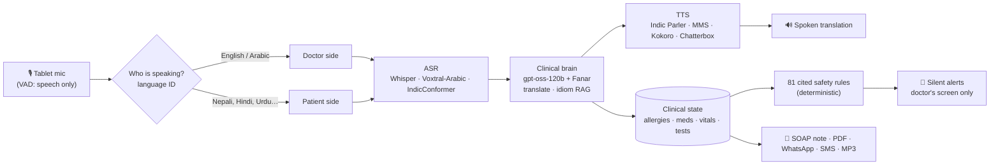

# بيان · Bayan AI

**An ambient interpreter and clinical safety net for the patients Qatar's clinics struggle to hear.**

*Bayan* (بيان) is the Arabic word for clarity, eloquence and illumination.

Qai × Hugging Face Hackathon O1 · Team **QH-129** · Doha, 5–7 Nov 2026

[▶️ Try the Space](https://huggingface.co/spaces/dullgrey/team-qh-129-bayan-app) · [🎬 Demo video](#links) · [🧠 Model](https://huggingface.co/dullgrey/team-qh-129-bayan) · [📚 Idioms dataset](https://huggingface.co/datasets/dullgrey/team-qh-129-bayan-idioms) · [📖 Docs](#documentation)

---

## In 30 seconds

Roughly **9 in 10 people living in Qatar are not Qatari** (an estimate; no official nationality breakdown is published). Most of the migrant workforce speaks Nepali, Hindi, Urdu, Bengali, Malayalam or Filipino. Their doctors mostly speak English and Arabic.

**Bayan AI is one tablet on the consultation desk that listens, talks and thinks.**

- 🎧 **Listens.** No buttons and no push-to-talk. It hears the doctor and the patient and works out who is speaking from the language they use.
- 🗣️ **Talks.** It speaks each sentence aloud to the other person in their own language, within seconds.
- 🧠 **Thinks.** In the background it:
  - interprets **cultural idioms**, e.g. a Nepali worker's *"gyastrik"* (ग्यास्ट्रिक, "gastric") burning chest, which can hide cardiac pain;
  - shows **silent safety alerts** to the doctor only, e.g. a penicillin allergy mentioned at minute 1 against an amoxicillin prescription at minute 6;
  - flags a chest-pain patient being discharged with no ECG or troponin.

When the consultation ends, Bayan produces two outputs:
- **For the doctor:** an English SOAP note ready for the hospital record (EMR).
- **For the patient:** a care plan in their own language, as a **PDF**, by **WhatsApp** and **SMS**, and as a **downloadable audio file** for patients who cannot read.

> Most medical AI saves the doctor time. **Bayan AI protects the patient**: their safety, their understanding and their dignity.

---

## Why Qatar needs this

| | Evidence |
|---|---|
| 🇶🇦 **The state has already named the languages** | The MoPH **Patients' Bill of Rights** is published in **Arabic, English, Bengali, Filipino, Hindi, Malayalam, Nepali and Urdu**. It promises information patients can easily understand, an interpreter when needed, and consent "in an understandable language". These are exactly Bayan's Tier-1 languages. [MoPH](https://dhp.moph.gov.qa/en/Pages/FTPDownloads.aspx) |
| 🏥 **Language barriers are documented at Hamad** | In a study of 84 outpatients at Hamad General Hospital, most had experienced or witnessed language barriers and relied on whoever happened to be around to interpret. Speakers of languages other than English and Arabic were the most vulnerable. [Health Communication, 2017](https://doi.org/10.1080/10810730.2017.1296507) |
| 🚑 **…and on the ambulance** | Among 312 HMC Ambulance Service staff, **65%** face language-related communication difficulties at least occasionally. Only **37%** say the information they get from patients is sufficient. [Qatar Med J, 2025](https://pmc.ncbi.nlm.nih.gov/articles/PMC12127531/) |
| ⚠️ **Ad hoc interpretation causes harm** | A mean of **31 interpreter errors per encounter**, 63% of them with potential clinical consequences. Errors by ad hoc interpreters were consequential **77%** of the time. [Flores et al., Pediatrics 2003](https://pubmed.ncbi.nlm.nih.gov/12509547/) |
| 🫀 **Missed chest pain kills young workers** | Cardiovascular causes dominate deaths among young Nepali migrant workers in Qatar and correlate with heat exposure. The authors estimate up to 200 of 571 cardiovascular deaths were preventable. [Pradhan et al., Cardiology 2019](https://doi.org/10.1159/000500853) |
| 📈 **The scale is real** | Qatar Red Crescent's Workers' Health Centres logged **1,460,696 visits in 2025**. [Qatar Tribune](https://www.qatar-tribune.com/article/247543/nation/qrcs-medical-affairs-division-getsaccreditation-canada-diamond-tag) |

Full evidence, personas and competitor comparison: [01 · Problem & Impact](docs/01-problem-and-impact.md).

---

## What happens in a consultation (the golden path)

1. **Consent.** Bayan explains itself in Nepali and asks for consent. Ramesh, a 29-year-old construction worker (an illustrative persona), agrees.
2. **Interpretation.** The doctor speaks English or Arabic and Ramesh hears Nepali. Ramesh speaks Nepali and the doctor hears English.
3. **Idiom card.** Ramesh says his chest "burns like *gyastrik*". The doctor sees the literal phrase plus a note:
   - it usually means dyspepsia or reflux;
   - it can mask cardiac pain;
   - questions to ask next: exertion, radiation of the pain, sweating.
4. **Silent alerts.** The doctor is about to prescribe amoxicillin and send Ramesh home. Two alerts appear on the doctor's screen and are never spoken aloud:
   - 🔴 Ramesh mentioned a penicillin allergy earlier;
   - 🔴 chest pain with no ECG or troponin before discharge.
5. **Correction.** The doctor acknowledges the alerts and orders blood pressure, an ECG and a troponin test.
6. **"Bayan, end consultation."** Bayan produces:
   - an English SOAP note;
   - a Nepali PDF care plan with a medicine-time grid, red-flag symptoms and the emergency number 999;
   - a WhatsApp link, an SMS and an MP3 of the plan read aloud.

Script, shot list and judge Q&A: [09 · Pitch & Demo](docs/09-pitch-and-demo.md).

---

## How it works

**Why a cascade, not one speech-to-speech model?**
- No open end-to-end model can **speak** Nepali or Malayalam.
- The text in the middle is what makes safety checks, idiom notes, audit trails and the final notes possible.

**Three loops at three speeds:**

| Loop | When it runs | Target speed | What it uses |
|---|---|---|---|
| **Talk** | Every sentence | ≤ 3 s to translated speech | Fast models |
| **Think** | In the background | Never blocks the talk loop | Small extractor plus rules |
| **Wrap-up** | Once per consultation | — | Biggest model |

Deep dive: [03 · Architecture](docs/03-architecture.md) · [04 · Models & Languages](docs/04-models-and-languages.md).

---

## Built with Hugging Face

| Layer | Hugging Face piece |
|---|---|
| App | **Gradio Space** `dullgrey/team-qh-129-bayan-app` on `cpu-upgrade` |
| Clinical brain | `openai/gpt-oss-120b` via **Inference Providers** (Cerebras / Groq), with JSON output |
| Arabic grounding 🇶🇦 | `QCRI/Fanar-1-9B-Instruct`, Qatar's national Arabic LLM from QCRI/HBKU, via Inference Providers |
| ASR | `whisper-large-v3-turbo` (Providers) · `Voxtral-Mini-4B-Realtime-Arabic` (Gulf, Egyptian and Sudanese Arabic) · `indic-conformer-600m-multilingual` · `omniASR` |
| TTS | `indic-parler-tts` (Nepali, Hindi, Urdu, Bengali, Malayalam, Tamil, Telugu) · `mms-tts-*` · `Kokoro-82M` · `chatterbox` |
| Turn-taking & language ID | Silero VAD · `speechbrain/lang-id-voxlingua107-ecapa` · `pyannote/speaker-diarization-community-1` |
| Voice worker | One GPU worker for the models no provider serves, on an **Inference Endpoint** that scales to zero (or ZeroGPU) |
| Fine-tune | `dullgrey/team-qh-129-bayan`: a LoRA on `Qwen3-4B-Instruct-2507`, trained with **TRL + PEFT on HF Jobs**, for idiom interpretation and clinical-state extraction. *Ships only if it passes the eval gates in [06](docs/06-fine-tuning-plan.md); otherwise remove this row and the `models:` entry.* |
| Dataset | `dullgrey/team-qh-129-bayan-idioms`: cultural idioms of distress mapped to clinical meaning, published on the **Hub** |

No closed frontier model sits in the runtime path.

---

## Languages

| Tier | Patient languages | Status |
|---|---|---|
| **Tier 1**: demo targets | Nepali · Hindi · Urdu · Bengali · Malayalam · Filipino (Tagalog) | Full voice in and voice out |
| **Tier 2**: supported | Tamil · Telugu · Punjabi · Sinhala · Indonesian · Swahili · Amharic | Voice in and out; quality less tested |
| **Tier 3**: best effort | Somali · Tigrinya · Oromo · Pashto | Speech recognition plus text; limited voice |
| Doctor side | English · Arabic (MSA, Gulf, Egyptian) | — |

The full coverage matrix, with the model used for every cell and its licence: [04 · Models & Languages](docs/04-models-and-languages.md).

---

## Efficiency: $100, spent on purpose

- **Pay per use, not per hour.** Inference Providers handle the LLMs and English/Arabic speech. The only GPU is the voice worker, and it scales to zero.
- **Model routing.** The 120B model runs in the talk loop and once at wrap-up. Frequent background extraction goes to a 4B model. The safety rules run on CPU in milliseconds, at no cost.
- **Silence is free.** Voice activity detection in the browser means only speech is sent. Fixed phrases (consent, "please repeat") are generated once and cached.
- **Cost per consultation:** about **$0.015**, against about $0.047 for a naive build. That is roughly 3× cheaper. *These are estimates from list prices; the in-app cost meter shows the measured value.*
- **Planned spend:** about **$32 of the $100 pool**, with a $25 reserve kept untouched. Actual spend: ⟨measure: final spend⟩.

Line-item budget and how to present it: [07 · Compute Budget](docs/07-compute-budget-and-efficiency.md).

---

## Safety, privacy & honesty

- **Decision support, not diagnosis.** Bayan never prescribes or diagnoses. A licensed clinician decides, acknowledges every alert, and approves every output before it is sent.
- **Rules are the authority** for drug, dose and allergy checks. There are 81 deterministic rules, each citing an FDA label or guideline (NICE, AHA/ACC, ESC, WMS and others). The LLM only extracts facts, and every alert shows the quoted words it is based on.
- **Literal translation is always shown** next to any interpretation. Low-confidence speech recognition triggers a spoken "Did you mean…?" instead of a guess.
- **Privacy by default.** No audio is stored. Sessions are in memory and erased on close. Patient links expire. The design follows Qatar's **PDPPL (Law No. 13 of 2016)** treatment of health data, and an on-prem deployment path keeps data in-country.
- **What has not been reviewed yet:**
  - The idiom lexicon (59 entries) and the safety rules are **literature-sourced but not yet clinician-reviewed**.
  - Native-language demo lines are machine drafts until a native speaker verifies them.
  - All demo consultations are **synthetic**; no real patient data is used.

Details: [05 · Clinical Safety & Cultural Intelligence](docs/05-clinical-safety-and-cultural-intelligence.md).

---

## Documentation

| # | Doc | What's inside |
|---|---|---|
| 01 | [Problem & Impact](docs/01-problem-and-impact.md) | Qatar evidence, personas, competitor comparison, impact KPIs, policy alignment |
| 02 | [Product Spec](docs/02-product-spec.md) | Ambient-agent behaviour, single-screen UX, features, MVP scope, acceptance criteria |
| 03 | [Architecture](docs/03-architecture.md) | Three loops, routing, echo guard, the safety sentinel, outputs, deployment, privacy |
| 04 | [Models & Languages](docs/04-models-and-languages.md) | Why a cascade, coverage matrix for 18 languages, model comparisons, licences, latency |
| 05 | [Clinical Safety & Cultural Intelligence](docs/05-clinical-safety-and-cultural-intelligence.md) | Idiom interpreter, 81-rule sentinel, alert UX, guardrails, evaluation |
| 06 | [Fine-Tuning Plan](docs/06-fine-tuning-plan.md) | What to fine-tune and why, data recipe, HF Jobs commands, eval gates |
| 07 | [Compute Budget & Efficiency](docs/07-compute-budget-and-efficiency.md) | $100 line items, cost per consultation, cost guardrails |
| 08 | [Build Plan](docs/08-build-plan.md) | Roles, repo layout, hour-by-hour plan, go/no-go gates |
| 09 | [Pitch & Demo](docs/09-pitch-and-demo.md) | 3-minute pitch, demo-video script, backup plan, judge Q&A |
| 10 | [Submission Checklist](docs/10-submission-checklist.md) | Hackathon rules mapped to proof, deliverables, last-hour checks |

Data: [`data/idiom_lexicon.json`](data/idiom_lexicon.json) · [`data/safety_rules.json`](data/safety_rules.json)

---

## Links

| | |
|---|---|
| Space | https://huggingface.co/spaces/dullgrey/team-qh-129-bayan-app |
| Demo video (2–3 min) | ⟨add public link⟩ |
| Fine-tuned model | https://huggingface.co/dullgrey/team-qh-129-bayan |
| Dataset | https://huggingface.co/datasets/dullgrey/team-qh-129-bayan-idioms |
| Blog post (optional) | ⟨add link⟩ |

## Team QH-129

⟨Names and roles: Voice · Brain · Product · Story; see [08 · Build Plan](docs/08-build-plan.md)⟩

---

Bayan AI is a hackathon prototype built during the Qai × Hugging Face Hackathon O1 (Doha, 5–7 Nov 2026). It is not a medical device and has not been clinically validated. Model licences vary: some speech models are CC-BY-NC-4.0 and are used here for non-commercial research and demo only. See [04 §6](docs/04-models-and-languages.md).
