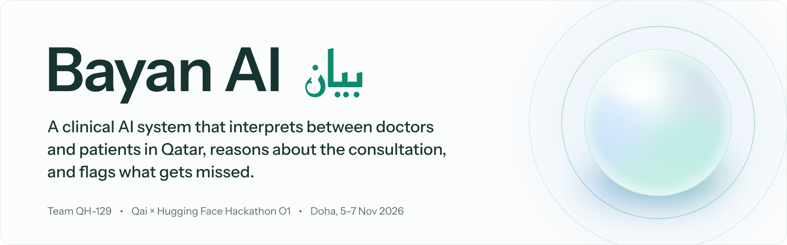
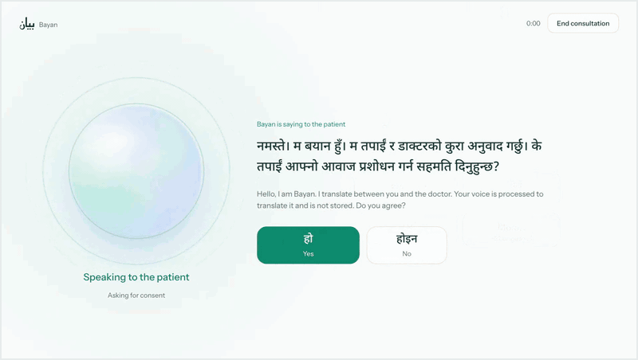
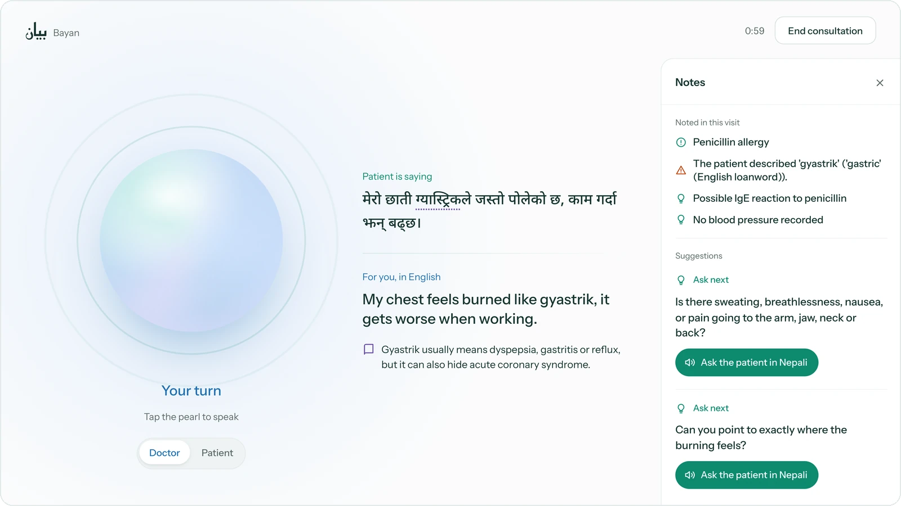
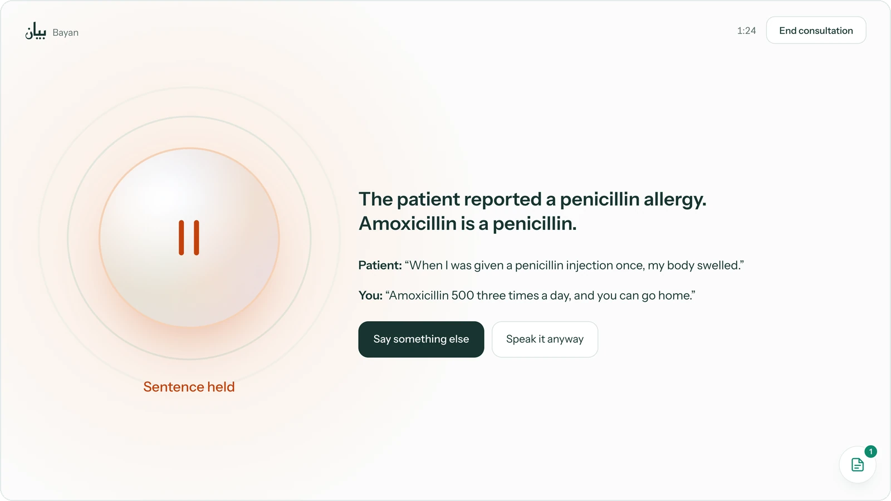
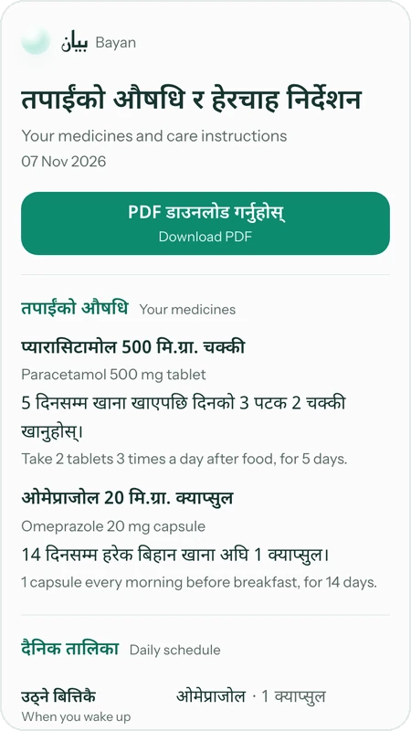
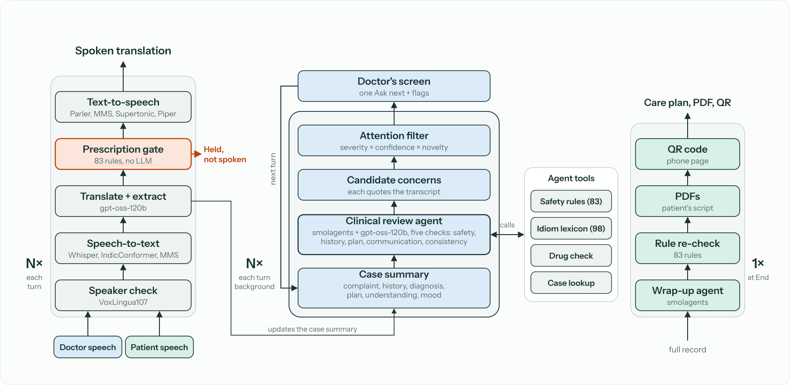

<p align="center">
  <picture>
    <source media="(prefers-color-scheme: dark)" srcset="assets/readme/banner-dark.svg">
    
  </picture>
</p>

<p align="center">
  <a href="https://huggingface.co/spaces/dullgrey/team-qh-129-bayan-app"><picture><source media="(prefers-color-scheme: dark)" srcset="https://huggingface.co/datasets/huggingface/badges/resolve/main/open-in-hf-spaces-lg-dark.svg"></picture></a>
</p>

<p align="center">
  <a href="https://dullgrey-team-qh-129-bayan-app.hf.space"></a>
  <a href="assets/readme/demo.mp4"></a>
  <a href="docs/pitch/Bayan-pitch.pdf"></a>
  <a href="#team"></a>
</p>

<p align="center">
  <a href="#license"></a>
  
  
  
</p>

<p align="center">
  <a href="#what-it-does">What it does</a> ·
  <a href="#how-it-works">How it works</a> ·
  <a href="#results">Results</a> ·
  <a href="#quickstart">Quickstart</a> ·
  <a href="#documentation">Docs</a>
</p>

<p align="center">
  
  <br>
  <sub>Scripted Nepali consultation on the live Space, sped up. <a href="assets/readme/demo.mp4">Full video (MP4)</a>.</sub>
</p>

About 94% of Qatar's workforce is not Qatari. Many patients speak Nepali, Hindi, Urdu, Bengali, Malayalam or Tagalog; their doctors mostly speak English or Arabic, and the gap is often filled by a roommate or no one. Bayan sits on the consultation desk between them. *Bayan* (بيان) is Arabic for clarity.

## What it does

| Interprets | Reasons | Flags | Suggests |
|---|---|---|---|
| 37 patient languages. The doctor speaks English or Arabic. Tap the pearl, speak, tap again. | Keeps a running case summary and reviews it after every turn with a smolagents agent. | Allergies, doses, interactions, missed workup, plans that don't fit the complaint, patient confusion. A dangerous or contradictory instruction is paused before the patient hears it. | One next question at a time, asked in the patient's language with one tap. |

<table>
  <tr>
    <td width="50%"></td>
    <td width="50%"></td>
  </tr>
  <tr>
    <td><sub><b>Live.</b> The patient's words, the English, an idiom note (<i>gyastrik</i> can hide cardiac pain) and the copilot's Notes. Cards appear on the doctor's screen only.</sub></td>
    <td><sub><b>Held.</b> Rule <code>ALG-PEN-01</code> stops the amoxicillin instruction in about 3 ms, with no language model in the path. "Speak it anyway" is logged.</sub></td>
  </tr>
</table>

At the end of the visit a wrap-up agent writes the doctor's note and a care plan in the patient's language and script, re-checks every medicine against the rules, and hands the patient a QR code to a phone page that expires after 24 hours.

<p align="center">
  
  <br>
  <sub>The patient's care plan on a phone, in Nepali with English beneath.</sub>
</p>

## How it works

<picture>
  <source media="(prefers-color-scheme: dark)" srcset="assets/readme/architecture-dark.svg">
  
</picture>

| Loop | Runs | What happens |
|---|---|---|
| Interpretation | Every turn | Language ID decides who spoke, speech-to-text, translation and extraction with `gpt-oss-120b`, the prescription gate (83 rules, no LLM), then speech in the listener's language. |
| Reasoning | Every substantive turn, in the background | A smolagents agent reviews the case summary across safety, history, plan, communication and consistency, calls its tools, and proposes concerns that must quote the transcript. An attention filter ranks them by severity, confidence and novelty. |
| Wrap-up | Once, at the end | A second agent drafts the note and the care plan, re-checks medicines against the rules, and renders the PDFs and the phone page. |

Rules are the authority. Only the rule engine can raise a critical alert or hold a sentence; agent cards are capped at caution and must cite the transcript. If an agent fails or times out, deterministic cards take over.

<h2 id="hugging-face-stack"> Hugging Face stack</h2>

| Component | Role | Runs on |
|---|---|---|
| [dullgrey/team-qh-129-bayan-app](https://huggingface.co/spaces/dullgrey/team-qh-129-bayan-app) | The app: Gradio and FastAPI, rule engine, both agents, PDFs | Space, CPU upgrade |
| dullgrey/team-qh-129-bayan-voice ([source](voice_worker)) | Speech models, called with `gradio_client` | Private Space, NVIDIA L4 |
| [openai/gpt-oss-120b](https://huggingface.co/openai/gpt-oss-120b) | Translation, extraction, clinical review agent, wrap-up agent | Inference Providers (Cerebras; Groq for extraction) |
| [speechbrain/lang-id-voxlingua107-ecapa](https://huggingface.co/speechbrain/lang-id-voxlingua107-ecapa) | Who is speaking (language ID) | Voice worker |
| [openai/whisper-large-v3-turbo](https://huggingface.co/openai/whisper-large-v3-turbo) | Doctor speech; patient languages without an Indic model | Voice worker |
| [ai4bharat/indic-conformer-600m-multilingual](https://huggingface.co/ai4bharat/indic-conformer-600m-multilingual) | Patient speech in South Asian languages | Voice worker |
| [facebook/mms-1b-all](https://huggingface.co/facebook/mms-1b-all) | Patient speech in Georgian | Voice worker |
| [ai4bharat/indic-parler-tts](https://huggingface.co/ai4bharat/indic-parler-tts) | Voice for South Asian languages, streamed | Voice worker |
| [facebook/mms-tts-tgl](https://huggingface.co/facebook/mms-tts-tgl), [-swh](https://huggingface.co/facebook/mms-tts-swh), [-ara](https://huggingface.co/facebook/mms-tts-ara) | Voice for Filipino, Swahili, Arabic | Voice worker |
| [Supertone/supertonic-3](https://huggingface.co/Supertone/supertonic-3) | Voice for Korean and most other languages | Voice worker |
| [rhasspy/piper-voices](https://huggingface.co/rhasspy/piper-voices) | Voice for Georgian | Voice worker |
| [smolagents](https://github.com/huggingface/smolagents) | `ToolCallingAgent` for the clinical review and wrap-up agents | Library |

No closed model is in the runtime path.

## Results

Scripted consultations played as text through the real engine with `gpt-oss-120b`. Model outputs vary between runs; these are single runs, not a clinical validation.

| 99% | 0 of 44 | 477 of 477 | 8 of 12 | 0 |
|:---:|:---:|:---:|:---:|:---:|
| of 727 rule checks passed | false-alarm traps tripped | PDF checks: native script, paused drug never on the patient sheet | expected clinical concerns flagged, one run | false caution alerts on 6 quiet visits |

- **Safety rules:** 38 consultations in 14 languages ([summary](reports/sim/gptoss120b-full/summary.md)).
- **Clinical review:** 16 consultations in 9 languages: 7 with a plan that doesn't fit, 6 quiet visits, 3 repeats of rule cases ([summary](reports/sim/coherence-r2/summary.md)). Smaller reruns caught 4 of 7 and 2 of 5.
- **Speed and cost:** translation and gate 0.9 s per turn (median); agent cards about 6 to 7 s after the turn; wrap-up 6 to 8 s; LLM cost about $0.011 to $0.014 per consultation.

## Languages

**37 patient languages.** Nepali, Malayalam, Bengali, Hindi and Urdu on the start screen; Filipino, Tamil, Swahili and 29 more (including Korean, Japanese, Georgian, Russian, Turkish, Indonesian, Vietnamese, Spanish and French) under *More*. **The doctor speaks English or Arabic**, and the whole interface also runs right to left in Arabic. Accuracy varies by language; Nepali is the most tested.

## Quickstart

Requires Python 3.10 and a Hugging Face token with Inference Providers access.

```bash
git clone https://github.com/diyorbekibragimov/BayanAI.git && cd BayanAI
python3.10 -m venv .venv && source .venv/bin/activate
pip install -r requirements.txt gradio==5.49.1

export HF_TOKEN=hf_...
python app.py            # http://localhost:7860
```

Open `http://localhost:7860/?demo=1` for the scripted Nepali consultation.

Speech runs on the voice worker, a separate GPU Space. To use your own, deploy [`voice_worker/`](voice_worker) and set `BAYAN_WORKER`.

| Variable | Default | Purpose |
|---|---|---|
| `HF_TOKEN` | none | Inference Providers and the voice worker |
| `BAYAN_WORKER` / `BAYAN_WORKER_URL` | `dullgrey/team-qh-129-bayan-voice` | Voice worker Space (or its URL) |
| `BAYAN_LLM`, `BAYAN_LLM_PROVIDER` | `openai/gpt-oss-120b`, `cerebras` | Translation model |
| `BAYAN_EXTRACT_PROVIDER` | `groq` | Background extraction |
| `BAYAN_AGENT_PROVIDER` | `cerebras` | Both agents |
| `BAYAN_BRAIN_LLM`, `BAYAN_BRAIN_PROVIDER` | unset | Swap the model for extraction and both agents |
| `BAYAN_CLINIC_NAME` | unset | Clinic name on the PDFs |
| `BAYAN_PLAN_AUDIO` | off | Read the care plan aloud as audio |

**Tests and simulation**

```bash
pip install pytest pyyaml pymupdf
pytest tests                             # offline, paid calls blocked
python scripts/smoke_e2e.py --offline    # golden path, scripted models
python scripts/simulate.py --list        # simulation suite (live)
python scripts/simulate.py --only alg-01 # about $0.015 per consultation
```

Results land in `reports/sim/<run-id>/`. Scenario format: [`scenarios/README.md`](scenarios/README.md).

## Deploy

Two Spaces. The app Space's card (title, SDK, hardware, tags including `qai-hf-hackathon-2026`) lives in [`space/README.md`](space/README.md), because this README carries no Space front-matter.

```bash
# App Space: code, then the Space card as README.md
hf upload dullgrey/team-qh-129-bayan-app . . --repo-type space \
  --include "app.py" --include "requirements.txt" \
  --include "bayan/*" --include "data/*" --include "assets/fonts/*" \
  --exclude "*__pycache__*" --exclude "*.pyc"
hf upload dullgrey/team-qh-129-bayan-app space/README.md README.md --repo-type space

# Voice worker Space (its README.md carries its own card)
hf upload dullgrey/team-qh-129-bayan-voice voice_worker . --repo-type space \
  --exclude "*__pycache__*"
```

Set `HF_TOKEN` as a secret in both Spaces.

## Repository layout

```
app.py                 Space entry point: Gradio + FastAPI (/plan, /files)
bayan/
  consult.py           consultation state machine and talk loop
  talk.py              voice worker client and translation
  ui.py, web/          the stage UI (HTML, CSS, JS)
  brain/               rules, idioms, extraction, clinical review agent, wrap-up agent
  outputs/             PDFs, delivery links, retention
  careplan.py          the patient's phone page
voice_worker/          GPU Space: language ID, speech-to-text, text-to-speech
data/                  safety_rules.json (83 rules), idiom_lexicon.json (98 idioms)
scenarios/, scripts/   simulation suite and smoke tests
reports/sim/           simulation summaries
tests/                 offline tests
docs/                  design docs, pitch deck and script
space/README.md        Hugging Face Space card
```

## Documentation

| Document | Contents |
|---|---|
| [Problem and impact](docs/01-problem-and-impact.md) | Qatar evidence, personas, competitors |
| [Product spec](docs/02-product-spec.md) | Behaviour, screens, outputs |
| [Architecture](docs/03-architecture.md) | Modules, call flow, deployment, privacy |
| [Models and languages](docs/04-models-and-languages.md) | Models used and alternatives, licences, coverage |
| [Clinical safety](docs/05-clinical-safety-and-cultural-intelligence.md) | Rules, idioms, cards, guardrails |
| [Compute budget](docs/07-compute-budget-and-efficiency.md) | Measured cost and provider routing |
| [Clinical copilot agent](docs/11-clinical-copilot-agent.md) | Agent tools, cards, guardrails |
| [Pitch deck](docs/pitch/Bayan-pitch.pdf) and [script](docs/pitch/script.md) | The 3-minute pitch |

## Limitations

- Machine translation is not certified interpreting. Bayan is for the visits that today get an ad hoc interpreter or none, not for consent to procedures or breaking bad news.
- The 83 rules and 98 idioms are cited from the literature but not yet reviewed by clinicians.
- Accuracy varies by language. Patient-facing strings are machine drafts without native-speaker review. The patient's own words are always shown beside the English.
- Decision support, not a medical device. Not clinically validated. Tested on synthetic consultations only.

## Team

Team QH-129, Qai × Hugging Face Hackathon O1, Doha, 5–7 November 2026.

Diyorbek Ibragimov, Sangyoon Lim, Mohammed Al-Kuwari, George Chkhaidze.

## License

Apache License 2.0. Model weights keep their own licences (see [Models and languages](docs/04-models-and-languages.md)); the two `ai4bharat` models are gated on the Hub. Bundled Noto fonts are under the SIL Open Font License ([`assets/fonts/OFL.txt`](assets/fonts/OFL.txt)).

## Citation

```bibtex
@software{bayan_ai_2026,
  title  = {Bayan AI: a clinical AI system that interprets between doctors and patients in Qatar},
  author = {{Team QH-129}},
  year   = {2026},
  month  = nov,
  url    = {https://github.com/diyorbekibragimov/BayanAI},
  note   = {Qai x Hugging Face Hackathon O1, Doha}
}
```
