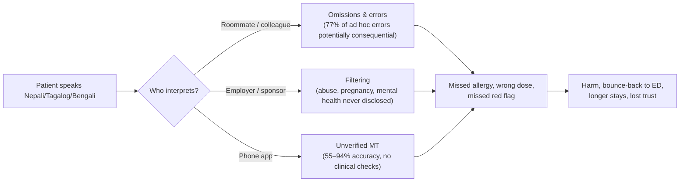

# 01 · Problem & Impact: why Qatar needs Bayan AI

> **Read with:** [02 Product Spec](02-product-spec.md) · [03 Architecture](03-architecture.md) · [04 Models & Languages](04-models-and-languages.md) · [05 Clinical Safety & Cultural Intelligence](05-clinical-safety-and-cultural-intelligence.md) · [07 Compute Budget & Efficiency](07-compute-budget-and-efficiency.md) · [09 Pitch & Demo](09-pitch-and-demo.md)
>
> **Judging criterion this doc serves:** *Impact & relevance*, meaning a real problem in Qatar, solved well. Every number below has a link. Estimates are labelled as estimates, with their date. Personas are **illustrative composites**, not real patients.

---

## TL;DR

- **Qatar's patients mostly don't speak its clinical languages.** About 3.21 million people live in Qatar ([NPC, Dec 2025](https://marhaba.qa/qatars-population-surpasses-3-2-million-by-end-of-2025-npc/)), and roughly 9 in 10 residents are not Qatari (estimate; no official nationality breakdown). Doctors work in English and Arabic, while most low-wage workers speak Nepali, Hindi, Malayalam, Bengali, Urdu, Tagalog, Sinhala or Tamil. The Ministry of Public Health already publishes the Patients' Bill of Rights in six of these languages (Bengali, Filipino, Hindi, Malayalam, Nepali, Urdu) plus Arabic and English, the same eight languages as Bayan AI's Tier-1 set ([MoPH](https://dhp.moph.gov.qa/en/Pages/FTPDownloads.aspx)).
- **The gap is documented in Qatar and it is dangerous.** Most Hamad General Hospital outpatients interviewed had experienced or witnessed language barriers, and they coped through incidental interpreters ([Abdelrahim et al., 2017](https://doi.org/10.1080/10810730.2017.1296507)). 65% of HMC ambulance staff report communication difficulties at least occasionally ([Farhat et al., 2025](https://pmc.ncbi.nlm.nih.gov/articles/PMC12127531/)). A US study of interpreted paediatric visits found a mean of 31 interpreter errors per encounter, and ad hoc interpreters' errors were more likely to have clinical consequences (77% vs 53%) ([Flores et al., 2003](https://pubmed.ncbi.nlm.nih.gov/12509547/)).
- **Bayan AI closes the gap where interpreters can't reach.** It is one ambient tablet that interprets both ways, explains cultural idioms to the doctor, quietly flags safety gaps (allergy conflicts, missed chest-pain workup), and sends the patient a care plan in their language as a PDF, WhatsApp/SMS message and audio file. It is built on open Hugging Face models, and its natural Arabic partner is Qatar's sovereign LLM, Fanar.

---

## 1. The problem in Qatar

### 1.1 A population that speaks neither clinical language

| Fact | Figure | Source |
|---|---|---|
| Total population | **3,214,609** (end of Dec 2025, +2.3% year on year) | NPC via [Marhaba](https://marhaba.qa/qatars-population-surpasses-3-2-million-by-end-of-2025-npc/), [Qatar Living](https://www.qatarliving.com/en/article/qatar-s-population-jumps-2-3-touches-3-21-million-people-in-december-2025) |
| Sex ratio | **70% male** (2,215,203 men and 928,288 women, mid-2024) | PSA/NPC via [GLMM](https://gulfmigration.grc.net/?p=11457) |
| Qatari nationals | **≈11%** of residents (so ≈89% non-Qatari). **Estimate:** Qatar does not publish a nationality breakdown. | [Ahmad & Hillman, *Multilingua* 2021](https://doi.org/10.1515/multi-2020-0119); embassy-based table (2018–19) in [Wikipedia: Demographics of Qatar](https://en.wikipedia.org/wiki/Demographics_of_Qatar) |
| Migrant share of the **labour force** | ≈95% of a 2M+ workforce | [Human Rights Watch, World Report 2020](https://www.hrw.org/world-report/2020/country-chapters/qatar) |
| Domestic workers | **168,626** (2022 Labour Force Survey) | NHRC citing PSA, [Gulf Times, Jun 2025](https://www.gulf-times.com/article/706093/qatar/qatar-sees-significant-progress-in-protecting-domestic-worker-rights) |
| Languages spoken by patients at HMC hospitals | **38+** in a two-month random sample (2009) | [WCMC-Q press release, 2009](https://qatar-weill.cornell.edu/news-archive/Reports/documents/culturalCompetencyPREnglish.pdf) |

Ahmad & Hillman sum it up: two-thirds of non-nationals do not speak Arabic, and "a vast majority of them are semi-literate, blue-collar workers" who do not speak English as a lingua franca either ([*Multilingua* 40(3), 2021](https://doi.org/10.1515/multi-2020-0119)).

### 1.2 Who they are, and which languages Bayan AI must speak

The figures are **unofficial estimates** compiled from embassy sources dated 2015–2019 ([archived table](https://web.archive.org/web/20181122162153/http://priyadsouza.com/population-of-qatar-by-nationality-in-2017/), via [Wikipedia](https://en.wikipedia.org/wiki/Demographics_of_Qatar)). Use them for ranking, not as census data.

| Community (est., date) | Main patient languages | Used by Qatar's own health/public messaging? |
|---|---|---|
| India ~700,000 (May 2019) | **Malayalam, Hindi**, Tamil, Telugu, Kannada | Hindi and Malayalam were in every COVID-19 pamphlet. Hindi and Malayalam are also in the Patients' Bill of Rights. HMC's Nesmaak helpline covers Malayalam. ([Ahmad & Hillman](https://doi.org/10.1515/multi-2020-0119); [MoPH](https://dhp.moph.gov.qa/en/Pages/FTPDownloads.aspx); [Peninsula 2022](https://s.thepeninsula.qa/article/05/10/2022/hamad-medical-corporations-nesmaak-helpline-is-now-available-247)) |
| Nepal ~400,000 (Jul 2018) | **Nepali** | In every COVID-19 pamphlet and in the Bill of Rights |
| Bangladesh ~400,000 (Apr 2019) | **Bengali (Bangla)** | In COVID-19 pamphlets and the Bill of Rights |
| Egypt ~300,000 (May 2018), Sudan ~60,000 | Arabic (already served) | n/a |
| Philippines ~236,000 (Jul 2019) | **Tagalog/Filipino** | In COVID-19 pamphlets and the Bill of Rights. The PHCC helpline covered it in 2015. |
| Pakistan ~150,000 (Jul 2019) | **Urdu**, Pashto, Punjabi | Urdu was in every COVID-19 pamphlet and is in the Bill of Rights. Pashto appeared in one pamphlet. |
| Sri Lanka ~140,000 (Sep 2018) | **Sinhala**, Tamil | Sinhala was in every COVID-19 pamphlet. Tamil was in the first pamphlet. |
| Kenya ~30,000 (Mar 2019) | Swahili (and English) | Not found |
| Indonesia ~27,350 (Apr 2019) | Indonesian | Appeared in three pamphlets |
| Ethiopia ~25,000 (Jan 2018) | Amharic (also Oromo, Tigrinya) | Not found |

**Finding for the language tiers ([04](04-models-and-languages.md)):** Qatar's government ran its COVID-19 print campaign in Bengali, Hindi, Malayalam, Nepali, Sinhala, Tagalog, Tamil and Urdu. Urdu, Hindi, Malayalam, Nepali and **Sinhala** were the five used in *all* communications ([Ahmad & Hillman 2021, pp. 316–317](https://doi.org/10.1515/multi-2020-0119)). The team's Tier-1 set (Nepali, Hindi, Urdu, Bengali, Tagalog, Malayalam) matches this almost exactly, and it matches the MoPH Patients' Bill of Rights languages exactly (§2.3, §7). **Sinhala and Tamil are the strongest Tier-2 candidates.** Hindi/Urdu also works as a spoken lingua franca among Malayalam, Tamil, Telugu and Bengali speakers in Qatar (same paper, p. 310), so it is a sensible fallback.

**Literacy drives the output channels.** Qatar's COVID-19 campaign leaned on radio because "a large number of the Asian workers in Qatar are not fully literate" ([Gulf Times, 2020](https://www.gulf-times.com/Story/673740)). Radio Olive and Suno sent the multilingual audio clips to about 40,000 listeners on **WhatsApp** ([Ahmad & Hillman 2021](https://doi.org/10.1515/multi-2020-0119)). This is the evidence behind Bayan AI's **audio care plan + WhatsApp** outputs. They are not a gimmick: Qatar's own campaign found that this is how the community receives health information.

### 1.3 The health system they enter

| Provider | Role for these patients | Language provision we could verify |
|---|---|---|
| **Hamad Medical Corporation (HMC)**, the public hospital network | 3,198,989 outpatient visits and 672,701 ED patients in 2024 ([Peninsula, Jan 2025](https://thepeninsulaqatar.com/article/23/01/2025/hmc-sees-over-three-million-outpatient-visits-in-2024)). **Hazm Mebaireek General Hospital** serves adult men in the Industrial Area, with an ED taking referrals from HMC, PHCC and QRCS ([HMC](https://hamad.qa/EN/Hospitals-and-services/HMGH/About)). | Interpretation is free, "in multiple languages", and patients are asked to request it "as soon as possible". **No language list or hours are published** ([HMC Interpreter Services](https://hamad.qa/EN/Patient-Information/Interpreter-Services/)). The Cuban Hospital runs a 24-hour service in Arabic, Spanish and English (13 interpreters, 2,000–2,400 patients a month, 2019) ([HMC](https://hamad.qa/EN/news/2019/August/Pages/Over-2000-Patients-Benefit-from-Language-Services-each-Month-at-HMCs-The-Cuban-Hospital.aspx)). The Nesmaak helpline is in Arabic, English, Urdu and Malayalam ([Peninsula 2022](https://s.thepeninsula.qa/article/05/10/2022/hamad-medical-corporations-nesmaak-helpline-is-now-available-247)). |
| **Primary Health Care Corporation (PHCC)** | Residents' primary care. Registration requires a health card/QID and an annual fee, QR100 for expatriate residents ([Peninsula 2023](https://thepeninsulaqatar.com/article/20/02/2023/new-to-qatar-how-to-access-primary-healthcare-services)). Sources disagree on the number of centres, around 30. | The helpline was in Malayalam, Tagalog and Urdu in 2015 (cited in [Ahmad & Hillman](https://doi.org/10.1515/multi-2020-0119)). We found no published clinical interpreter list. |
| **Qatar Red Crescent Workers' Health Centres** (Al Hemailah/Industrial Area, Mesaimeer, Fereej Abdul Aziz, Zekreet; run with MoPH) | Primary and urgent care for single male workers. **1,460,696 patient visits in 2025** ([Qatar Tribune, 2026](https://www.qatar-tribune.com/article/247543/nation/qrcs-medical-affairs-division-getsaccreditation-canada-diamond-tag)). About 4,000–5,000 patients a day, roughly 10% urgent or emergency ([Peninsula, Feb 2024](https://thepeninsulaqatar.com/article/11/02/2024/urgent-care-services-for-single-workers-treat-around-5000-patients-daily)). | Not published |
| **Private hospitals and clinics** | Growing role under **Law No. 22 of 2021**, which makes health insurance mandatory for expatriates and visitors (employers cover employees). It entered into force in May 2022, and its Executive Regulations (Ministerial Resolution No. 8 of 2022) followed in Sept 2022 ([EMPHNET](https://epinews.emphnet.net/en/news/featured/qatar-healthcare-services-law-no-22-of-2021-effective-as-of-4-may-2022); [Gulf Times](https://www.gulf-times.com/story/702773/mandatory-health-insurance-to-guarantee-access-to-comprehensive-healthcare)) | Varies by facility |

**What this means:** the clinical workforce operates in English and Arabic, and Hamad General outpatients described English as the dominant hospital language ([Gulf Times, 2017](https://www.gulf-times.com/story/553525/wcm-q-study-finds-language-barrier-impact-on-healthcare)). Professional interpreters exist but are **requested, not ambient**. Their language coverage is unpublished, and they are hard to summon to a 2 a.m. urgent-care visit in Mesaimeer. WCM-Q has trained bilingual staff as medical interpreters since 2012 through "Bridging the Gap" ([Gulf Times](https://www.gulf-times.com/story/553525/wcm-q-study-finds-language-barrier-impact-on-healthcare)). That shows the need, but training people does not scale to roughly 4,000 worker-clinic visits a day.

---

## 2. Evidence that language barriers harm care

### 2.1 In Qatar

| Study | What it found |
|---|---|
| **Abdelrahim et al., *J Health Commun* 2017.** WCM-Q, HMC and U. Michigan. 84 outpatients at Hamad General Hospital (Arabic 24, English 20, Hindi 20, Urdu 20). [doi](https://doi.org/10.1080/10810730.2017.1296507) · [record](https://vivo.weill.cornell.edu/display/pubid28339340) | Most participants had experienced or witnessed language barriers. They were **largely unfamiliar with professional interpreters** and relied on incidental interpreters, fragments of several languages and body language. The authors warn these strategies could compromise patient safety. Hindi and Urdu speakers met barriers more than Arabic and English speakers. Patients reported "communicating through untrained nurses or family members" ([Gulf Times](https://www.gulf-times.com/story/553525/wcm-q-study-finds-language-barrier-impact-on-healthcare)). |
| **Farhat et al., *Qatar Med J* 2025.** Survey of 312 HMC Ambulance Service frontline staff, Mar–Jun 2023. [PMC](https://pmc.ncbi.nlm.nih.gov/articles/PMC12127531/) · [doi](https://doi.org/10.5339/qmj.2025.19) | **65%** face communication difficulties from language barriers at least occasionally (24% "very frequently", 41% "occasionally"). Only **37%** rated the information they obtain from patients as sufficient or very sufficient, and 16% called it insufficient. **71%** are comfortable using bystander family members as interpreters. The authors recommend mobile translation apps. (A 2024 conference abstract of the same project reports 395 respondents. The peer-reviewed paper reports 312, and we use 312.) |
| **Ahmad & Hillman, *Multilingua* 2021.** Qatar's COVID-19 migrant-language campaign. [doi](https://doi.org/10.1515/multi-2020-0119) | Language coverage was inconsistent ("a lack of coherent policy"). Written material in community languages is not enough for "barely literate" audiences, while audio and trusted messengers worked. |
| **Latoo et al., *Qatar Med J* 2024.** 376 lower-skilled male migrant workers at the Hazm Mebaireek psychiatry clinic. [PMC](https://pmc.ncbi.nlm.nih.gov/articles/PMC11201897/) | 77% were from the Indian subcontinent. Hindi was the most common primary language (56.6%). Anxiety (38.8%) and depression (28.1%) dominated. Somatic symptoms were the referral reason in 10.4%. The clinic coped with multilingual psychiatrists, translators and telepsychiatry. |

### 2.2 Global evidence (why "a roommate translating" is not good enough)

| Study | Key numbers |
|---|---|
| **Flores et al., *Pediatrics* 2003** ([PubMed](https://pubmed.ncbi.nlm.nih.gov/12509547/)). 13 audiotaped interpreted encounters. | 396 interpreter errors, a **mean of 31 per encounter**. **63%** had potential clinical consequences. Errors by **ad hoc interpreters** (nurses, social workers, an 11-year-old sibling) were more often consequential: **77% vs 53%** for hospital interpreters ([AHRQ summary](https://webarchive.library.unt.edu/web/20081105020658/http:/www.ahrq.gov/research/apr03/0403RA20.htm)). |
| **Flores et al., *Ann Emerg Med* 2012** ([doi](https://doi.org/10.1016/j.annemergmed.2012.01.025)). 57 paediatric ED encounters. | 1,884 errors, 18% potentially consequential. **12%** were consequential with professional interpreters, versus **22%** with ad hoc and **20%** with no interpreter. Professional interpreters with 100+ training hours fell to **2%** ([PSNet](https://psnet.ahrq.gov/issue/errors-medical-interpretation-and-their-potential-clinical-consequences-comparison)). |
| **Divi et al., *Int J Qual Health Care* 2007.** Joint Commission authors, 6 US hospitals ([PubMed](https://pubmed.ncbi.nlm.nih.gov/17277013/)) | Of adverse events in limited-English-proficient (LEP) patients, **49.1% caused physical harm** vs 29.5% for English speakers. Among those with harm, 46.8% ranged from moderate temporary harm to death (vs 24.4%). **52.4%** were caused by communication errors (vs 35.9%). This was a pilot using voluntarily reported events. |
| **Karliner et al., *Health Serv Res* 2007**, systematic review ([PubMed](https://pubmed.ncbi.nlm.nih.gov/17362215/)) | Professional interpreters are associated with better communication (fewer errors, better comprehension), utilisation, clinical outcomes and satisfaction than ad hoc interpreters. |
| **Lindholm et al., *J Gen Intern Med* 2012**, 3,071 LEP admissions ([PMC](https://pmc.ncbi.nlm.nih.gov/articles/PMC3445680)) | With no interpreter at admission or discharge, adjusted length of stay was **+1.49 days** and **30-day readmission was 24.3%**, vs 14.9% with an interpreter on both days. |
| **Khoong et al., *JAMA Intern Med* 2019** ([doi](https://doi.org/10.1001/jamainternmed.2018.7653)) | Google Translate rendered ED discharge instructions **92%** accurately in Spanish and **81%** in Chinese. 2% and 8% respectively were potentially harmful. "Hold the kidney medicine" became "keep taking" ([UCSF](https://www.ucsf.edu/news/2019/02/413376/google-translates-doctors-orders-spanish-and-chinese-few-significant-errors)). |
| **Taira et al., *J Gen Intern Med* 2021** ([PMC](https://pmc.ncbi.nlm.nih.gov/articles/PMC8606479/)) | Across languages, Google Translate's accuracy for ED instructions ranged from **94% (Spanish) to 55% (Armenian)**. The authors conclude it "should not be relied on" for patient instructions. Lower-resource languages fare worse, and that describes most of Qatar's patient languages. |

### 2.3 Ad hoc interpreters: the safety and dignity problem



- **Privacy and power.** Qatar's Domestic Workers Law (No. 15 of 2017) makes employers responsible for providing domestic workers' medical treatment ([HRW, 2017](https://www.hrw.org/news/2017/08/24/qatar-new-law-gives-domestic-workers-labor-rights)). The person who brings the worker to the clinic, and often interprets, is therefore frequently the employer. Amnesty interviewed 105 women who had been live-in domestic workers in Qatar and reports that "isolation and restricted freedom of movement" make it very hard for many of them to seek support; 87 had had their passports confiscated ([Amnesty UK, 2020](https://www.amnesty.org.uk/press-releases/qatar-domestic-workers-suffering-extreme-overwork-and-abuse-new-report)). A patient cannot disclose abuse, pregnancy or distress through the person they fear.
- **Qatar's own patient charter promises better.** The MoPH Patients' Bill of Rights says patients have the right to "easily understood information" about diagnosis, treatment and side effects, and that "an interpreter can be provided when needed". It also requires consent "in an understandable language" and guarantees privacy and confidentiality ([MoPH Bill of Rights, English](https://dhp.moph.gov.qa//en/FTPDocuments/Patients%20Bill%20of%20Rights%20and%20Responsibilities%20(English).pdf)). Bayan AI is a way to **deliver that right at scale**.

### 2.4 Qatar-specific clinical burden: why the safety sentinel matters

Bayan AI's safety sentinel is decision support for the doctor, never a diagnosis. Its rules (see [05](05-clinical-safety-and-cultural-intelligence.md)) target the failure modes that matter most for this population:

| Burden | Evidence | Sentinel rule it motivates |
|---|---|---|
| **Cardiovascular deaths in young workers, linked to heat** | Nepali migrant workers in Qatar, 2009–2017: an average death rate of **150 per 100,000 a year**, dominated by cardiovascular causes and correlated with afternoon WBGT. The authors estimate **as many as 200 of 571 CVD deaths could have been prevented** with effective heat protection ([Pradhan et al., *Cardiology* 2019](https://doi.org/10.1159/000500853)). Many deaths were certified vaguely as "cardiac arrest" (same paper). | Chest pain with **no ECG or troponin** before discharge, or syncope with no ECG → silent "missing workup" alert |
| **Scale of migrant deaths** | The Guardian counted **6,500+ deaths** of Indian, Nepali, Bangladeshi, Pakistani and Sri Lankan workers between 2010 and 2020 from home-country data. Qatar's government disputes any link to World Cup work and says the numbers are proportionate to the workforce ([B&HRRC summary](https://www.business-humanrights.org/zh-hant/最新消息/qatar-guardian-investigation-finds-6500-migrant-workers-have-died-in-world-cup-host-country-since-2010)). Amnesty estimated that close to 70% of deaths went unexplained ([Amnesty, 2021](https://www.amnesty.org/en/latest/news/2021/08/qatar-failure-to-investigate-migrant-worker-deaths-leaves-families-in-despair/)). | A reason to document clearly: an English SOAP note in which every line traces back to the transcript |
| **Heat strain** | In an ILO-commissioned field study (125 workers), about **1 in 3 workers** became hyperthermic (≥38 °C core) at some point during a shift ([ILO, 2019](https://www.ilo.org/publications/assessment-occupational-heat-strain-and-mitigation-strategies-qatar); [news](https://www.ilo.org/resource/news/study-identifies-effective-mitigation-strategies-keep-workers-safe-heat)). In a Hamad ICU series, all 7 heatstroke patients developed renal insufficiency ([QMJ 2005](https://qscience.com/content/journals/10.5339/qmj.2005.2.14)). | Heat exposure + confusion, vomiting or reduced urine → prompt to consider heat illness and kidney function |
| **Heat law** | **Ministerial Decision No. 17 of 2021** bans outdoor work from 10:00 to 15:30 between 1 June and 15 September, stops all work when WBGT exceeds 32.1 °C, and introduces annual health checks and mandatory risk assessments ([ILO, May 2021](https://www.ilo.org/resource/news/new-legislation-qatar-provides-greater-protection-workers-heat-stress)) | Occupational history capture (job, hours, sun exposure) in the SOAP note |
| **Early chronic disease** | A QRCS records study (58,342 patients, 90% South Asian) found NCDs appearing early (mean age **34.8**). Diabetes and hypertension drive repeat visits ([Al-Hatimy et al., *IJERPH* 2022](https://doi.org/10.3390/ijerph19042266)). | Dose-anomaly and drug-interaction checks for chronic medications. The care plan carries medication times as pictograms. |
| **Mental health** | Labour migrants had **3.31×** the odds of depression compared with non-migrants in a 2016 national survey ([Qatar study, QNL Manara](https://manara.qnl.qa/articles/journal_contribution/Depression_in_migrant_workers_and_nationals_of_Qatar_An_exploratory_cross-cultural_study/25295395)). At the Hazm Mebaireek psychiatry clinic, two-thirds of patients had anxiety or depression ([Latoo et al. 2024](https://pmc.ncbi.nlm.nih.gov/articles/PMC11201897/)). | Idiom cards that point to possible distress, plus a private "speak without your companion" prompt |

### 2.5 Cultural idioms of distress (motivation only; the lexicon is in [05](05-clinical-safety-and-cultural-intelligence.md))

Patients often describe illness in culturally specific language that a literal translation misreads. Among Nepali speakers, distress is located in the **man** (heart-mind). "Heart-mind" problems are a socially acceptable reason to seek care, while "brain-mind" language carries stigma ([Kohrt & Hruschka, *Cult Med Psychiatry* 2010](https://pmc.ncbi.nlm.nih.gov/articles/PMC3819627)). Punjabi speakers' **"sinking heart"** describes chest and heart sensations that the speaker attributes to heat, exhaustion, worry or social setbacks. It maps exactly onto neither depression nor heart disease ([Krause, *Soc Sci Med* 1989](https://ideas.repec.org/a/eee/socmed/v29y1989i4p563-575.html)). A worker coming off a hot shift who says their heart is "sinking" or "burning" could be describing anxiety, reflux, heat strain or an acute coronary syndrome. A literal translation hides that ambiguity. Bayan AI shows it to the doctor: the literal text, plus a short note listing the possibilities to rule out.

---

## 3. Who suffers: personas

> **Illustrative composites** built from the evidence above. They are not real people.

**1. Ram, 29, scaffolder from Nepal, QRCS urgent care at Al Hemailah, 9 p.m. in August.**
Ram speaks Nepali and a little Hindi. In Nepali, he says his chest burns "like *gyastrik*" (ग्यास्ट्रिक, "gastric") after a shift in the heat. His roommate interprets, compresses his words to "stomach problem", and leaves out that a penicillin injection once made Ram's body swell. The doctor considers gastritis and prescribes amoxicillin.
*What goes wrong:* a missed cardiac workup (the burden described in Pradhan 2019) and an allergy conflict. *Bayan AI:* interprets Ram directly. It shows the idiom card for *gyastrik* ("usually dyspepsia or reflux; can mask cardiac pain; ask about exertion, radiation, sweating"), raises a silent **missing-workup** alert, and flags **penicillin allergy → amoxicillin**. Ram leaves with a Nepali audio care plan on WhatsApp. (This is the Golden Path demo in [09](09-pitch-and-demo.md).)

**2. Maricel, 34, domestic worker from the Philippines, at a PHCC health centre.**
Maricel has had lower abdominal pain for three days. Her employer drove her to the centre and "helps with English". Maricel answers in clipped English and won't mention her missed period or that she hasn't been allowed to rest.
*What goes wrong:* the history is filtered through the person with power over her, and her privacy right in the Bill of Rights is defeated. *Bayan AI:* runs the consultation in Tagalog. The doctor can trigger a one-tap private segment ("we'll speak with Maricel alone for a minute"). The care plan goes to **her** phone, not the employer's.

**3. Ammini, 68, visiting her son from Kerala, at a private clinic.**
Ammini speaks only Malayalam and reads little. She is covered by mandatory visitor insurance (Law 22/2021). She takes metformin and two blood-pressure tablets and says the dosing differently each time she's asked.
*What goes wrong:* dosing confusion, and written instructions she cannot read. *Bayan AI:* flags the dose discrepancy to the doctor, then produces a Malayalam **audio** plan with sun and moon pictograms for medication times and a red-flag box for when to call 999.

**4. Dr. Hala, emergency physician at an HMC hospital, speaks Arabic and English.**
HMC's EDs saw 672,701 patients in 2024. Hala has minutes per patient, and the interpreter request is still pending. She is not short of skill. What she lacks is **signal**: she cannot hear the allergy, the idiom or the hesitation.
*Bayan AI:* acts as ambient interpretation that needs no booking, plus a quiet second reader and an English SOAP note ready for the EMR. It saves her time without asking her to trust a black box, because every alert links to the transcript line it came from.

---

## 4. Why existing solutions fail

| | **Languages Qatar needs** (ne, hi, ml, bn, ur, tl, si, ta) | **Cultural idiom interpretation** | **Clinical safety checks** | **Patient-facing outputs in their language** | **On-prem / sovereign option** | **Cost model** |
|---|---|---|---|---|---|---|
| **Professional interpreter** (in person / phone) | Gold standard where available ([Karliner 2007](https://pubmed.ncbi.nlm.nih.gov/17362215/)). HMC publishes no language list, and the one published hospital service (Cuban Hospital) covers Arabic, Spanish and English. | Human judgement, if trained | None built in | Spoken only. No take-home plan. | n/a (human) | Salaried staff or per-minute vendor fees. Availability is the bottleneck. |
| **Google Translate** (conversation mode) | Broad, 243 languages after the 2024 expansion ([Google](https://blog.google/intl/en-mena/product-updates/connect-communicate/google-translate-new-languages-2024/)), but accuracy for ED instructions ranged from 55% to 94% by language ([Taira 2021](https://pmc.ncbi.nlm.nih.gov/articles/PMC8606479/)) | No, literal only | None | Text/voice in the moment. No structured care plan. | No (consumer cloud) | Free (consumer) |
| **Microsoft Translator** | Broad (vendor) | No | None | Same as Google | Enterprise cloud | Free or enterprise |
| **Pocketalk-type devices** | 92+ languages claimed ([Pocketalk](https://pocketalk.com/healthcare)) | No | None | No | Vendor cloud | Device + subscription |
| **Ambient AI scribes**: Nuance DAX / Dragon Copilot | Records some non-English languages (Nepali, Bengali, Urdu, Filipino listed; **Malayalam and Sinhala not**). It **"doesn't translate conversations"** and the note is in English ([Microsoft](https://support.microsoft.com/en-us/dax-copilot/epic/record-multilingual-conversations)). | No | Documentation only | No | Vendor cloud | Per-clinician subscription (not public) |
| **Abridge** | 28 languages for recording, producing an English note ([Abridge](https://support.abridge.com/hc/en-us/articles/30235001206419-Record-an-Encounter-in-Multiple-Languages)) | No | Documentation only | No | Vendor cloud | Per-clinician subscription |
| **Heidi, Suki** and similar scribes | Heidi claims 110+ languages (vendor claim, [TechBullion](https://techbullion.com/?p=777718)) | No | Documentation only | Not designed as a live interpreter (as of our review) | Vendor cloud | Subscription |
| **Bayan AI** | Tier-1: ne, hi, ur, bn, tl, ml. Tier-2: si, ta and others ([04](04-models-and-languages.md)). | **Yes:** literal text + clinical context note | **Yes:** allergy conflicts, dose anomalies, missing workup (silent, doctor-only) | **Yes:** PDF + WhatsApp/SMS + **audio** | **Yes by design:** open-weight HF models can be self-hosted, and Fanar runs in a closed national ecosystem | Open models. Per-minute compute ([07](07-compute-budget-and-efficiency.md)). |

**The core gap:** scribes save **doctor time** and assume the patient speaks the doctor's language. Translators move **words** but don't understand medicine. Interpreters understand both but **can't be everywhere**. None of them gives an illiterate patient a care plan to take home. Bayan AI is built for that missing combination.

**Honest positioning:** Bayan AI does **not** replace professional interpreters. When the patient declines, when confidence is low, or for high-stakes conversations (consent for surgery, breaking bad news), Bayan AI tells the doctor to call a human interpreter.

---

## 5. What Bayan AI changes

| Failure today | Bayan AI capability | Evidence it targets |
|---|---|---|
| No interpreter at 9 p.m.; a roommate interprets | **Ambient two-way interpretation** that needs no booking or push-to-talk | Abdelrahim 2017; Farhat 2025 (71% use bystanders) |
| Idioms translated literally | **Idiom cards**: the literal translation + a short clinical-context note, shown to the doctor and never spoken aloud | Kohrt 2010; Krause 1989 |
| Allergy lost in translation; dose misheard | **Silent safety sentinel**: allergy–drug conflict and dose anomaly alerts, deterministic rules over structured state | Flores 2003/2012; Divi 2007 |
| Chest pain discharged without workup | **Missing-workup alert** for red-flag symptoms | Pradhan 2019; ILO 2019 |
| Instructions the patient can't read | **Native-language care plan**: PDF + WhatsApp/SMS + audio, with pictograms for medication times | Ahmad & Hillman 2021; Khoong 2019 |
| Employer as interpreter | Patient speaks **directly**; private-segment prompt; plan sent to the **patient's** phone | Amnesty 2020; Bill of Rights (privacy) |
| Documentation burden | **English SOAP note** ready for the EMR, every line traceable to the transcript | Scribe-market demand (DAX, Abridge) |

---

## 6. Impact & KPIs

### 6.1 Who benefits

| Stakeholder | Benefit |
|---|---|
| **Patients** (workers, domestic workers, elderly visitors) | Understood the first time. Safer prescriptions. A care plan they can **hear**. Dignity and privacy. |
| **Doctors and nurses** | Signal they currently miss (allergies, idioms, hesitation). A quiet second reader. A ready note. |
| **HMC, PHCC, QRCS, private hospitals** | Fewer communication-driven adverse events, which Divi 2007 found to be over half of LEP adverse events. Evidence for patient-experience and accreditation goals; QRCS recently earned Accreditation Canada Diamond ([Qatar Tribune](https://www.qatar-tribune.com/article/247543/nation/qrcs-medical-affairs-division-getsaccreditation-canada-diamond-tag)). |
| **Insurers and employers** | Under Law 22/2021, employers and insurers pay for expatriate care. Fewer bounce-back visits and avoidable admissions reduce cost, though we have not yet quantified the saving. |
| **MoPH** | A tool that delivers the Bill of Rights' interpreter and understandable-information rights, and the National Health Strategy's patient-experience priority. |

### 6.2 Pilot KPIs (what a 3-month pilot at a QRCS centre or HMC ED would measure)

| KPI | Definition | How measured | Direction |
|---|---|---|---|
| **Time to interpretation** | Minutes from the patient's arrival in the room to the first interpreted exchange | Bayan AI logs vs interpreter-request timestamps | ↓ |
| **Consultation length** | Minutes per LEP consultation | EMR timestamps; matched non-Bayan controls | ↔ or ↓ (must not rise) |
| **Ad hoc interpreter use** | % of LEP visits where a family member, colleague or employer interpreted | Clinician checkbox | ↓ |
| **Safety catches** | Sentinel alerts the doctor **accepted** (allergy, dose, workup) per 100 consultations | Alert log + acknowledge/override | Track (precision > recall for trust) |
| **Alert precision** | % of alerts the doctor rated useful | One-tap rating | ↑ (target ≥ 70%) |
| **Patient comprehension** | % passing **teach-back** (the patient explains the plan back in their own words) | Scripted teach-back in the patient's language | ↑ |
| **Return visits / ED bounce-back** | 72-hour and 7-day unplanned return to any HMC/PHCC/QRCS facility | Linked records (with consent) | ↓ |
| **Care-plan delivery** | % of patients receiving the plan via WhatsApp/SMS; audio play-through rate | Delivery receipts / link analytics | ↑ |
| **Translation quality** | Native-speaker adequacy rating on a weekly sample | Blind rating, 1–5 | ≥ 4 |
| **Privacy** | % of consultations with consent captured; zero raw-audio retention incidents | Audit log | 100% / 0 |

### 6.3 Impact model (formula, not a promise)

We do **not** quote dollar savings, because no Qatar baseline exists yet. The pilot creates it. These formulas show how to compute impact once the pilot supplies the inputs:

```
LEP_encounters/yr        = Visits/yr × p_LEP
Interpreter-wait saved   = LEP_encounters × (W_current − W_bayan)
Consequential errors     = LEP_encounters × E_per_visit × c_current
Errors averted           = Consequential errors × (1 − c_bayan / c_current)
Bounce-backs averted     = LEP_encounters × (b_current − b_bayan)
```

| Input | Known value | Source / status |
|---|---|---|
| Visits/yr at QRCS workers' centres | 1,460,696 (2025) | [Qatar Tribune](https://www.qatar-tribune.com/article/247543/nation/qrcs-medical-affairs-division-getsaccreditation-canada-diamond-tag) |
| p_LEP (share needing interpretation) | **Unknown.** Measure in the pilot's first week. | No published figure |
| c_current (share of interpreter errors that are consequential) | 22% ad hoc, 12% professional, 20% none | [Flores 2012](https://doi.org/10.1016/j.annemergmed.2012.01.025) (US paediatric ED, Spanish) |
| c_bayan | **Unknown.** We claim no value until it is measured. | Pilot: native-speaker audit of transcripts |
| b (bounce-back rate) | US benchmark: 24.3% vs 14.9% 30-day readmission without vs with interpreters | [Lindholm 2012](https://pmc.ncbi.nlm.nih.gov/articles/PMC3445680) |

*Purely illustrative scale check:* if p_LEP were 10%, the QRCS network alone would see about 146,000 LEP encounters a year. That is roughly 400 consultations every day in which interpretation is currently left to chance. The 10% is a placeholder, not a finding.

---

## 7. Policy alignment

| Policy / law | What it says | How Bayan AI aligns |
|---|---|---|
| **Qatar National Vision 2030**, Human Development pillar | Aims to develop a healthy population, both physically and mentally ([GCO](https://www.gco.gov.qa/en/state-of-qatar/qatar-national-vision-2030/human-development/)) | Health access for the ≈89% of residents who aren't Qatari |
| **National Health Strategy 2024–2030, "Health for All"** | Three priorities: population health and wellbeing; **excellence in service delivery and patient experience**; system efficiency and resilience ([Peninsula, Sept 2024](https://thepeninsulaqatar.com/article/12/09/2024/qatar-launches-national-health-strategy-2024-2030-aims-to-build-health-centered-society)). Aims at a fully digital health system ([Arabian Business](https://www.arabianbusiness.com/abnews/qatar-healthcare-strategy-2030)). | Patient experience for patients who don't speak the clinical languages, delivered digitally. *(We could not access the full MoPH strategy PDF, so we do not claim a named "equity" target.)* |
| **MoPH Patients' Bill of Rights** | Easily understood information, an interpreter when needed, consent in an understandable language, privacy. Published in Arabic, English, Bengali, Filipino, Hindi, Malayalam, Nepali and Urdu ([MoPH](https://dhp.moph.gov.qa/en/Pages/FTPDownloads.aspx)). | Bayan AI's Tier-1 set (English + Arabic for doctors; Nepali, Hindi, Urdu, Bengali, Malayalam, Tagalog/Filipino for patients) is exactly the MoPH's eight Bill of Rights languages |
| **Qatar National AI Strategy (2019)** | Six pillars: education, data access, employment, business, research, ethics. "AI for Arabic language processing should be a national priority". Healthcare is an AI+X focus area ([QCRI strategy PDF](https://qcai-blog.qcri.org/wp-content/uploads/2020/04/QCRI-Artificial-Intelligence-Strategy-2019-ENG.pdf)). | An Arabic-side pipeline using Fanar; a homegrown solution for a "specific local need" |
| **MCIT ethical AI guidelines (2025)** | "Principles and Guidelines for Ethical Development and Deployment of AI" and "…Ethical Use of AI": transparency, privacy ([Qatar Tribune, May 2025](https://www.qatar-tribune.com/article/178284/latest-news/mcit-outlines-efforts-to-establish-regulatory-ethical-frameworks-for-ai-use-at-doha-conference)) | Doctor-in-the-loop, transcript-traceable alerts, consent first |
| **MoPH work on AI ethics** | The 2024 national workshop on AI in health research ethics, run with the National Cyber Security Agency (NCSA), Qatar University (QU) and HBKU ([QNA](https://www.qna.org.qa/en/News-Area/News/2024-12/01/0057-moph-discusses-ethics-of-use-of-artificial-intelligence-in-health-research)). We found **no published MoPH clinical-AI regulation**. | A pilot would go through MoPH research ethics approval |
| **Personal Data Privacy Protection Law, Law No. 13 of 2016** | Health is "personal data of a special nature". Processing it needs permission from the regulator, and the regulator's guidance requires a DPIA ([Clyde & Co](https://www.clydeco.com/en/insights/2021/03/new-regulatory-guidelines-on-the-qatar-persona-1)). | Privacy by design: consent capture, no raw-audio retention, a path to in-country hosting (see [03](03-architecture.md)) |
| **Fanar** (QCRI/HBKU), Qatar's sovereign Arabic AI | Launched in Dec 2024. Fanar 2.0 (27B) was launched in Dec 2025, with speech-to-text and TTS, and runs in "a fully closed ecosystem" without sharing data beyond the user environment ([Middle East AI News](https://www.middleeastainews.com/p/qatar-announces-fanar-20-arabic-ai); [launch](https://www.middleeastainews.com/p/qatar-fanar-large-language-model-llm)). `QCRI/Fanar-1-9B-Instruct` is on the HF Hub under Apache-2.0. | The doctor's Arabic side, kept in Qatar: strong local grounding and a sovereign deployment path |
| **Law No. 22 of 2021** (mandatory insurance) and **Ministerial Decision 17/2021** (heat stress) | Expatriate care is paid by employers and insurers. Workers get annual health checks. | Clear buyers (insurers, employers, providers) and a recurring touchpoint (annual checks) |

---

## 8. Sources

**Qatar: population, language, system**
- NPC population, Dec 2025: [Marhaba](https://marhaba.qa/qatars-population-surpasses-3-2-million-by-end-of-2025-npc/) · [Qatar Living](https://www.qatarliving.com/en/article/qatar-s-population-jumps-2-3-touches-3-21-million-people-in-december-2025)
- Population by sex (PSA/NPC): [GLMM](https://gulfmigration.grc.net/?p=11457)
- Nationality estimates (unofficial, 2015–2019): [Wikipedia](https://en.wikipedia.org/wiki/Demographics_of_Qatar) · [archived source](https://web.archive.org/web/20181122162153/http://priyadsouza.com/population-of-qatar-by-nationality-in-2017/)
- Ahmad R, Hillman S. Laboring to communicate: Use of migrant languages in COVID-19 awareness campaign in Qatar. *Multilingua* 2021;40(3):303–337. [doi:10.1515/multi-2020-0119](https://doi.org/10.1515/multi-2020-0119) · [Gulf Times coverage](https://www.gulf-times.com/Story/673740)
- Domestic workers 168,626: [Gulf Times, Jun 2025](https://www.gulf-times.com/article/706093/qatar/qatar-sees-significant-progress-in-protecting-domestic-worker-rights)
- HRW World Report 2020, Qatar: [hrw.org](https://www.hrw.org/world-report/2020/country-chapters/qatar)
- WCMC-Q 2009 (38+ languages): [press release PDF](https://qatar-weill.cornell.edu/news-archive/Reports/documents/culturalCompetencyPREnglish.pdf)
- HMC Interpreter Services: [hamad.qa](https://hamad.qa/EN/Patient-Information/Interpreter-Services/) · Cuban Hospital language service: [hamad.qa](https://hamad.qa/EN/news/2019/August/Pages/Over-2000-Patients-Benefit-from-Language-Services-each-Month-at-HMCs-The-Cuban-Hospital.aspx) · Nesmaak: [Peninsula](https://s.thepeninsula.qa/article/05/10/2022/hamad-medical-corporations-nesmaak-helpline-is-now-available-247) · HMGH: [hamad.qa](https://hamad.qa/EN/Hospitals-and-services/HMGH/About) · HMC 2024 activity: [Peninsula](https://thepeninsulaqatar.com/article/23/01/2025/hmc-sees-over-three-million-outpatient-visits-in-2024)
- QRCS Workers' Health Centres: [Qatar Tribune 2026](https://www.qatar-tribune.com/article/247543/nation/qrcs-medical-affairs-division-getsaccreditation-canada-diamond-tag) · [Peninsula 2024](https://thepeninsulaqatar.com/article/11/02/2024/urgent-care-services-for-single-workers-treat-around-5000-patients-daily)
- PHCC access: [Peninsula 2023](https://thepeninsulaqatar.com/article/20/02/2023/new-to-qatar-how-to-access-primary-healthcare-services)
- Law 22/2021: [EMPHNET](https://epinews.emphnet.net/en/news/featured/qatar-healthcare-services-law-no-22-of-2021-effective-as-of-4-may-2022) · [Gulf Times](https://www.gulf-times.com/story/702773/mandatory-health-insurance-to-guarantee-access-to-comprehensive-healthcare)
- MoPH Patients' Bill of Rights: [English PDF](https://dhp.moph.gov.qa//en/FTPDocuments/Patients%20Bill%20of%20Rights%20and%20Responsibilities%20(English).pdf) · [all languages](https://dhp.moph.gov.qa/en/Pages/FTPDownloads.aspx)

**Qatar: evidence**
- Abdelrahim H, et al. Patient perspectives on language discordance during healthcare visits… Qatar. *J Health Commun* 2017;22(4). [doi:10.1080/10810730.2017.1296507](https://doi.org/10.1080/10810730.2017.1296507) · [Gulf Times](https://www.gulf-times.com/story/553525/wcm-q-study-finds-language-barrier-impact-on-healthcare)
- Farhat H, Alinier G, et al. EMS staff and linguistic diversity in a Middle Eastern pre-hospital environment. *Qatar Med J* 2025;2025(1):19. [PMC12127531](https://pmc.ncbi.nlm.nih.gov/articles/PMC12127531/) · [conference abstract (n=395)](https://manara.qnl.qa/articles/conference_contribution/Evaluating_the_Impact_of_Language_Barriers_on_Pre-Hospital_Emergency_Treatment-_A_Cross-Sectional_Study_in_Hamad_Medical_Corporation_Ambulance_Service/25709364)
- Latoo J, et al. Psychiatry outpatient visits by lower-skilled male migrant workers in Qatar. *Qatar Med J* 2024;2024(3):29. [PMC11201897](https://pmc.ncbi.nlm.nih.gov/articles/PMC11201897/)
- Pradhan B, Kjellstrom T, et al. Heat stress impacts on cardiac mortality in Nepali migrant workers in Qatar. *Cardiology* 2019;143(1):37–48. [doi:10.1159/000500853](https://doi.org/10.1159/000500853)
- Al-Hatimy F, et al. NCDs amongst blue-collar migrant workers in Qatar. *IJERPH* 2022;19:2266. [doi:10.3390/ijerph19042266](https://doi.org/10.3390/ijerph19042266)
- ILO heat strain study (2019): [ILO](https://www.ilo.org/publications/assessment-occupational-heat-strain-and-mitigation-strategies-qatar) · Ministerial Decision 17/2021: [ILO news](https://www.ilo.org/resource/news/new-legislation-qatar-provides-greater-protection-workers-heat-stress)
- Heatstroke ICU series: [QMJ 2005](https://qscience.com/content/journals/10.5339/qmj.2005.2.14)
- Depression in migrant workers and nationals of Qatar: [QNL Manara](https://manara.qnl.qa/articles/journal_contribution/Depression_in_migrant_workers_and_nationals_of_Qatar_An_exploratory_cross-cultural_study/25295395)
- Guardian 6,500 deaths (summary): [B&HRRC](https://www.business-humanrights.org/zh-hant/最新消息/qatar-guardian-investigation-finds-6500-migrant-workers-have-died-in-world-cup-host-country-since-2010) · Amnesty 2021: [amnesty.org](https://www.amnesty.org/en/latest/news/2021/08/qatar-failure-to-investigate-migrant-worker-deaths-leaves-families-in-despair/)
- Domestic workers: [HRW 2017](https://www.hrw.org/news/2017/08/24/qatar-new-law-gives-domestic-workers-labor-rights) · [Amnesty UK 2020](https://www.amnesty.org.uk/press-releases/qatar-domestic-workers-suffering-extreme-overwork-and-abuse-new-report)

**Global evidence**
- Flores G, et al. Errors in medical interpretation… pediatric encounters. *Pediatrics* 2003;111:6–14. [PubMed 12509547](https://pubmed.ncbi.nlm.nih.gov/12509547/)
- Flores G, et al. Errors of medical interpretation… professional vs ad hoc vs no interpreters. *Ann Emerg Med* 2012;60(5):545–553. [doi](https://doi.org/10.1016/j.annemergmed.2012.01.025)
- Divi C, Koss RG, Schmaltz SP, Loeb JM. Language proficiency and adverse events in US hospitals. *Int J Qual Health Care* 2007;19(2):60–67. [PubMed 17277013](https://pubmed.ncbi.nlm.nih.gov/17277013/)
- Karliner LS, et al. Do professional interpreters improve clinical care…? *Health Serv Res* 2007;42(2):727–754. [PubMed 17362215](https://pubmed.ncbi.nlm.nih.gov/17362215/)
- Lindholm M, et al. Professional language interpretation and inpatient LOS and readmission. *J Gen Intern Med* 2012;27(10):1294–1299. [PMC3445680](https://pmc.ncbi.nlm.nih.gov/articles/PMC3445680)
- Khoong EC, et al. Google Translate for Spanish and Chinese ED discharge instructions. *JAMA Intern Med* 2019;179(4):580–582. [doi](https://doi.org/10.1001/jamainternmed.2018.7653)
- Taira BR, et al. A pragmatic assessment of Google Translate for ED instructions. *J Gen Intern Med* 2021. [PMC8606479](https://pmc.ncbi.nlm.nih.gov/articles/PMC8606479/)
- Kohrt BA, Hruschka DJ. Nepali concepts of psychological trauma. *Cult Med Psychiatry* 2010;34:322–352. [PMC3819627](https://pmc.ncbi.nlm.nih.gov/articles/PMC3819627)
- Krause IB. Sinking heart: a Punjabi communication of distress. *Soc Sci Med* 1989;29(4):563–575. [RePEc](https://ideas.repec.org/a/eee/socmed/v29y1989i4p563-575.html)

**Policy and competitors**
- QNV 2030: [GCO](https://www.gco.gov.qa/en/state-of-qatar/qatar-national-vision-2030/human-development/) · NHS 2024–2030: [Peninsula](https://thepeninsulaqatar.com/article/12/09/2024/qatar-launches-national-health-strategy-2024-2030-aims-to-build-health-centered-society) · [Arabian Business](https://www.arabianbusiness.com/abnews/qatar-healthcare-strategy-2030)
- National AI Strategy 2019: [QCRI PDF](https://qcai-blog.qcri.org/wp-content/uploads/2020/04/QCRI-Artificial-Intelligence-Strategy-2019-ENG.pdf) · MCIT AI ethics: [Qatar Tribune](https://www.qatar-tribune.com/article/178284/latest-news/mcit-outlines-efforts-to-establish-regulatory-ethical-frameworks-for-ai-use-at-doha-conference) · MoPH AI ethics workshop: [QNA](https://www.qna.org.qa/en/News-Area/News/2024-12/01/0057-moph-discusses-ethics-of-use-of-artificial-intelligence-in-health-research)
- PDPPL: [Clyde & Co](https://www.clydeco.com/en/insights/2021/03/new-regulatory-guidelines-on-the-qatar-persona-1)
- Fanar: [Fanar 2.0](https://www.middleeastainews.com/p/qatar-announces-fanar-20-arabic-ai) · [Fanar launch](https://www.middleeastainews.com/p/qatar-fanar-large-language-model-llm) · [QCRI blog](https://cs.qcri.org/blogs/fanar-2-0-launch/)
- DAX/Dragon Copilot multilingual: [Microsoft Support](https://support.microsoft.com/en-us/dax-copilot/epic/record-multilingual-conversations) · Abridge: [Help Center](https://support.abridge.com/hc/en-us/articles/30235001206419-Record-an-Encounter-in-Multiple-Languages) · Heidi: [TechBullion](https://techbullion.com/?p=777718) · Pocketalk: [pocketalk.com](https://pocketalk.com/healthcare) · Google Translate 2024: [Google blog](https://blog.google/intl/en-mena/product-updates/connect-communicate/google-translate-new-languages-2024/)

### Unverified or deliberately omitted
- **Official nationality breakdown:** Qatar doesn't publish one. The figures used are 2015–2019 embassy-based estimates.
- **HMC interpreter language list, hours and headcount:** not published. We say "multiple languages", as HMC does.
- **Literacy rate of low-wage workers:** we found no representative Qatar figure. We rely on the qualitative statements in Ahmad & Hillman 2021.
- **Domestic workers' gender split:** no official figure found. We do not claim "mostly women" as a statistic.
- **A named health-equity target in NHS 2024–2030:** the MoPH PDF was inaccessible (bot wall), so we don't claim one.
- **A MoPH regulation specific to clinical AI:** none found. Only the ethics workshop and MCIT's voluntary guidelines.
- **Interpreter costs and scribe pricing in Qatar:** not public, so they are omitted.
- **Exact PDPPL article wording:** summarised from a law-firm source, not the official Arabic text.
