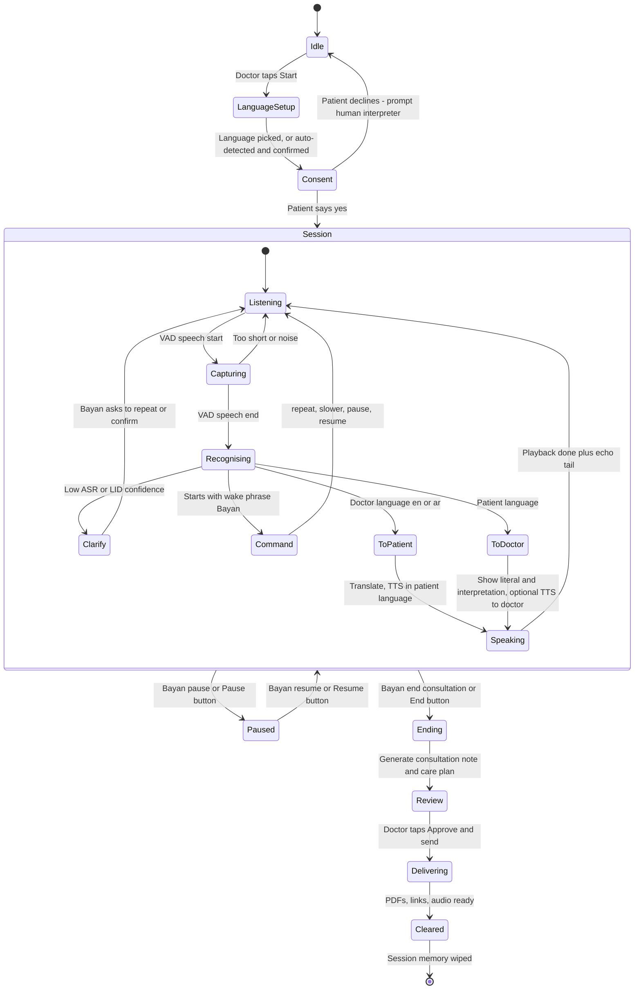
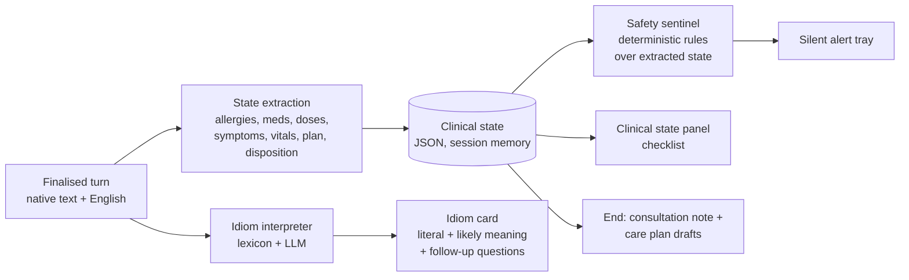

# 02 — Product Spec (and Build Spec)

> **Status (7 Nov 2026):** this was written as the build contract before coding started. What is actually built, and what is still design, is in [§0 MVP status](#0-mvp-status). Sections below keep the original design; "As built" notes mark where the code differs.
> **Related docs:** [01 Problem & Impact](01-problem-and-impact.md) · [03 Architecture](03-architecture.md) · [04 Models & Languages](04-models-and-languages.md) · [05 Clinical Safety & Cultural Intelligence](05-clinical-safety-and-cultural-intelligence.md) · [06 Fine-tuning Plan](06-fine-tuning-plan.md) · [07 Compute Budget & Efficiency](07-compute-budget-and-efficiency.md) · [09 Pitch & Demo](09-pitch-and-demo.md). Values that can only be known once the system runs are written `⟨measure: …⟩`. Fill them in from real runs; never estimate them.
> **Honesty status:** no clinician has reviewed any clinical content yet (idiom lexicon, safety rules, Golden Path). All native-language lines are machine drafts awaiting native-speaker verification. "Tier 1" means *demo target*, not *verified*.

**Bayan AI** is a single tablet that sits between a doctor and a patient who speaks neither English nor Arabic. It is an **ambient agent**: it **listens** to the room, **talks** (speaks each translation aloud in the right language), and **thinks** in the background, interpreting cultural idioms and watching for safety problems. When the consultation ends it writes an English **Consultation note** for the doctor (PDF plus a plain-text copy for the EMR) and a **patient sheet** in the patient's language (PDF, native script first, English beneath), with prefilled WhatsApp and SMS links and a read-aloud audio file where a voice exists.

It supports the doctor's decisions. It does not diagnose. Every clinical suggestion goes to the doctor, and only the doctor sees it.

---

## 0. MVP status

| Status | What |
|---|---|
| **Built and in the Space** | Access-code gate; start screen with language choice (Nepali, Hindi, Urdu, Bengali, Malayalam, Filipino); consent spoken in the patient's language, answered by tapping Yes / No; ambient FastRTC loop (WebRTC, server-side Silero VAD, no push-to-talk, Cloudflare TURN); who-is-speaking by language ID on the GPU voice worker; Whisper (doctor) and IndicConformer (patient) ASR; `gpt-oss-120b` translation; streaming Indic Parler-TTS voice for ne, hi, ur, bn, ml (Filipino is text only); mic held while Bayan speaks plus a 300 ms echo tail; doctor/patient "Duet" view with caption mode; Notes panel with idiom notes and "Ask next" suggestions; held sentence on an allergy/drug-class conflict with "Say something else" / "Speak it anyway" (override logged); "Say it again" and "Slower"; "end consultation" by button or voice; review screen with the editable care plan, Approve and send, and an on-screen QR to an expiring `/plan/<id>` page (in memory, 24 h, English + patient language); no-mic demo mode (golden path as text turns, real translation, real worker voice when the worker is running). |
| **Built and wired into the Space code (local, not yet deployed)** | Clinical brain (`bayan/brain`): deterministic spine on every turn (extraction on Groq, state merge with utterance evidence, all 81 rules, 98-entry idiom lexicon), synchronous prescription gate (no LLM, about 3 ms, intent-aware: prescribe / stop / mention), smolagents copilot agent posting ask / possibly-missed / observation cards, deterministic fallback, smolagents wrap-up agent. Outputs (`bayan/outputs`): Consultation note PDF + plain-text copy, patient sheet PDF, care-plan WAV, prefilled `wa.me` and `sms:` links, per-consultation temp folder with purge and 24 h sweep. `bayan/consult.py` owns a brain `Consultation`; `bayan/copilot.py` maps brain cards to the Notes panel; the review screen has a "Doctor's note" tab (editable) next to the care plan, and Approve re-renders the doctor PDF with the approval time; `/plan/<id>` renders the structured care plan with a PDF download; PDFs are served at `/files/<token>/` (whitelisted names). Tested offline (`pytest tests`, 269 tests with fake models) and live on the merged code (`scripts/smoke_e2e.py`, 17/17). |
| **Not built (roadmap)** | Pause / resume; "Did you mean…?" confirm-back and back-translation; self-match echo filter; auto-detect patient language; true barge-in and diarization; Arabic voice output; Filipino voice; Tier-2 and Tier-3 languages; automatic WhatsApp or SMS sending (Twilio, Business API); FHIR export; fine-tuned model; published idiom dataset; care-plan audio is built but off by default in the Space (`BAYAN_PLAN_AUDIO=1`). |

Measured so far (golden path, 9 text turns, live models): copilot agent about 1.2–1.6 s per run (1 step), extraction about 1.1 s, wrap-up about 6–8 s; cost about $0.015 for the consultation brain plus about $0.004 for the wrap-up, excluding talk-loop translation and GPU hours. End-to-end voice turn latency is not measured yet.

**Pending:** deploying this state to the Space, demo video, native-speaker review of every Nepali line, clinician review of the rules and lexicon.

---

## Contents

0. [MVP status](#0-mvp-status)
1. [Product principles](#1-product-principles)
2. [Who is in the room](#2-who-is-in-the-room)
3. [The ambient agent: behaviour state machine](#3-the-ambient-agent-behaviour-state-machine)
4. [Hard UX questions, answered](#4-hard-ux-questions-answered)
5. [Single-screen layout](#5-single-screen-layout)
6. [Features F1–F5 (MVP vs stretch, acceptance criteria)](#6-features)
7. [MVP scope for Saturday 2 PM (MoSCoW)](#7-mvp-scope-for-saturday-2-pm-moscow)
8. [The Golden Path demo scenario](#8-the-golden-path-demo-scenario)
9. [Non-functional requirements](#9-non-functional-requirements)
10. [Mapping to judging criteria](#10-mapping-to-judging-criteria)

---

## 1. Product principles

Use these to settle any design argument. When two of them conflict, the one higher in the list wins.

| # | Principle | What it means in the product |
|---|---|---|
| P1 | **Consent first** | Bayan processes no clinical speech until the patient has heard, **in their own language**, what Bayan is and what happens to their data, and has said yes. If they decline, Bayan stops and the doctor is prompted to use a human or phone interpreter. |
| P2 | **Dignity first** | The patient is spoken *to*, not *about*. Bayan interprets in the first person, as professional interpreters do ("I will give you…", not "The doctor says he will give you…"). It interprets everything said in the room, including asides, unless the doctor visibly pauses it. It never adds, softens or leaves out content. |
| P3 | **The doctor stays in control** | Alerts, idiom notes and drafts are suggestions. The doctor acknowledges or overrides (with a reason) every alert, edits the note, and must tap **Approve & send** before anything reaches the patient. Bayan never prescribes or diagnoses, and never speaks clinical advice the doctor did not say. |
| P4 | **Silent alerts are never spoken** | Safety alerts and idiom interpretations are shown only on the screen and never pass through TTS, so the patient is not frightened by "WARNING: allergy". Bayan only speaks what the doctor or patient said, plus its own scripted prompts (consent, "please repeat", "did you mean…?"). |
| P5 | **Literal translation always next to interpretation** | Whenever Bayan interprets an idiom or clarifies an ambiguous phrase, the literal translation sits beside it, so the doctor can always see what was actually said. Interpretation is labelled as interpretation. |
| P6 | **Privacy by default** | No audio is retained by default. Transcripts live in session memory and are cleared when the session ends. Patient links expire. The hackathon build uses synthetic data only. See [§9](#9-non-functional-requirements). |
| P7 | **Honest uncertainty** | When ASR or translation confidence is low, Bayan asks ("Did you mean…?") instead of guessing. Confidence is shown, not hidden. |

---

## 2. Who is in the room

| Role | Language | Sees the screen? | Hears Bayan? | Needs |
|---|---|---|---|---|
| **Doctor** | English or Arabic | Yes. The single screen faces the doctor. | Optional English or Arabic voice for patient turns (default on) | Speed, glanceable truth, no extra clicks, a note ready for the EMR |
| **Patient** | Any supported migrant language. Tier-1 demo targets: Nepali, Hindi, Urdu, Bengali, Malayalam, Tagalog/Filipino (full list below and in [04 §3](04-models-and-languages.md#3-language-coverage-matrix)). | Glances only. Not designed for them. | Yes, always, in their language | To be understood, to understand, to leave with instructions they can actually use |
| **Companion** (family, roommate, supervisor) | Patient's language, English or Arabic | No | Yes | Optional. Bayan does not depend on them (see [§4.8](#48-a-family-member-or-companion-is-present)). |
| **Nurse or clinic staff** | English or Arabic | Sometimes | Yes | Help with delivery (phone number, WhatsApp send) |

**Patient-language tiers (planned).** Tier-1 languages are **demo targets**. A Tier-1 language counts as "demo-verified" only after it passes the speech-in/speech-out smoke test in [04 §9](04-models-and-languages.md#9-verification-plan-cheap-and-it-doubles-as-an-efficiency-talking-point). None has passed a native-speaker check yet; Nepali is the one exercised end to end. The Golden Path language is **Nepali**.

| Tier | Languages | Stack as built (all speech models on the private L4 GPU voice worker) |
|---|---|---|
| **Doctor side** | English, Arabic | Who is speaking: `speechbrain/lang-id-voxlingua107-ecapa` over {en, ar, patient language}. ASR: `openai/whisper-large-v3-turbo` (en, ar). Voice: optional English voice with `hexgrad/Kokoro-82M` (off by default); no Arabic voice yet |
| **Tier 1** (in the app) | Nepali, Hindi, Urdu, Bengali, Malayalam, Filipino | ASR: `ai4bharat/indic-conformer-600m-multilingual` (ne, hi, ur, bn, ml); `whisper-large-v3-turbo` (tl). Voice: `ai4bharat/indic-parler-tts`, streamed (ne, hi, ur, bn, ml); Filipino is text only |
| **Tier 2** (roadmap) | Tamil, Telugu, Punjabi, Sinhala, Indonesian, Swahili, Amharic | Not in the app. Candidates in [04](04-models-and-languages.md) |
| **Tier 3** (roadmap) | Somali, Tigrinya, Oromo, Pashto | Not in the app. Candidates in [04](04-models-and-languages.md) |

The Tier-1 set is the same six patient languages in which the Ministry of Public Health publishes the Patients' Bill of Rights (with Arabic and English) ([MoPH](https://dhp.moph.gov.qa/en/Pages/FTPDownloads.aspx); see [01 §7](01-problem-and-impact.md#7-policy-alignment)).

---

## 3. The ambient agent: behaviour state machine

### 3.1 Foreground loop (listen → route → talk)



**Each state, in plain words:**

| State | What Bayan does | What the patient perceives | What the doctor sees |
|---|---|---|---|
| **Idle** | Mic closed. Nothing is processed. | Nothing | "Start consultation" button, language picker |
| **LanguageSetup** | Doctor picks the language, or taps **Auto-detect**. Auto-detect runs LID on the patient's first words, then Bayan asks in that language: "You speak Nepali, is that right?" | A question in their own language | Detected language and confidence |
| **Consent** | Speaks a fixed, pre-verified consent script in the patient's language (§3.3). Waits for yes or no. | "I am Bayan, a computer interpreter…" | Consent status chip: pending, given or declined, with a timestamp |
| **Listening** | VAD watches the mic. The audio ring buffer stays in memory only. | A soft "listening" glow on the screen edge | Pulsing mic indicator |
| **Capturing** | Speech segment being recorded | — | Live waveform |
| **Recognising** | LID and ASR on the segment. Language picks the route, which also tells us who spoke (§4.2). | A short **chime** confirming "heard you" (§4.4) | Draft transcript line appears greyed |
| **Clarify** | Asks the speaker to repeat, or confirms a reading ("Did you mean…?") | A question in their language | "Bayan is confirming…" tag on the line |
| **ToPatient** | Translates the doctor's words into the patient's language | — | Doctor line plus the patient-language text |
| **ToDoctor** | Translates the patient's words. Shows native script, literal English and, if needed, an interpretation card. | — | Bubble with three layers (see §5) |
| **Speaking** | TTS plays. **Mic input is gated** (§4.3). | Hears the translation | Speaker icon on the active line |
| **Command** | Handles a `Bayan, …` command | Spoken acknowledgement in the relevant language | Toast showing the command |
| **Paused** | Mic closed. Visible and spoken notice to the patient: "Interpretation is paused." | Knows they are not being interpreted | Large "PAUSED" banner |
| **Ending → Review** | Generates the consultation note and care plan. The doctor reviews and edits. | "The doctor is preparing your instructions." | Note and care plan preview, unresolved alerts listed first |
| **Delivering** | Renders the two PDFs and the care-plan WAV, builds prefilled WhatsApp and SMS links (a person taps Send), shows a QR | Receives the care plan on their phone | Delivery status per channel |
| **Cleared** | Wipes the transcript, state and buffers. Expiring links remain. | "Goodbye, get well" in their language | Back to Idle |

**As built (`bayan/consult.py`):** screens are start → consent → live → wrap → review → sent. The doctor picks the language (no auto-detect). Consent is spoken; the answer is a tap on Yes / No. There is no Pause, no Clarify state and no "Bayan, …" wake phrase: "Say it again" and "Slower" are buttons, and "end consultation" is matched in the doctor's speech or tapped. The live view is the "Duet" layout, not a scrolling transcript.

### 3.2 Background loop (the "thinking")

This runs in parallel with every finalised turn. It never speaks. Its only outputs are screen elements and the end-of-visit documents.



As built (`bayan/brain`, wired into `bayan/consult.py`), each think run is a deterministic spine followed by an optional agent, every step logged as a tool call ([11](11-clinical-copilot-agent.md)):

- **Idiom interpreter:** deterministic matching over the curated lexicon [`data/idiom_lexicon.json`](../data/idiom_lexicon.json) (**98 entries**, 55 literature-sourced, 43 marked `community_reported`): native-script substring, normalised romanized forms (fuzzy for longer forms) and English loanwords such as "gastric". No embeddings and no LLM: the card text and the suggested questions come straight from the matched entry. The lexicon lives in the repo; it is not published as a Hub dataset.
- **State extraction:** one `openai/gpt-oss-120b` call per think run (JSON schema, reasoning medium) on **Groq** via Inference Providers, falling back to Cerebras. Facts include allergy, reaction, medication, dose, frequency, symptom, onset, vitals and disposition intent; each keeps the utterance ids and quotes it came from. Courtesy turns are skipped, and a doctor's plain question is batched with the patient's answer. If the call fails, a keyword fallback still records chest-pain symptoms. Schema: [05 §2.3](05-clinical-safety-and-cultural-intelligence.md#23-clinical-state-schema-extractor-output).
- **Safety sentinel:** **deterministic rules** run over that state after every merge. The LLM extracts the facts and the rules decide whether to alert, which makes alerts reproducible and auditable. The rule set is [`data/safety_rules.json`](../data/safety_rules.json): **81 rules** (29 dose ceilings, 16 missing-workup, 12 drug–allergy, 12 drug–drug, 10 pregnancy, 2 heat-and-medication; 37 critical, 35 caution, 9 info). Each rule has `source_urls` (FDA labels on DailyMed, NICE, AHA/ACC 2021, ESC 2023, ACSM, WMS, CDC and others). Families and citations: [05 §2.4](05-clinical-safety-and-cultural-intelligence.md#24-rule-families-81-rules-in-safety_rulesjson). Only the rule engine can raise a critical alert. **The rules have not been reviewed by a clinician or pharmacist yet.**
- **Prescription gate:** on a doctor turn that names a drug, the talk loop calls the `on_prescribe` rules synchronously (no LLM, about 3 ms). It is intent-aware: "prescribe" is checked and may hold the sentence, "stop" removes the drug from the state, a mere mention does nothing.
- **Copilot agent:** only when the spine found something new, a smolagents `ToolCallingAgent` on `gpt-oss-120b` (Cerebras, reasoning medium) with read-only tools `lookup_idiom`, `lookup_drug`, `check_safety_rules` and `final_answer(cards)` posts up to a few ask / possibly-missed / observation cards, never above caution. If it fails, times out or is switched off, a deterministic fallback posts ask cards from the idiom's questions and the open checklist.

### 3.3 Consent script (fixed text, pre-verified per language)

Consent is **not** generated on the fly. For each Tier-1 language we pre-write it in English, translate it, have a native speaker verify it, and cache the TTS audio. English meaning:

> "Hello. I am Bayan, a computer interpreter. I will repeat what you and the doctor say, in your language and in theirs. Your voice is not recorded or kept. Only the doctor sees the notes. At the end you will get your instructions on your phone. Do you agree? Please say yes or no."

- A **yes** in the patient's language (keyword list per language plus LLM intent fallback) moves to Session. The consent event (language, timestamp, verbatim reply text) goes into the note. **No audio is stored.**
- A **no**, or no answer after two prompts, ends the session. The doctor sees: "Patient declined automated interpretation. Use a professional interpreter."
- For every Tier-1 language, the native-speaker verification of this script is a **Must** (see §7).

**As built:** the app uses a shorter line (`consult.CONSENT_EN`: "Hello, I am Bayan. I translate between you and the doctor. Your voice is processed to translate it and is not stored. Do you agree?"). The Nepali text is written into the code (a machine draft, native check pending); other languages are translated once by the LLM and cached. The answer is a tap on Yes / No.

---

## 4. Hard UX questions, answered

### 4.1 Wake word vs always-on

**Decision: always-on during a consented session, with a wake phrase for commands only.**

- The user chose an ambient agent: no push-to-talk. Between Start and End, every speech segment is interpreted.
- Commands begin with **"Bayan, …"** and are not translated. MVP: matched on the ASR transcript (the first token is "Bayan" or "بيان", then fuzzy match against a small command set). This needs no separate wake-word model. Stretch: an on-device wake-word model.

| Command (doctor, English or Arabic) | Effect |
|---|---|
| "Bayan, repeat" / "Bayan, say that again" | Re-plays the last translation to the patient |
| "Bayan, slower" | Re-plays at slower TTS rate and keeps that rate for the session |
| "Bayan, pause" / "Bayan, resume" | Pause or resume interpretation, announced to the patient |
| "Bayan, end consultation" | Moves to Ending |
| "Bayan, the patient is speaking Arabic" | Switches to diarization routing (§4.7) |

The patient can say "repeat" or "again" **in their own language**. A small per-language keyword list (LLM intent fallback) re-plays the last doctor turn. This matters because patients often will not ask the doctor to repeat.

Every command also has an on-screen button. Voice is a convenience, not the only path.

### 4.2 Who is speaking? Language as diarization

Language identity is a free speaker signal. **English or Arabic → doctor side. Any other language → patient side.** This covers the normal case without a diarization model. Edge cases are in §4.7 and §4.8. If LID confidence is low, the line is shown with a **"?"** speaker badge, and the doctor can tap the bubble to flip the speaker. That correction reroutes the turn.

### 4.3 How Bayan avoids translating its own voice (echo / self-hearing)

This is the most likely way an ambient agent breaks. We use three layers of defence:

1. **Half-duplex gating (MVP):** while TTS is playing, plus an *echo tail* (start at 300 ms and tune on the real tablet), captured audio is not sent to ASR.
2. **Acoustic echo cancellation (MVP):** browser capture with `echoCancellation`, `noiseSuppression` and `autoGainControl` on.
3. **Self-match filter (MVP):** any ASR result that closely fuzzy-matches the text Bayan just spoke (same language, high similarity) is dropped as self-hearing.

As built: layer 1 only. FastRTC runs with `can_interrupt=False`, and the turn handler holds the mic until playback ends plus a 300 ms tail. Layer 3 is not built.

### 4.4 How the patient knows they were heard

- **Chime** (short, neutral, the same in every language) when an utterance is captured and accepted.
- **Spoken output** in the doctor's language follows (if doctor TTS is on). That tells the patient their words went somewhere.
- If processing goes over the latency ceiling (§9), a soft **"one moment"** earcon plays, so silence is never ambiguous.
- If Bayan could not understand, it says so **in the patient's language**: "Sorry, I did not catch that. Could you say it again?" It never stays silent.

### 4.5 Barge-in and overlapping speech

- **MVP:** half-duplex. If someone talks over TTS, that speech is lost because of gating. Mitigation: the doctor says "Bayan, stop" (or taps **Stop**) to cut playback. The doctor can also say "Bayan, repeat" afterwards.
- **Stretch:** true barge-in. Keep VAD running during playback. If speech energy is well above the expected echo level **and** the self-match filter rejects it as not-Bayan, duck or stop TTS and capture the new utterance.
- **Overlapping doctor and patient speech:** one segment may come back with mixed languages. If LID is uncertain, Bayan routes the segment to Clarify: "Please speak one at a time." The doctor sees the raw transcript.

### 4.6 Low-confidence translations

Both ASR confidence and translation or interpretation confidence are scored. The signals come from [04](04-models-and-languages.md): the role/language-ID score from `speechbrain/lang-id-voxlingua107-ecapa`; the ASR model's own confidence, with Whisper's `no_speech` threshold and low-energy segment drops ([04 §8](04-models-and-languages.md#8-risks--mitigations)); the translation LLM's `uncertain_terms[]` field in its JSON output; and, for safety-critical sentences (allergy, drug, dose, red flags), an **independent back-translation** (IndicTrans2 for Indic languages, NLLB for the rest). If the back-translation diverges in meaning, the line is treated as medium confidence ([04 §4.3](04-models-and-languages.md#43-translation--reasoning-llm-the-clinical-brain)). Thresholds are tuned on rehearsal audio: ⟨measure: chosen LID / ASR / back-translation thresholds⟩.

| Confidence | Behaviour |
|---|---|
| High | Translate and speak normally |
| Medium (patient side) | Show to the doctor with an amber "uncertain" tag. Bayan **confirms with the patient** in their language: "Did you mean: *the pain started after lunch*?" Yes keeps the line and no triggers a repeat. |
| Medium (doctor side, clinical instruction such as a dose or drug) | Bayan reads its reading back to the doctor on screen before speaking it: "Speak to patient: 'Take 500 mg three times a day'? ✓ / ✎". The patient hears it only after the doctor confirms. |
| Low | Ask for a repeat in the speaker's language |

**Numbers, doses, drug names and negations are always "critical tokens".** If they change or drop between ASR and translation, confidence is forced to medium.

As built: none of this section is implemented yet (no confidence scoring, confirm-back or back-translation). The translation prompt asks for exact numbers, doses and drug names, and the wrap-up re-checks care-plan numbers against what the doctor said.

### 4.7 The patient also speaks Arabic (or English)

Language-based routing breaks when the patient uses the doctor's language, for example an Egyptian or Sudanese patient, or a South Asian worker using Gulf Arabic phrases.

- **If the patient speaks Arabic or English fluently**, Bayan is not needed for interpretation. The doctor can still run it as a **scribe and sentinel** (translation off, safety and notes on).
- **Mixed use** (patient switches between Urdu and Arabic): the doctor says "Bayan, the patient is speaking Arabic" or flips a toggle. Bayan switches to **speaker diarization** routing. MVP: no automatic routing. Every Arabic or English line gets a speaker badge the doctor can tap to flip. Stretch: a voice embedding of the doctor enrolled during the Start step, plus pyannote-style diarization.

### 4.8 A family member or companion is present

- Bayan **interprets the companion too**, so the patient is not dependent on them. Interpretation by ad hoc family members is a known source of clinically significant errors: a study of interpreted paediatric visits found ad hoc interpreters' errors more likely to have clinical consequences than hospital interpreters' (77% vs 53%) ([Flores et al., *Pediatrics* 2003](https://pubmed.ncbi.nlm.nih.gov/12509547/)).
- If the companion speaks English or Arabic to the doctor, Bayan translates it **to the patient as well** (P2: the patient hears everything said about them).
- The doctor can re-label any bubble as **Companion**. Companion statements are marked in the consultation note ("per roommate"). (Not built yet.)
- The consent script asks for consent from the patient, not the companion.

### 4.9 Noise in the emergency department

- **MVP:** browser noise suppression, VAD threshold tuned on a recording of a noisy room, and a **"Noisy room"** toggle that raises the VAD threshold and the minimum segment length.
- Bayan prompts in both languages when segments keep failing: "Please come a little closer to the tablet."
- **Recommended hardware:** a small external USB or Bluetooth conference microphone on the desk between doctor and patient. It is optional, but good for the demo.
- **No push-to-talk**, by product decision. In a room that is persistently too noisy, the honest fallback is a phone or human interpreter, and the doctor is told so.

---

## 5. Single-screen layout

One screen, landscape tablet, facing the doctor. Large type (body ≥ 18 px, alert titles ≥ 22 px). Readable at arm's length in a two-second glance. **No split screen.** The patient is never expected to read it.

> **As built:** the Space uses the teammate's approved "Duet" design (`bayan/ui.py`): a doctor and a patient pane with tints, caption mode while Bayan speaks to the patient, an edge-docked Notes panel (idiom notes, "Ask next", allergies, drugs, tests, held and override notes), the held-sentence panel and the review screen with the QR hand-off. The wireframe below is the original design; in the build, the brain's cards appear in the Notes panel (red alerts, notes, "Ask next"); there is no separate alert tray or state panel.

```
┌──────────────────────────────────────────────────────────────────────────────────────┐
│ ● BAYAN  Patient: नेपाली Nepali ✓ consent 21:00  Doctor: EN ▾  🎙 Listening [⏸ Pause]  │
├──────────────────────────────────────────────────────┬───────────────────────────────┤
│ LIVE TRANSCRIPT                                      │ ⚠ SILENT ALERTS (2 cards)     │
│                                                      │ ┌───────────────────────────┐ │
│  DR  What brings you in today?               21:01   │ │ 🔴 ALLERGY CONFLICT       │ │
│      → तपाईं आज किन आउनुभयो?  🔊                       │ │ ALG-PEN-01 · critical     │ │
│                                                      │ │ Penicillin allergy        │ │
│  PT  छाती ग्यास्ट्रिकले जस्तो पोलेको छ।           21:01    │ │ reported ("…my body       │ │
│      Literal: "My chest is burning, like gastric."   │ │ swelled", 21:02).         │ │
│      ┌ IDIOM CARD · npi-005 · literature ────────┐   │ │ Amoxicillin is a          │ │
│      │ "Gyastrik" (ग्यास्ट्रिक): usually dyspepsia  │   │ │ penicillin.               │ │
│      │ or gastritis; can carry distress.         │   │ │ [Acknowledge] [Override▾] │ │
│      │ CAN MASK CARDIAC CHEST PAIN.              │   │ └───────────────────────────┘ │
│      │ Not a diagnosis.                          │   │ ┌───────────────────────────┐ │
│      │ Ask ▸ worse with work, eases at rest?     │   │ │ 🔴 CHEST-PAIN WORKUP (4)  │ │
│      │     ▸ sweating, breathless, arm/jaw?      │   │ │ Discharge planned, but:   │ │
│      │     ▸ black stools or vomiting blood?     │   │ │ 🔴 no ECG · CHEST-02      │ │
│      └───────────────────────────────────────────┘   │ │ 🔴 no troponin · CHEST-03 │ │
│                                                      │ │ Since 21:01:              │ │
│  PT  …पेनिसिलिनको सुई लगाउँदा जिउ सुन्निएको…   21:02      │ │ 🟠 no ECG at 10 min       │ │
│      Literal: "…after a penicillin injection,        │ │    · CHEST-01             │ │
│      my body swelled…"                               │ │ 🟠 "gyastrik" can mask    │ │
│                                                      │ │    heart pain · CHEST-04  │ │
│  DR  …amoxicillin… you can go home.         21:12    │ │ [Acknowledge] [Override▾] │ │
│      ⏳ HELD: not spoken to the patient until        │ └───────────────────────────┘ │
│         the red alerts are acknowledged              ├───────────────────────────────┤
│                                                      │ CLINICAL STATE                │
│                                                      │ ☑ Allergy: PENICILLIN         │
│                                                      │     (body swelling · severe)  │
│                                                      │ ☑ Current meds: none          │
│                                                      │ ☐ BP  ☐ HR  ☐ Temp  ☐ SpO₂    │
│                                                      │ ☐ ECG  ☐ Troponin             │
│                                                      │     (expected: chest pain)    │
│                                                      │ ☑ Onset: after lunch, today   │
│                                                      │ ☑ Exposure: outdoor work      │
│                                                      │ Plan: amoxicillin 500mg TDS ⚠ │
├──────────────────────────────────────────────────────┴───────────────────────────────┤
│  [ ↻ Repeat ]  [ 🐢 Slower ]  [ 🔇 Doctor voice off ]        [ ■ END CONSULTATION ]  │
└──────────────────────────────────────────────────────────────────────────────────────┘
```

> Nepali strings in this wireframe are **machine-drafted placeholders**. A native speaker must verify them before they appear in the UI or demo. The idiom card text and its *Ask* questions come from lexicon entry `npi-005` ([`data/idiom_lexicon.json`](../data/idiom_lexicon.json); sources: [Kohrt & Harper 2008](https://pmc.ncbi.nlm.nih.gov/articles/PMC3869091/), [Kohrt & Hruschka 2010](https://pmc.ncbi.nlm.nih.gov/articles/PMC3819627/), [Prajapati et al., JNHRC 2022](https://jnhrc.com.np/index.php/jnhrc/article/view/1217), [AHA/ACC 2021](https://doi.org/10.1161/CIR.0000000000001029)). The alert texts follow the `message_en` templates of the named rules in [`data/safety_rules.json`](../data/safety_rules.json). The four `WORK-CHEST-*` rules are grouped into one card, as specified in [05 §2.7](05-clinical-safety-and-cultural-intelligence.md#27-alert-ux-silent-evidenced-accountable).

**Layout rules**

| Region | Rule |
|---|---|
| **Header** | Patient language (native name plus English), consent chip with time, doctor language toggle, mic state, Pause. A Paused session turns the whole header amber. |
| **Live transcript** (≈ 60% width) | Newest at the bottom, auto-scroll. Doctor lines: English or Arabic plus the patient-language text Bayan spoke. Patient lines: **native script first, then "Literal:" English**, then an idiom card when relevant (P5). Arabic and Urdu lines render RTL (`dir="auto"` per bubble). Tap a bubble to flip speaker, mark as Companion, or re-play. |
| **Idiom card** | Inline under the patient line. Literal meaning, *likely* clinical meaning, 1–3 suggested follow-up questions, confidence, "Not a diagnosis", source tag. Never spoken. |
| **Silent alert tray** | Top right. Severity levels follow [05 §2.7](05-clinical-safety-and-cultural-intelligence.md#27-alert-ux-silent-evidenced-accountable): 🔴 **critical** (red card, pinned, labelled "CRITICAL"), 🟠 **caution** (amber card, "CAUTION"), **info** (collapsed grey chip). Each alert shows the rule ID, quotes the **evidence turns** verbatim with timestamps, and links the rule's sources. Related rules are grouped into one card (e.g. `WORK-CHEST-01…04` → "Chest-pain workup"), and a group takes the colour of its most severe item. Buttons: **Acknowledge**, **Override ▾** (reason: "allergy de-labelled", "already done, not captured", "benefit outweighs risk", "extraction error") or **Wrong fact** (correct the state and re-run the rules). Visual only: no sound, no TTS (P4). |
| **Held translation** | If a doctor turn triggers a **critical** `on_prescribe` rule (e.g. `ALG-PEN-01`: prescribing a penicillin to a patient with a penicillin allergy), Bayan **holds** speaking that turn until the doctor acknowledges. The doctor can then say it again, change it, or tap "Speak anyway". *This is the one place the sentinel adds friction to the conversation, on purpose.* Other critical alerts (e.g. discharge without an ECG) do not hold speech. They block **finalising** the note and care plan until acknowledged, as in [05 §2.7](05-clinical-safety-and-cultural-intelligence.md#27-alert-ux-silent-evidenced-accountable). Caution alerts never hold. |
| **Clinical state panel** | Checklist that auto-fills from extraction: allergies (with reaction and severity), current meds, vitals (BP, HR, Temp, SpO₂, RR), red-flag workup items that depend on context (e.g. ECG and troponin for chest pain), onset, exposures, plan. Ticks link to the source turn. The doctor can tap to edit. |
| **Footer** | Repeat, Slower, Doctor voice on/off, and a large **END CONSULTATION** button (bottom right, colour-distinct, confirm dialog). |

---

## 6. Features

Each feature lists the MVP (must ship Saturday 2 PM), the stretch, and acceptance criteria (AC) the team tests against. Model choices for every pipeline stage are in [04 §0](04-models-and-languages.md#0-tldr-the-recommended-stack) (summarised in the tier table in §2). Wiring (talk, think and wrap-up loops; Space orchestrator plus one GPU voice worker) is in [03](03-architecture.md).

### F1 — Live two-way interpretation

| | |
|---|---|
| **What** | Ambient loop: VAD → LID/ASR → LLM translation → TTS, in both directions. English or Arabic for the doctor, patient language for the patient. |
| **MVP** | English ↔ Nepali on the Golden Path, plus English ↔ at least **two** other Tier-1 languages in text, with speech where TTS exists. Recommended: **Hindi and Bengali**. They reuse the Nepali stack (IndicConformer ASR plus Indic Parler-TTS on the same GPU worker), so they cost almost nothing extra ([04 §3](04-models-and-languages.md#3-language-coverage-matrix)). Half-duplex echo gating. Consent flow. Commands: repeat, slower, pause, end. Pre-recorded **replay mode** for the backup demo (see [09](09-pitch-and-demo.md#3-backup-demo-plan)). |
| **As built** | English ↔ Nepali live, plus Hindi, Urdu, Bengali and Malayalam on the same stack (voice in and out, not native-checked) and Filipino (speech in, text out). Arabic doctor speech is recognised by Whisper and translated; replies to the doctor are in English. Half-duplex gating, consent, "Say it again", "Slower", "end consultation". Backup: no-mic demo mode with text turns (not WAV replay). No pause. |
| **Stretch (roadmap, not built)** | Arabic voice output and an Arabic-specialised ASR, auto-detect language, true barge-in, diarization for Arabic-speaking patients, streaming partial transcripts. Candidate models: [04](04-models-and-languages.md). |
| **AC** | (1) Every Golden Path line is interpreted correctly, as judged by a native Nepali speaker's back-check. (2) Turn latency meets §9 on venue Wi-Fi. (3) Over a full Golden Path run, Bayan never re-translates its own TTS (0 self-hearing events). (4) Numbers, doses and drug names come through unchanged, or the line is flagged for confirmation. |

### F2 — Cultural idiom interpreter

| | |
|---|---|
| **What** | Detects culturally specific symptom descriptions and shows the doctor: the literal translation, what it *may* indicate, suggested follow-up questions, and confidence. |
| **MVP** | The curated lexicon of **98 idioms** in [`data/idiom_lexicon.json`](../data/idiom_lexicon.json). It covers 10 primary languages: Hindi/Urdu 23, Nepali 15 (+2 shared), Tagalog 15, Arabic 15, Bengali 14, Swahili 5, Malayalam 4, Tamil 3, and one each for Punjabi and Amharic ([05 §1.2](05-clinical-safety-and-cultural-intelligence.md#12-what-is-in-the-lexicon)). It includes the Golden Path's Nepali **"gyastrik"** (ग्यास्ट्रिक, `npi-005`, literature-sourced). As built: deterministic lexicon matching, no LLM interpretation; the card text and questions come from the entry. If nothing in the lexicon matches, no card is shown ([05 §1.4](05-clinical-safety-and-cultural-intelligence.md#14-what-the-doctor-sees)). |
| **Stretch** | Per-idiom source links shown on the card. (A fine-tuned idiom model was planned in [06](06-fine-tuning-plan.md) and did not ship.) |
| **AC** | (1) The Golden Path idiom shows a card within one turn. (2) Every card shows the literal translation (P5) and "Not a diagnosis". (3) No idiom card is ever spoken. (4) Every card shows its entry ID, `evidence_level` and sources. All 98 entries have `source_urls`, and the 43 `community_reported` entries are labelled as such. (5) A matched entry's `red_flag_tags` reach the sentinel (`npi-005` → `acs` → `WORK-CHEST-04`, which also needs a chest-pain-group symptom). |

### F3 — Safety sentinel (silent alerts)

| | |
|---|---|
| **What** | A quiet second opinion: deterministic rules over the extracted clinical state, shown as silent alerts. |
| **MVP rules** | The engine evaluates all 81 rules in [`data/safety_rules.json`](../data/safety_rules.json). These are the ones the Golden Path must demonstrate: (a) **Drug–allergy conflict**, `ALG-PEN-01` (critical): a penicillin-class allergy plus any prescribed penicillin, using the file's `meta.drug_classes` table. Amoxicillin is a penicillin-class antibiotic ([MedlinePlus](https://medlineplus.gov/druginfo/meds/a685001.html)). (b) **Missing chest-pain workup**: `WORK-CHEST-02` (discharge planned, no ECG, critical), `WORK-CHEST-03` (discharge planned, no troponin, critical), `WORK-CHEST-01` (no 12-lead ECG more than 10 min after chest pain was first mentioned, caution, timer) and `WORK-CHEST-04` (an idiom tagged `acs`, such as *gyastrik*, together with a chest-pain-group symptom and no ECG, caution). Sources: AHA/ACC 2021, ESC 2023, Prajapati 2022, AAAAI/ACAAI 2022, NICE CG183 ([05 §2.4](05-clinical-safety-and-cultural-intelligence.md#24-rule-families-81-rules-in-safety_rulesjson)). (c) **Dose ceiling**: the `DOSE-PARA-*` rules must stay silent for the Golden Path plan (see §8) and fire on a test dose above 1 g per dose or 4 g/day. |
| **Stretch** | Demo and test more of the rule families already in the file: drug–drug interactions, pregnancy, and the Qatar heat rules. [05 §3](05-clinical-safety-and-cultural-intelligence.md#3-worked-examples-end-to-end) examples 2 and 3 are ready-made test cases. Paediatric weight-based dosing is **not** in the rule set. |
| **AC** | (1) On the Golden Path, exactly these five rule hits fire: `ALG-PEN-01`, `WORK-CHEST-02`, `WORK-CHEST-03`, `WORK-CHEST-01` and `WORK-CHEST-04`. They appear as **two cards** (allergy, and chest-pain workup), each within 5 s of its triggering turn or timer tick. (2) No other rule fires at any point of the Golden Path, including after the corrected plan. (3) Every alert quotes its evidence turns. (4) Alerts are visual only, never spoken. (5) The `ALG-PEN-01` alert holds the conflicting doctor turn until it is acknowledged. (6) Acknowledge, override and wrong-fact actions, with reasons, are written to the append-only audit log and to the note's "Safety alerts" section. |
| **Status** | Rule engine, card store and golden-path checks built and tested (`tests/test_rules.py`, `tests/test_copilot.py`, `scripts/smoke_e2e.py`). In the Space today only the allergy/drug-class hold runs; the full sentinel is being wired in. Rule changes since the first draft (`WORK-CHEST-04`, `WORK-SUICIDE-01`) are recorded in [05](05-clinical-safety-and-cultural-intelligence.md). |

### F4 — Doctor consultation note (English)

| | |
|---|---|
| **What** | Generated at End by the wrap-up (`bayan/brain/wrapup.py`). English, fixed clinical headings, a PDF titled "Consultation note" plus a plain-text copy for the EMR. |
| **Content (as built)** | Header; a 4×2 patient/encounter box; **Allergies**; **Presenting complaint**; **History**; **Observations and investigations**; **Assessment** in the clinician's own words only (a code-level guard drops diagnostic claims nobody stated); **Plan**; **Medication changes**; **Information given to patient**; **Safety alerts** in plain sentences; sign-off (Reviewed by / Signature / Date-time); transcript appendix on a new page. Note and care plan are drafted in parallel (one LLM call each; long consultations map-reduce over transcript chunks); if the model output fails validation, a deterministic note is built from the structured record. |
| **MVP** | Note text editable before rendering; PDF and `.txt`. Each item is validated against source utterance ids (kept in the JSON for traceability, not printed). In the Space: the review screen's "Doctor's note" tab; Approve re-renders the PDF with the approval time. |
| **Stretch** | **FHIR-ready JSON** (not built). |
| **AC** | (1) No clinical fact in the note lacks a source turn. (2) The assessment contains only what the doctor said. (3) The penicillin allergy and the alert resolution appear in the Golden Path note (checked by `scripts/smoke_e2e.py`). (4) Generated in ≤ 30 s from End: measured about 6–8 s for the whole wrap-up on the golden path. |

### F5 — Patient care plan: PDF (final artifact), WhatsApp, SMS, audio

The **PDF is the final artifact**. Every other channel delivers or points to it. Nothing is sent before the doctor taps **Approve & send** (P3).

#### F5a — PDF care plan

**Language decision (recommended): native script primary, English secondary and small.** The patient reads the large native text. Clinic staff, pharmacists or a future doctor can read the small English line under each section. A native-only PDF would make it unsafe for any other clinician to act on.

As built (`bayan/outputs/report.py`, "Your medicines and care instructions"): every line in the patient's language first, English directly beneath. Black on white with hairline rules; dark red only on the two safety headings.

| Section | Content |
|---|---|
| Header | Title, date; clinic name only when one is configured |
| **Your medicines** | Each medicine as a pharmacy-label block: name + strength + form, then one plain instruction sentence |
| **Daily schedule** | Table with morning / midday / evening / bedtime pictograms, only when regular (not "as needed") medicines exist |
| **Do not take** | From the recorded allergies, e.g. "Penicillin… You are allergic." (naming a withdrawn drug of the same class) |
| **Other instructions** | Advice and follow-up the doctor gave |
| **Call 999 or come back now if** | Red-flag symptoms the doctor named, in plain words. 999 is Qatar's emergency number. |

No QR and no footer on the PDF (a page number only if it runs to two pages). The audio link goes out by WhatsApp.

- **Rendering:** fpdf2 with HarfBuzz shaping (uharfbuzz) and the Noto fonts in `assets/fonts/` (Devanagari, Bengali, Malayalam, Tamil, Telugu, Naskh Arabic for Arabic-script lines), with script fallback for mixed lines. **Known limitation:** copying Nepali text out of the PDF gives broken text; the rendered page is correct.
- **Content generation:** a deterministic skeleton from the structured state plus one LLM call for plain English and patient-language lines; only what the doctor said. Every medicine is re-checked by the rule engine; a check then verifies numbers, stopped drugs, 999 and missing translations. The Review screen shows this rule-checked structured plan read-only (the doctor edits the note in the "Doctor's note" tab, not the plan); `/plan/<id>` renders it with the patient PDF's wording and a PDF download.
- **MVP:** Nepali PDF for the Golden Path. Other scripts render in the offline tests; layout is checked by eye, not by native readers.
- **AC:** (1) Correct shaping, verified by a native reader for Nepali: **pending**. (2) Medication times match the approved plan exactly. (3) Red-flag section with 999 present. (4) Care plan lists paracetamol, not amoxicillin, and "do not take penicillin" (checked by `scripts/smoke_e2e.py`).

#### F5b — WhatsApp delivery

Be honest about approvals: business-initiated WhatsApp messages through the official API need an approved business setup and, outside a 24-hour customer-service window, approved message templates ([Twilio: WhatsApp rules](https://support.twilio.com/hc/en-us/articles/360017773294-Rules-and-Best-Practices-for-WhatsApp-Messaging-on-Twilio)). That cannot be guaranteed by Saturday.

| Tier | How | Honest limits |
|---|---|---|
| **MVP: click-to-chat** | Bayan builds `https://wa.me/<patient-number>?text=<url-encoded message>`. The message is a short native-language line plus English, the PDF link and the audio link. The tablet (or the nurse's phone) opens WhatsApp with the chat and message prefilled, and staff tap **Send**. Format per [WhatsApp Help Center: click to chat](https://faq.whatsapp.com/5913398998672934). | A person must press Send. The PDF goes as a **link**, not an attachment. It needs WhatsApp installed or WhatsApp Web logged in on the sending device, under a clinic account. |
| **Stretch: Twilio WhatsApp Sandbox** | Server sends the PDF as a media message to the demo phone | The recipient must first opt in by sending a `join <keyword>` message, and sandbox sessions expire after a few days ([Twilio sandbox docs](https://www.twilio.com/docs/whatsapp/sandbox)). Demo-only. |
| **Production** | WhatsApp Business Platform (Cloud API) with an approved care-plan template | Needs business verification and template approval. Not this weekend. |

**AC (MVP):** the link opens WhatsApp with the correct number and message, and the PDF and audio links open on a phone.

**As built:** click-to-chat only (`bayan/outputs/delivery.py`). The message is the sheet's native title, "Your medicines and care instructions", the PDF link, the audio link and "Emergency: 999". Nothing is sent automatically; Twilio and the Business API are not built. In the Space: a "Send the PDF link by WhatsApp" link after sending.

#### F5c — SMS

- **Constraint:** native scripts (Devanagari, Bengali, Arabic-script Urdu, etc.) force UCS-2 encoding: **70 characters** for a single SMS, **67 per segment** when concatenated ([Twilio: SMS character limit](https://www.twilio.com/docs/glossary/what-sms-character-limit)). A full care plan by SMS is not practical, so **SMS carries a one-line summary plus the link**.
- **Message template (English meaning; translated and verified per language):** "Bayan: your care plan from [clinic]. Medicines + danger signs: <short link>". Target ≤ 2 UCS-2 segments.
- **MVP:** `sms:<number>?body=<text>` URI opened on a staff phone (shown as a QR on the tablet), or **Twilio trial** SMS if set up. Twilio trial limits: it can only send to verified numbers and adds a trial prefix to each message ([Twilio trial docs](https://www.twilio.com/docs/usage/trials)). Check Twilio's messaging geo-permissions for Qatar (+974) before the demo. If that fails, the `sms:` URI path remains.
- **AC:** message ≤ 2 segments, the link opens the PDF, and native script displays correctly on an Android phone.
- **As built:** an `sms:` link with the native title plus the PDF link (or "Emergency 999" when there is no link). Twilio is not set up.

#### F5d — Downloadable audio (for patients who cannot read)

- A **WAV** of the care plan **read aloud in the patient's language**, generated by the same TTS as F1 ([04 §4.4](04-models-and-languages.md#44-tts-per-language)): `ai4bharat/indic-parler-tts` (Apache-2.0) on the private GPU voice worker for Nepali, Hindi, Urdu, Bengali and Malayalam. Each line is spoken with 0.4 s gaps, and each medicine is said twice. There is no Filipino voice yet.
- Delivered through the WhatsApp link. The on-screen QR on the Review screen opens the `/plan/<id>` care plan page (in memory, expires after 24 h). **QR handoff needs no third-party approval and is the most reliable channel.**
- **Languages with no voice:** the PDF and links still go out, and the wrap-up adds the warning "Audio not available for <language>: explain verbally or call an interpreter". Candidate voices for other languages are listed in [04 §4.4](04-models-and-languages.md#44-tts-per-language) (roadmap).
- **AC:** Nepali audio plays on a phone, a native speaker confirms it is intelligible (**pending**), and it is ≤ 2 min for the Golden Path (not measured yet).

#### Link hosting and expiry (all channels)

Output files live in one temp folder per consultation (`bayan/outputs/retention.py`), purged on reset and swept after **24 h**. Link URLs carry an **unguessable 128-bit token**. The `/plan/<id>` page is held in memory and expires after 24 h. All demo data is synthetic. In production these would be on clinic-controlled storage. Phone numbers are used to build the link and are never stored.

---

## 7. MVP scope for Saturday 2 PM (MoSCoW)

### Must (the demo fails without these)

| # | Item | Status (7 Nov) |
|---|---|---|
| M1 | **HF Space** (`dullgrey/team-qh-129-bayan-app`, tag `qai-hf-hackathon-2026`) running the single-screen web UI on a tablet browser, mic in and speaker out | Done (behind an access code) |
| M2 | **Consent flow** in Nepali (pre-verified script and cached TTS). Doctor picks the language. | Done; Nepali text not native-verified yet |
| M3 | **Ambient loop** English ↔ Nepali: VAD → ASR → route by language → LLM translation → TTS, with **half-duplex echo gating and the self-match filter** | Done, except the self-match filter |
| M4 | **Live bilingual transcript**: native script, literal English, RTL-safe bubbles | Done as the Duet view (current turn per side, not a scrolling transcript) |
| M5 | **Idiom card** for the Golden Path idiom, from the lexicon (plus a few others) | Done: brain idiom card (explanation under the English line) plus one red-flag-first "Ask next", posted synchronously |
| M6 | **Safety sentinel**: the rule engine over all 81 rules. For the Golden Path that means a penicillin-allergy conflict card (`ALG-PEN-01`, critical, holds the turn) and one grouped chest-pain workup card (`WORK-CHEST-01…04`, which turns critical at discharge). Silent, with Acknowledge, Override and Wrong fact | Done: the rule-engine gate holds the sentence ("Say something else" withdraws the turn and rolls the state back; "Speak it anyway" is audited as an override); rule cards show as red alerts in the Notes panel. Per-card Acknowledge / Wrong fact buttons are not in the UI |
| M7 | **Clinical state panel** auto-filled from extraction | State and checklist built in `bayan/brain`; the Notes panel lists allergies, medicines, tests and card notes; no separate state panel |
| M8 | **End consultation** by button **and** the voice command "Bayan, end consultation" | Done ("end consultation" in the doctor's speech, no wake word) |
| M9 | **Review screen**: editable consultation note and care plan preview. **Approve & send** gate. | Done: "Doctor's note" tab (editable) and the care plan; Approve & send |
| M10 | **Nepali PDF** care plan: native primary, English beneath, schedule pictograms, red flags with 999 | Done: rendered at the end of the visit, served at `/files/<token>/`, downloadable from `/plan/<id>` |
| M11 | **Delivery**: on-screen QR handoff, `wa.me` click-to-chat link, Nepali audio file | QR to `/plan/<id>` and the `wa.me` link: done. WAV: built, off by default in the Space (`BAYAN_PLAN_AUDIO=1`) |
| M12 | **Replay mode** (backup demo): feed pre-recorded WAVs per turn through the same pipeline | Replaced by the no-mic demo mode (text turns) |
| M13 | **Demo video** (2–3 min, public link) and submission sheet row marked Submitted | Pending |

### Should (build if Musts are green by Saturday ~09:00)

- S1. **Arabic doctor side** (one Arabic doctor question in the Golden Path). Status: Arabic speech in through `whisper-large-v3-turbo` on the GPU worker and `gpt-oss-120b` translation; no Arabic voice. No Arabic-specialised model is used.
- S2. SMS. Status: `sms:` link built in `bayan/outputs`; Twilio not set up.
- S3. Dose-anomaly rules live. Status: the 29 `DOSE-*` rules run in the brain's prescription gate and rule engine (tested, wired into the Space code).
- S4. "Did you mean…?" confirm-back for medium-confidence patient turns. Status: not built.
- S5. Repeat and slower, in both doctor and patient languages. Status: "Say it again" and "Slower" buttons (labelled in the patient's language) done; voice commands not built.
- S6. Two or three more Tier-1 languages working end to end, each passing the [04 §9](04-models-and-languages.md#9-verification-plan-cheap-and-it-doubles-as-an-efficiency-talking-point) smoke test. Status: Hindi, Urdu, Bengali and Malayalam are wired on the same stack as Nepali; none has passed a native-speaker check. Filipino: Whisper speech in, text out.
- S7. Fine-tuned model on the Hub ([06](06-fine-tuning-plan.md)). Status: **not done**; the runtime uses `gpt-oss-120b` only. No idiom dataset is published on the Hub.

### Could (none built)

- C1. Auto-detect patient language at Start.
- C2. Twilio WhatsApp Sandbox sending the PDF as an attachment.
- C3. FHIR-shaped JSON export.
- C4. True barge-in.
- C5. Doctor voice enrolment and diarization for Arabic-speaking patients.
- C6. "Noisy room" mode tuned on real ED noise.

### Won't (explicitly out of scope this weekend)

- Real patient data or any real clinical use. **Synthetic scenarios only.**
- EMR or HIS integration (Cerner etc.), user accounts, multi-clinic tenancy.
- Diagnosis, treatment recommendations, prescribing, or any output the doctor did not approve.
- On-device or offline inference (discussed as a production direction in [07](07-compute-budget-and-efficiency.md) and [03](03-architecture.md)).
- Storing audio or transcripts beyond the session.
- Production WhatsApp Business templates, SMS sender-ID registration.
- Sign language. Interpretation for more than one patient language at once.
- Clinical validation studies. These are next steps, not claims.

---

## 8. The Golden Path demo scenario

**Every build decision is tested against this one scenario.** It is illustrative and synthetic, and it is not medical advice. It mirrors [05 §3, worked example 1](05-clinical-safety-and-cultural-intelligence.md#example-1-nepali-construction-worker-chest-burning-like-gyastrik-penicillin-allergy-amoxicillin-discharge-without-ecg). Its clinical content comes from lexicon entry `npi-005` and the cited rules in [`data/safety_rules.json`](../data/safety_rules.json). **None of it has been reviewed by a clinician yet.** Exact scripted lines, and which must be recorded by a native speaker, are in [09 Pitch & Demo §2](09-pitch-and-demo.md#2-demo-video-script-23-min).

**Characters (fictional, from persona 1 in [01 §3](01-problem-and-impact.md#3-who-suffers-personas)):** *Ram*, 29, a Nepali scaffolder who does not speak English or Arabic, at a Qatar Red Crescent workers' urgent-care centre at 9 p.m. in August. *Dr Sara*, an emergency physician who speaks English and Arabic.

**Scenario clock.** The timer rule `WORK-CHEST-01` fires only when more than 10 minutes have passed since chest pain was first mentioned. The Golden Path therefore runs on a **scenario clock**. In the golden-path test and `scripts/smoke_e2e.py` each turn carries a scenario time (`Consultation.set_scenario_time`), and the rule engine's clock follows it. A 90-second demo then represents a consultation of roughly 12 minutes, plus a later results turn. In fully live mode (L0) the engine uses the wall clock, so `WORK-CHEST-01` will not appear in a short live run. That is expected, not a bug.

| Step | t (scenario) | What happens | Feature | Pass condition |
|---|---|---|---|---|
| 1 | 21:00 | Dr Sara taps **Start** and picks **Nepali**. Bayan speaks consent in Nepali. Ram says "yes". | M2 | Consent chip goes green with a timestamp. |
| 2 | 21:01 | Doctor (EN): "What brings you in today?" Bayan speaks Nepali. Ram (NE): "My chest is burning like *gyastrik* (gastric). It started after lunch, and I feel dizzy." | F1, F2, F3 | The literal line plus the **`npi-005` "gyastrik"** idiom card appear. Symptoms `chest_burning` (first mention 21:01) and `dizziness`. `idiom_hits += npi-005 [acs, gi_bleed]` → 🟠 **`WORK-CHEST-04`** opens the grouped "Chest-pain workup" card. |
| 3 | 21:02 | Doctor asks about work and allergies (one question in **Arabic** if S1 is done). Ram: "I work outside on a building site. Once, after a penicillin injection, my body swelled up. And my throat has hurt for three days." | F1, F3 | Allergy chip: PENICILLIN, reaction "body swelling", severity **severe** (see note 1). `patient.heat_exposure = true`. Sore throat added. No alert yet: a recorded allergy alone triggers nothing. |
| — | 21:11 | *(timer tick)* Still no ECG more than 10 min after the chest pain was first mentioned. | F3 | 🟠 **`WORK-CHEST-01`** is added to the chest-pain card. |
| 4 | 21:12 | Doctor: "It's probably just gastric, and a throat infection. I'll give you amoxicillin 500 mg three times a day for your throat, and you can go home." | F3 | 🔴 **`ALG-PEN-01`**: "Penicillin allergy reported ("…my body swelled", 21:02). Amoxicillin is a penicillin." The turn is **held** and not spoken. 🔴 **`WORK-CHEST-02`** (discharge planned, no ECG) and 🔴 **`WORK-CHEST-03`** (discharge planned, no troponin) turn the chest-pain card red. That makes **two cards with five rule hits**. Nothing about the alerts is spoken. |
| 5 | 21:13 | Doctor reads both cards and acknowledges them, then says: "Actually, no amoxicillin. Your throat looks viral. Before you go, we'll check your blood pressure, do a heart tracing (ECG), and a blood test for the heart called troponin." | F1, F3, M7 | The held turn is discarded and the corrected turn is spoken. Amoxicillin is removed from `prescribed_meds`. ECG and troponin are `ordered`, which clears `WORK-CHEST-01…04`. Acknowledgements are logged. |
| 6 | 22:15 *(later)* | Doctor, aloud: "Your blood pressure is 128 over 82, your heart tracing is normal, and the troponin test is normal." Then the plan: "Take paracetamol, one gram, up to three times a day, for your throat. Drink plenty of water and rest out of the sun for two days. If the chest pain comes back, spreads to your arm or jaw, you feel faint or sweaty, or you vomit blood or pass black stools, call 999 or come straight back." | F1, F3, M7 | BP, ECG and troponin get ticked as `resulted`. Paracetamol 1 g × 3 = **3 g/day**, so **no `DOSE-PARA-*` rule fires** (see note 2). No other rule fires. |
| 7 | 22:16 | Doctor: "End consultation." Review: consultation note and the Nepali care plan. The doctor taps **Approve & send**. PDFs, QR, WhatsApp link and audio follow. | F4, F5 | The note includes the allergy (body swelling, recorded as severe), the vitals and results *as stated by the clinician*, and a Safety alerts section with both cards acknowledged and the amoxicillin withdrawn. The patient sheet lists paracetamol 1 g as needed (up to 3 times a day), "Do not take" penicillin, the red flags and 999. The audio plays in Nepali. |

**As built:** the golden path is scripted twice. `tests/test_copilot.py` (`GOLDEN_TURNS`, run offline and live by `scripts/smoke_e2e.py`: 9 text turns, 17 checks covering the idiom card, the held amoxicillin, the grouped chest-pain card, card resolution, no critical card from an agent, the state, the note headings, the care plan and both PDFs) drives the brain. `consult.DEMO_SCRIPT` is a shorter no-mic version for the Space UI.

**Expected rule outcome (the sentinel's acceptance test).** A dry run of the states above against `data/safety_rules.json`, using a scratch evaluator in the same style as [05 §2.5](05-clinical-safety-and-cultural-intelligence.md#25-the-rule-language-machine-checkable-triggers), gave exactly these results:

| Moment | Rules that fire | Shown as |
|---|---|---|
| Step 2 (idiom) | `WORK-CHEST-04` caution | 🟠 Chest-pain workup card (1 item) |
| Timer, 21:11 | + `WORK-CHEST-01` caution | 🟠 Chest-pain workup card (2 items) |
| Step 4 (prescribe + discharge) | + `ALG-PEN-01` critical, `WORK-CHEST-02` critical, `WORK-CHEST-03` critical | 🔴 Allergy card + 🔴 Chest-pain workup card (4 items) |
| Steps 5–7 (corrected plan) | none | Cards resolved, audit log kept |

**Notes for the build team**

1. **Allergy severity.** `ALG-PEN-01` fires on *any* recorded penicillin-class allergy, whatever the severity, so the alert is the same whether Ram describes swelling or a rash. The extractor records the reaction verbatim ("body swelling"). It conservatively maps generalised swelling, which could be angioedema, to severity `severe` (an engineering choice, not clinician-reviewed), and the doctor can correct it with **Wrong fact**. Severity matters for the next prescription. If the doctor had switched to cephalexin, `ALG-PEN-02` would fire and escalate to **critical** because the allergy is recorded as severe. The "non-severe allergy" info rule `ALG-PEN-04` would not apply. ([05 §3](05-clinical-safety-and-cultural-intelligence.md#3-worked-examples-end-to-end) example 1 uses a rash, recorded as moderate. The `ALG-PEN-01` outcome is identical.)
2. **Paracetamol dose.** 1 g up to three times a day stays at or below every `DOSE-PARA-*` ceiling: ≤ 1 g per dose and ≤ 4 g/day (`DOSE-PARA-01`). The 3 g/day caution ceiling of `DOSE-PARA-04` (heat illness or another hepatic risk factor) is not exceeded either. `DOSE-PARA-03` (under 50 kg) cannot fire because no weight is recorded. "Four times a day" (4 g/day) would be within label limits. It is avoided on purpose: if the extractor ever set `heat_illness_suspected` for an August outdoor worker, `DOSE-PARA-04` would fire.
3. **Keep `heat_illness_suspected` false.** The doctor never assesses heat illness in this script. That is why step 4 says "gastric", not "the heat". If the extractor sets `heat_illness_suspected = true` from "rest out of the sun", `WORK-HEAT-03` (CK, creatinine and electrolytes not ordered) fires. Treat that as an extraction error to fix, not a script change.
4. **Timer fact name (resolved).** `WORK-CHEST-01` now reads `elapsed_min_since.first_match`. That is the minutes since the earliest first mention of *any* code in the rule's chest-pain group (`chest_pain`, `chest_discomfort`, `chest_pressure`, `chest_burning`, `epigastric_pain_exertional`, `jaw_arm_pain`), so it fires for Ram's `chest_burning`. See [05 §2](05-clinical-safety-and-cultural-intelligence.md).
5. **Clinical framing.** Vitals, ECG and troponin results enter the note "as stated by the clinician". Bayan does not interpret them, and the timing of troponin testing is the doctor's decision. If Nepali TTS fails its native-speaker check, [08](08-build-plan.md) allows switching the Golden Path to Hindi, with Nepali kept as text plus best-effort audio.

---

## 9. Non-functional requirements

### 9.1 Latency

| Metric | Definition | Target (MVP) | Measured |
|---|---|---|---|
| **Turn latency** | VAD end-of-speech → first audio of the translation | p50 ≤ 3 s, p90 ≤ 4 s (target, [03 §2](03-architecture.md#2-the-three-loops)) | ⟨measure: p50 / p90 end-to-end turn latency on venue Wi-Fi⟩. Measured part: the worker's `/speak_stream` first audio is about 2.2 s for a 3-sentence answer and about 3.1 s for a short question, from Doha (TTS only) |
| Latency ceiling | After this, play the "one moment" earcon | 4 s | Not built |
| **Alert latency** | End of triggering turn → alert visible | ≤ 5 s (think-loop target, [03 §2](03-architecture.md#2-the-three-loops)), and always before that turn's translation is spoken (for held critical alerts) | Prescription gate (held critical alerts): about 3 ms, synchronous. Think run: extraction about 1.1 s, then the copilot agent about 1.2–1.6 s (1 step), golden path, live |
| Outputs | End → Review screen with note and care plan | ≤ 30 s (wrap-up loop, [03 §2](03-architecture.md#2-the-three-loops)) | Wrap-up about 6–8 s (note, care plan, checks, both PDFs; golden path, text turns, no audio) |
| PDFs and audio | Approve → links ready | ≤ 20 s | PDFs: inside the wrap-up time above. Nepali care-plan audio: not measured yet |

Cold starts can break these. Warm-up before the demo is in [09 §3](09-pitch-and-demo.md#3-backup-demo-plan). Budget trade-offs are in [07](07-compute-budget-and-efficiency.md). The GPU voice worker is a private Space on an L4 GPU (reached with `gradio_client`, not an Inference Endpoint). It sleeps when idle, and a boot takes about 99 s once the hardware is assigned (commit `474e406`), so wake it well before any demo.

### 9.2 Accuracy and safety

| Requirement | Target | Evidence |
|---|---|---|
| Golden Path interpretation | 100% of lines judged correct by a native speaker's back-check | **Pending** (no native-speaker review yet) |
| Critical tokens (numbers, doses, drug names, negation) | 0 silent changes. Any change triggers confirm-back. | Not built (no confirm-back). Care-plan numbers are checked against the doctor's words at wrap-up |
| Safety alerts on the Golden Path | 5 of 5 expected rule hits fire (`ALG-PEN-01`, `WORK-CHEST-01…04`) as 2 cards; 0 other rules fire (see §8) | `tests/test_rules.py`, `tests/test_copilot.py` (offline) and `scripts/smoke_e2e.py` (live, text turns) |
| ASR / MT quality per language | Reported, not claimed | Not measured yet |
| Idiom and sentinel content | Every lexicon entry and rule cites a source | 98/98 lexicon entries and 81/81 rules have `source_urls` in `data/` ([05](05-clinical-safety-and-cultural-intelligence.md)). **Clinician and native-speaker review: not done yet.** |
| Hallucination control | Every note sentence traceable to a source turn. Assessment and plan come only from the doctor's words. | F4 AC |

### 9.3 Privacy (PDPPL-aware, by default)

- **No audio retention by default (design).** As built: the Space writes each utterance to a temp WAV for the worker call and deletes it right after. The voice worker deletes the uploaded audio right after loading it in `/hear` and `/transcribe`, and Gradio's `delete_cache` clears other cached files.
- **Session-scoped memory.** The consultation lives in memory, is replaced on "New" or a declined consent, and is dropped after 8 h without use (`consult._gc`).
- **Minimal outputs.** Output files sit in a per-consultation temp folder, purged on reset and swept after 24 h; links carry a 128-bit token; the `/plan/<id>` page expires after 24 h. Phone numbers are not stored.
- **Logs.** Logs keep errors, timings and an override audit line (rule id and drug); no transcripts are printed by the UI shell.
- **Data processors:** in the hackathon build, audio goes to the team's private GPU Space on Hugging Face, and text goes to third-party model hosts (Cerebras, Groq) via HF Inference Providers. That is acceptable for synthetic data and **not** for real patients. The production path is sovereign or in-country hosting (Inference Endpoints in a suitable region, or on-premise), covered in [03](03-architecture.md) and [07](07-compute-budget-and-efficiency.md).
- **Qatar law:** Qatar's Personal Data Privacy Protection Law (Law No. 13 of 2016) treats health data as personal data of a special nature, with stricter processing conditions ([DLA Piper: Data protection in Qatar](https://www.dlapiperdataprotection.com/?c=QA&t=law); [Chambers 2026 guide](https://practiceguides.chambers.com/practice-guides/data-protection-privacy-2026/qatar)). Explicit spoken consent (P1), data minimisation and no retention are designed with this in mind. **This is not legal advice.** A real deployment needs review by the hospital's data-protection officer and the competent authority.

### 9.4 Accessibility

| Need | Design response |
|---|---|
| **Patients who cannot read** | Audio: care-plan WAV by WhatsApp link where a voice exists (built, off by default: `BAYAN_PLAN_AUDIO=1`). Pictograms for times of day in the schedule table. Spoken consent. Everything critical is said aloud during the visit. |
| **Elderly patients and those hard of hearing** | "Slower" button (a slower voice description for Parler), "Say it again", large native-script text first on the sheet, dark red "Do not take" and "Call 999" headings |
| **Low digital literacy** | QR scan or tap a WhatsApp link. No app install and no account. |
| **Doctor glanceability** | Body ≥ 18 px, colour plus icon plus text for alerts (never colour alone), at most two alert colours |
| **Arabic and Urdu RTL** | `dir="auto"` per transcript bubble. RTL PDF layout for Urdu (Nastaliq font) and Arabic doctor content. Correct bidi for Latin drug names inside RTL text. Test "Amoxicillin 500 mg" inside an Urdu sentence. |
| **Colour-blind doctors** | Red (critical) and amber (caution) alerts also differ by icon (🔴 / 🟠) and label ("CRITICAL" vs "CAUTION") |

### 9.5 Reliability

- **Demo mode** (no microphone) runs the golden path as text turns with real translation and, when the worker is up, real voice. It is the demo fallback.
- Graceful degradation (as built): if the voice fails, the turn continues as text ("Voice is offline. Showing text only."); a failed turn shows "Bayan could not process that. Please say it again." without killing the stream; the LLM client tries the next response format, then the fallback provider; an agent failure falls back to deterministic cards or the fixed wrap-up order; a failed PDF layout falls back to a plain PDF.
- The UI must work in a single browser tab on a tablet (Chrome on Android or Safari on iPad) and on a laptop for the judges.

---

## 10. Mapping to judging criteria

| Criterion | Where this spec delivers it |
|---|---|
| **Impact & relevance** | A Qatar workforce-health problem ([01](01-problem-and-impact.md)), dignity principles, outputs patients who cannot read can use, and a heat-exposure Golden Path |
| **Use of Hugging Face** | Gradio Space `dullgrey/team-qh-129-bayan-app`. `openai/gpt-oss-120b` via Inference Providers (Cerebras and Groq); `hexgrad/Kokoro-82M` for the optional English voice; **smolagents** for the copilot and wrap-up agents; a private L4 GPU Space as voice worker (`openai/whisper-large-v3-turbo`, `speechbrain/lang-id-voxlingua107-ecapa`, `ai4bharat/indic-conformer-600m-multilingual`, `ai4bharat/indic-parler-tts`) reached with `gradio_client` ([04](04-models-and-languages.md)) |
| **Technical execution** | Consent to care plan in the Space; brain and outputs wired into the Space code, with 269 offline tests and a live golden-path smoke run (17 checks); acceptance criteria per feature; no-mic demo fallback |
| **Efficiency** | Deterministic rules and a synchronous prescription gate instead of LLM calls for alerts; extraction on Groq (same `gpt-oss-120b`, cheaper input); doctor questions batched with the patient's answer; trivial turns skipped; the agent runs only when something is new. Measured on the golden path: about $0.015 for the consultation brain plus about $0.004 for the wrap-up (about $0.06 estimated for a 40-turn consultation), excluding talk-loop translation and GPU hours ([07](07-compute-budget-and-efficiency.md)). Total spend: ⟨measure: total $ spent, from the billing page⟩ |
| **Demo & pitch** | One Golden Path that shows all five features in about 90 seconds ([09](09-pitch-and-demo.md)) |
