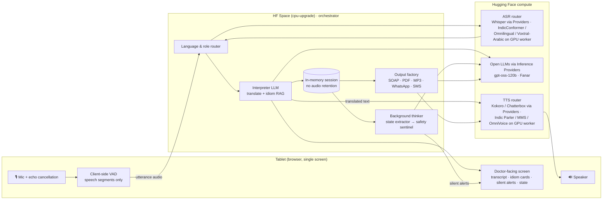
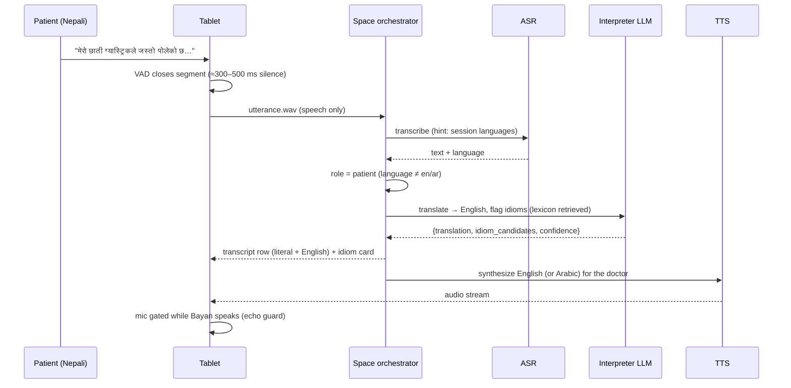
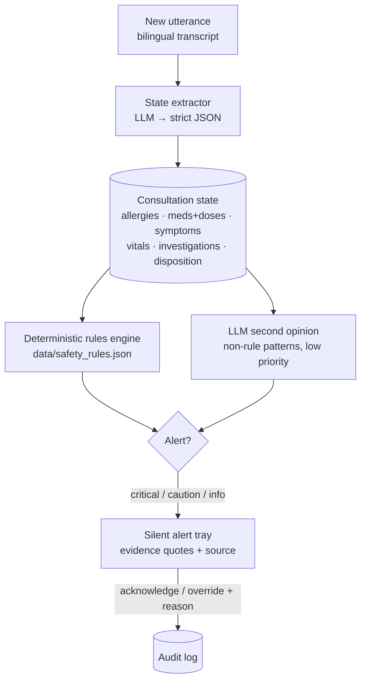
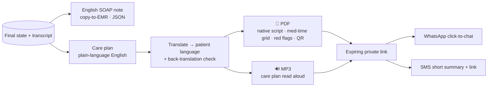

# 03 · System Architecture

> **One tablet. One ambient agent. It listens, talks, and thinks.**
> Bayan AI is a *cascaded* pipeline of open Hugging Face models. Speech is turned into text, the text is reasoned over, and the result is spoken again. It is not a single black-box speech-to-speech model. The text in the middle is what makes safety checks, idiom interpretation, audit trails and the final notes possible.
> Model choices and language coverage are justified in [04 · Models & Languages](04-models-and-languages.md).

---

## 1. Bird's-eye view

## 2. The three loops

Bayan runs three loops at different speeds. Keeping them separate is what makes it feel instant while it still thinks deeply.

| Loop | Trigger | Job | Latency target | Model tier |
|---|---|---|---|---|
| **Talk loop** (foreground) | Every utterance | Recognise speech, translate, speak to the other party, show the transcript | **≤ 3 s** from end of speech to start of translated audio | Fast ASR plus a fast LLM on low-latency providers |
| **Think loop** (background) | Every utterance (debounced), and always before the end of the consultation | Update the structured clinical state, run deterministic safety rules, interpret idioms | ≤ 5 s after the utterance; never blocks the talk loop | Small or fine-tuned extractor, plus rules engine |
| **Wrap-up loop** | "Bayan, end consultation" or the button | SOAP note, patient care plan (PDF, MP3, WhatsApp, SMS) | ≤ 30 s | Largest open LLM, run once per consultation |

> **Efficiency by design:** the expensive model runs **once per consultation**, the cheap model runs often, and deterministic rules cost nothing. See [07 · Compute Budget](07-compute-budget-and-efficiency.md).

## 3. Talk loop, step by step

### 3.1 Who is speaking? (diarization for free)

- At consent time the session knows two language sets. **Doctor side:** English and Arabic. **Patient side:** the patient's language, chosen by the doctor or detected automatically from the first utterance.
- Each utterance's detected language tells us the role: doctor-side means translate to the patient; patient-side means translate to the doctor. No speaker-diarization model is needed in the common case.
- **Edge case: the patient also speaks Arabic** (for example an Egyptian or Sudanese worker). Language can no longer separate the speakers, so we fall back to a speaker-embedding diarization model (pyannote) that is enrolled during the consent exchange. See [04](04-models-and-languages.md).
- **Low confidence:** if language ID or ASR confidence is low, Bayan asks a short clarification in the likely language instead of guessing.

### 3.2 Not translating itself (echo/self-hearing guard)

1. Browser `getUserMedia({ echoCancellation: true, noiseSuppression: true })`.
2. **Half-duplex gating:** VAD segments are dropped while Bayan's own TTS is playing, with a short tail buffer.
3. **Barge-in (stretch goal, C4 in [02](02-product-spec.md)):** if a human keeps speaking over Bayan for more than about 700 ms, Bayan stops speaking and listens. The interrupted translation stays visible on screen. The MVP uses half-duplex gating only.

## 4. Think loop: structured state and the safety sentinel

> The think loop is run by the **clinical copilot agent** (smolagents `ToolCallingAgent` on `gpt-oss-120b`). It calls the extractor, the rule engine and the idiom lexicon as tools, and turns the results into doctor-approved cards. Full design: [11 · Clinical Copilot Agent](11-clinical-copilot-agent.md).

- **Rules are the authority** for drug–allergy, dose ceilings, interactions, pregnancy and missing-workup checks. They are explainable, testable and hallucination-free. The LLM only *extracts* facts and *suggests* softer concerns.
- Every alert shows the **exact quoted utterances, with timestamps**, plus the rule's source, so the doctor can verify it in a second.
- Alerts are **never spoken aloud**. They are de-duplicated and capped to avoid alert fatigue.
- Details: [05 · Clinical Safety & Cultural Intelligence](05-clinical-safety-and-cultural-intelligence.md).

## 5. Idiom interpretation (retrieval-grounded)

1. A patient-side utterance is embedded with a small multilingual embedding model on CPU and matched against `data/idiom_lexicon.json`. Keyword and romanization matching serve as a fallback.
2. The top matches go into the interpreter prompt. The LLM must cite which lexicon entry it used, or say "no lexicon match" (no free-floating medical claims).
3. The doctor sees: **Literal** (always) · **Clinical note** (likely meanings, red flags it may mask) · **Ask next** (one or two clarifying questions, already translatable with one tap).

## 6. Wrap-up loop: outputs

- **The PDF is the final artifact.** Complex scripts (Devanagari, Bengali, Malayalam, Tamil, Sinhala, Arabic RTL) need a renderer that does proper text shaping (HarfBuzz), such as WeasyPrint, plus Noto fonts bundled in `assets/fonts/`. Naive PDF libraries break conjunct letters, and that would be a dignity failure in a dignity product.
- **WhatsApp (MVP):** a `https://wa.me/<number>?text=<prefilled message + link>` click-to-chat link that the doctor or nurse taps. It needs no business API approval. A Cloud API or Twilio sandbox is the stretch goal.
- **SMS:** native-script SMS uses UCS-2 encoding (70 characters per segment), so we send a short summary plus the link. A Twilio trial is the stretch goal; the `sms:` URI is the MVP.
- **Audio:** an MP3 of the care plan through the same TTS router, downloadable and linked by QR, for patients who cannot read.

## 7. Deployment topology on Hugging Face

| Piece | Where it runs | Why |
|---|---|---|
| UI + orchestrator | **HF Space** `dullgrey/team-qh-129-bayan-app` (Gradio/FastAPI, `cpu-upgrade`, $0.03/h) | Cheap; all heavy compute is remote |
| Client VAD | In the browser (ONNX) | Only speech is sent, so silence costs nothing and less audio leaves the device |
| ASR: English, Tagalog, Indonesian | **Inference Providers**: Whisper large-v3 / turbo | Pay per use, no idle GPU |
| ASR: Indic patient languages, Gulf Arabic, long-tail languages | **One GPU voice worker** (L4 Endpoint scale-to-zero, or ZeroGPU / GPU Space): IndicConformer-600M, Voxtral-Mini-4B-Realtime-Arabic, Omnilingual ASR | No provider serves these today, and Whisper's published WER on Bengali/Malayalam is above 99% ([04](04-models-and-languages.md)) |
| Interpreter + thinker + wrap-up LLMs | **Inference Providers**: `openai/gpt-oss-120b` on Cerebras/Groq; `QCRI/Fanar-1-9B-Instruct` for Arabic-side text | Low latency, pay per token; Fanar is Qatar's national Arabic LLM |
| TTS: doctor side (English, Arabic) | **Inference Providers**: Kokoro-82M, Chatterbox Multilingual | Serverless |
| TTS: patient side | **Same GPU voice worker**: Indic Parler-TTS (Nepali, Hindi, Urdu, Bengali, Malayalam, Tamil, Telugu), MMS-TTS (Tagalog, Indonesian, Swahili, Amharic…), OmniVoice (Sinhala, Pashto) | No provider serves TTS in any South Asian patient language today. Fixed phrases (consent, "please repeat") are **pre-generated and cached** |
| Optional fine-tuned model | Trained on **HF Jobs**, pushed to the Hub, served on an Endpoint (scale-to-zero) | Shows the full HF loop; see [06](06-fine-tuning-plan.md) |
| Idiom dataset | **HF Hub dataset** | Reusable public good; feeds RAG and fine-tuning |

### Sovereign / on-prem path (post-hackathon)

The same cascade runs fully self-hosted: Transformers and vLLM on hospital GPUs, or llama.cpp for edge boxes, with Fanar for Arabic. No patient audio ever leaves the hospital network, which matches PDPPL (Law No. 13 of 2016) expectations for health data.

## 8. Data & privacy model

| Data | Default handling |
|---|---|
| Raw audio | Processed in memory per utterance; **not stored** |
| Transcript & state | In-memory session; erased when the doctor closes the session (the EMR note is copied out by the doctor) |
| Patient PDF/MP3 | Stored behind an unguessable link that **expires** (for example after 7 days); no patient name needed on the link |
| Audit log of alerts | Alert, evidence, the doctor's action and reason; no audio |
| Consent | Spoken in the patient's language at the start; the doctor confirms on screen |

> Demo builds use **synthetic, scripted consultations only.** No real patient data.

## 9. Failure modes & fallbacks

| Failure | Fallback |
|---|---|
| Provider slow or down | Secondary provider for the same open model; then a smaller model |
| No TTS for the language (for example Sinhala) | Large-type native-script text on screen plus English audio for staff; PDF is still generated |
| ASR confidence low | Spoken clarification ("Did you say…?") in the patient's language |
| Mic or network issue in the live demo | "Play sample consultation" runs the pre-recorded golden path through the real pipeline |
| LLM returns invalid JSON | Constrained/JSON mode, then one retry, then a safe default (show the literal translation only) |
