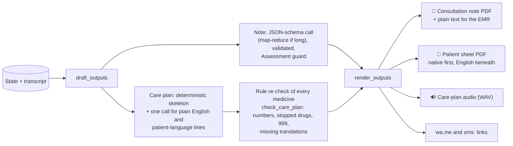

# 03 · System Architecture

> **One tablet. One ambient agent. It listens, talks, and thinks.**
> Bayan AI is a *cascade* of open Hugging Face models: speech becomes text, the text is checked and reasoned over, and the result is spoken again. The text in the middle is what makes the safety checks, idiom notes, audit trail and notes possible.
> Models and languages: [04](04-models-and-languages.md). The agents in detail: [11](11-clinical-copilot-agent.md).
>
> **Status (2026-11-07):** the clinical brain (`bayan/brain/`) and outputs (`bayan/outputs/`) are wired into the UI shell in the local code (269 offline tests, live smoke run 17/17). This state is **not yet deployed** to the Space.

---

## 1. Module map

| Module | Owner role | Job |
|---|---|---|
| `app.py` | UI shell | Access-code gate (`BAYAN_ACCESS_CODE`; a startup warning if unset), FastAPI + Gradio mount, FastRTC `WebRTC` stream with `ReplyOnPause` (Silero VAD), Cloudflare TURN, output pump that also re-renders when cards change, `GET /plan/<id>`, `GET /files/<token>/<name>`, retention sweeper |
| `bayan/ui.py` | UI shell | Assembles the screens from `bayan/web/`: gate, start (language), consent, doctor/patient "Duet", caption mode, Notes panel, held sentence, consultation ended, review (care plan + "Doctor's note" tab, QR hand-off), sent |
| `bayan/web/` | UI shell | Frontend files: `templates/` (HTML), `static/css`, `static/js`, `static/img` |
| `bayan/consult.py` | UI shell | Per-tab state machine that owns a brain `Consultation`: prescription gate on doctor turns, held sentences ("Say something else" withdraws the turn and rolls the state back; "Speak it anyway" is audited), allergies + idiom card + one "Ask next" on patient turns, speech queue, echo guard, no-mic demo, end of visit (copilot flush, then the wrap-up agent) |
| `bayan/talk.py` | Talk loop | Voice worker client (`/hear`, `/speak_stream`, `/speak`), translation call to `gpt-oss-120b` on Cerebras (JSON schema: translation, literal English, drugs with intent / dose / frequency, allergies, tests; the last 4 turns as context), optional Kokoro doctor voice |
| `bayan/copilot.py` | Adapter | Maps brain cards to the stage: "ask" → Notes-panel suggestion, idiom → explanation under the English line, missed / observation → notes, rule cards → red alerts |
| `bayan/careplan.py` | Adapter | Care plan page `/plan/<id>`: the structured plan with the patient PDF's wording plus a PDF download, in memory, expires after 24 h, opened by an on-screen QR; serves `/files/<token>/` (whitelisted names) |
| `bayan/brain/state.py` | Brain | Consultation state, turns with utterance ids (`u001`…), activity trace, consultation clock |
| `bayan/brain/extract.py` | Brain | `update_state`: one `gpt-oss-120b` JSON-schema call (Groq, Cerebras fallback) returning a delta with evidence; keyword fallback |
| `bayan/brain/merge.py` | Brain | Validator: drug normalisation (brand → generic, classes), units, daily dose, earliest first mention, never overwrites known with unknown |
| `bayan/brain/vocab.py` | Brain | Controlled vocabularies harvested from the rules, so extraction can only emit codes the rules know |
| `bayan/brain/rules.py` | Brain | Deterministic engine over `data/safety_rules.json` (81 rules), including `check_prescription` for the gate. No LLM |
| `bayan/brain/idioms.py` | Brain | Lexicon matcher over `data/idiom_lexicon.json` (59 entries): native script, romanized, English loanwords. No LLM |
| `bayan/brain/checklist.py` | Brain | Presenting-complaint workup checklists derived from the state |
| `bayan/brain/cards.py` | Brain | Card store with guardrails in code, dedupe, doctor actions, append-only audit |
| `bayan/brain/agentkit.py` | Brain | smolagents 1.26.0 plumbing: `InferenceClientModel` on Cerebras, compact system prompt, hard timeout, no extra final-answer call |
| `bayan/brain/copilot.py` | Brain | Think loop, prescription gate, `record_allergies`, copilot agent tools, deterministic fallback cards |
| `bayan/brain/wrapup.py` | Brain | Wrap-up agent: note, care plan, checks, render; deterministic fallback order |
| `bayan/outputs/report.py` | Outputs | fpdf2 + HarfBuzz PDFs with Noto fonts: "Consultation note" and the patient sheet |
| `bayan/outputs/delivery.py` | Outputs | Care-plan audio (WAV), prefilled `wa.me` and `sms:` links; phone numbers never stored |
| `bayan/outputs/retention.py` | Outputs | Per-consultation temp folder, `purge()` on reset, hourly sweep of folders older than 24 h |
| `voice_worker/app.py` | GPU Space | Whisper, VoxLingua107, IndicConformer, Indic Parler-TTS behind a private Gradio API |

## 2. Call flow

```mermaid
sequenceDiagram
    participant M as Tablet (WebRTC)
    participant A as app.py / consult.py
    participant W as GPU worker
    participant L as gpt-oss-120b (Cerebras)
    participant B as bayan/brain
    participant G as gpt-oss-120b (Groq)
    M->>A: audio stream; Silero VAD closes an utterance
    A->>W: /hear(utterance, patient_lang)
    W-->>A: role (VoxLingua107 over en/ar/patient), text (Whisper or IndicConformer)
    A->>L: translate (reasoning low) → translation, literal English, drugs, allergies, tests
    alt patient turn with allergies
        A->>B: record_allergies (sync, no LLM)
    end
    alt doctor turn with drugs
        A->>B: prescription_gate (sync, rules only, ~3 ms)
        B-->>A: critical hit → hold the sentence
    end
    A->>W: /speak_stream (unless held)
    W-->>M: streamed speech; mic gated while it plays
    A->>B: on_turn (background, debounced ~1.2 s)
    B->>B: lookup_idiom → idiom card at once
    B->>G: extraction (skipped for courtesy turns; questions batched with the answer)
    B->>B: merge → all 81 rules → rule cards
    B->>L: copilot agent, only if something is new (reasoning medium)
    B-->>A: cards for the Notes panel (doctor only)
```

## 3. The three loops

| Loop | Trigger | Job | Measured / target |
|---|---|---|---|
| **Talk** (foreground) | Every utterance | Hear, translate, gate, speak | Worker `/speak_stream` first audio ~2.2 s (3-sentence answer) and ~3.1 s (short question) from Doha. End-to-end target ≤ 3 s from end of speech, **not yet measured** |
| **Think** (background) | After each turn, debounced ~1.2 s; at most one run in flight per consultation, one rerun if a turn lands mid-run | Deterministic spine (idioms → extraction → merge → rules), then the copilot agent | Extraction ~1.1 s; agent ~1.2–1.6 s, 1 step (golden path) |
| **Wrap-up** | "End consultation" (voice or button) | Note + care plan in parallel, rule re-check, plan check, render | ~6–8 s (golden path) |

The talk loop never waits for the think loop. The prescription gate is the one synchronous safety step, and it uses no LLM.

### 3.1 Who is speaking?

The patient's language is chosen on the start screen. For each utterance the worker scores VoxLingua107 language ID over {English, Arabic, patient language} only: English or Arabic means the doctor, anything else the patient. The doctor is transcribed with Whisper; the patient with IndicConformer, or Whisper for languages it lacks (Filipino). No diarization model runs. A patient who also speaks Arabic is not handled yet (roadmap: speaker enrolment).

### 3.2 Not translating itself

`ReplyOnPause(can_interrupt=False)` ignores the mic while Bayan speaks, and `consult.speak_live` keeps it closed until playback ends plus a 300 ms echo tail. No barge-in.

## 4. Think loop: deterministic spine, then the agent

1. `lookup_idiom` on new patient turns → idiom card at once.
2. `update_state`: one extraction call (Groq) → `merge_delta`. Courtesy turns skip it; a doctor's plain question waits and is extracted with the patient's answer.
3. `check_safety_rules`: all 81 rules → rule cards (`WORK-CHEST-*` collapse into one "Chest-pain workup" card); ask/missed cards resolve when their checklist item is done.
4. Copilot agent (smolagents `ToolCallingAgent`), only when steps 1–3 found something new: read-only tools plus `final_answer(cards)`, 0–2 cards, at most caution.
5. Fallback: agent off, failed, timed out or no valid card → up to 2 deterministic "ask" cards.

Every step is logged as a tool call in the activity trace, with latency, tokens and cost per run. Steps 1–3 never depend on the LLM choosing to call a tool, so a safety alert cannot be skipped by the agent. Only the rule engine can raise a critical card. Details: [05](05-clinical-safety-and-cultural-intelligence.md), [11](11-clinical-copilot-agent.md).

## 5. Wrap-up: outputs



- Any agent failure falls back to the same steps in a fixed order; a failing note or plan falls back to one built from the structured record, and a failing PDF layout to a plain PDF. Outputs always exist.
- PDFs use fpdf2 with HarfBuzz shaping and bundled Noto fonts (Devanagari, Bengali, Malayalam, Tamil, Telugu, Arabic script). Known limitation: copying Nepali text out of the PDF gives broken characters; the rendered page is correct.
- WhatsApp and SMS are prefilled click-to-send links; nobody's message goes out without a person tapping Send.
- The on-screen QR opens `/plan/<id>`, served by `bayan/careplan.py` (in memory, expires after 24 h).

## 6. Deployment on Hugging Face

| Piece | Where it runs |
|---|---|
| UI, orchestration, brain, rules, PDFs | Gradio Space `dullgrey/team-qh-129-bayan-app` (CPU) |
| `gpt-oss-120b` | HF Inference Providers: Cerebras (translation, agents, wrap-up), Groq (extraction) |
| Speech models | Private GPU Space `dullgrey/team-qh-129-bayan-voice` on an L4 (`l4x1`, $0.80/h), called with `gradio_client`, one GPU job at a time. Not an Inference Endpoint |
| Optional English doctor voice | `hexgrad/Kokoro-82M` via Inference Providers (`BAYAN_DOCTOR_VOICE=1`) |
| WebRTC relay | Cloudflare TURN (own key) |

**On-prem path (post-hackathon):** the same cascade can run self-hosted on hospital GPUs so no patient audio leaves the network, in line with Qatar's PDPPL (Law No. 13 of 2016) for health data. Not built.

## 7. Data & privacy

| Data | Handling today |
|---|---|
| Utterance audio | The Space writes a temp WAV per utterance and deletes it after `/hear`; the worker deletes the upload right after loading it (`/hear`, `/transcribe`) and runs Gradio `delete_cache` for other cached files |
| Transcript & state | In memory per browser tab; idle sessions dropped after 8 h |
| Output files | One temp folder per consultation, `purge()` on reset, swept after 24 h; links carry an unguessable 128-bit token |
| Care plan page | In memory, expires after 24 h, `no-store`, `noindex` |
| Audit | Card actions and overrides in an append-only audit (no audio) |
| Access | The Space is behind an access code |
| Tests | No paid calls: `tests/conftest.py` blocks every inference request |

> Demo builds use **synthetic, scripted consultations only.** No real patient data.

## 8. Failure modes

| Failure | What happens |
|---|---|
| Voice worker asleep or down | "Voice service is offline or starting"; the visit continues in text |
| LLM provider fails | Extraction falls back Groq → Cerebras, then a keyword fallback; agents fall back to deterministic cards; wrap-up falls back to the fixed order |
| Agent too slow | 20 s timeout per run; late cards are ignored |
| No voice for the language (Filipino, Arabic) | Caption on screen long enough to read |
| Mic or network issue in the demo | No-mic demo mode replays the golden path as text turns through the real translation |
