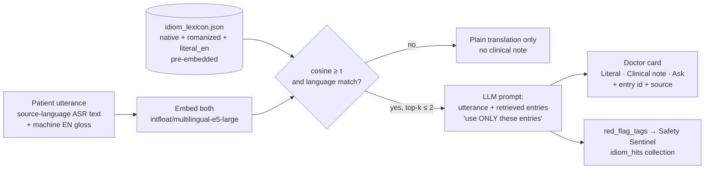
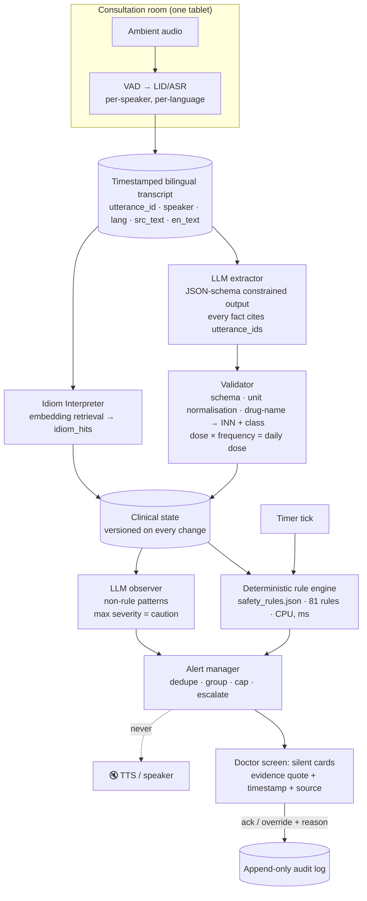

# 05 · Clinical Safety & Cultural Intelligence

> **Scope.** This document specifies two of Bayan AI's background "thinking" components: the **Cultural Idiom Interpreter** and the **Safety Sentinel**. It also covers the guardrails, evaluation plan and limitations that apply to both.
> **Data files:** [`data/idiom_lexicon.json`](../data/idiom_lexicon.json) (59 entries) · [`data/safety_rules.json`](../data/safety_rules.json) (81 rules).
> **Who wrote this:** engineers. The team includes **no clinician**, so every clinical statement here comes from a cited label, guideline or peer-reviewed paper. Nothing in this document is medical advice. Bayan AI is **decision support for a licensed doctor**: it never diagnoses, prescribes or speaks a safety alert to the patient.

---

## TL;DR

- **Problem.** Patients describe illness in *idioms of distress*, for example a Nepali worker's *"gyastrik"* or a Syrian patient's *"qalbi maqboud"* (my heart is squeezed). Literal translation loses the meaning, and the idiom can **mask a red flag**: "gas" in the chest may be cardiac. Human interpreters also make errors. In one paediatric study, interpreters averaged **31 errors per encounter, and 63% of errors had potential clinical consequences** ([Flores et al., *Pediatrics* 2003](https://pubmed.ncbi.nlm.nih.gov/12509547/)).
- **Cultural Idiom Interpreter.** When the patient uses a known idiom, retrieval (embedding similarity) pulls the matching lexicon entry and grounds the LLM's note in it. The doctor sees `Literal: … | Clinical note: … | Ask: …`, always with the literal translation and the source. **59 sourced entries** cover 9 primary languages: **39** from peer-reviewed or institutional literature and **20** honestly marked `community_reported`.
- **Safety Sentinel.** An open-weights LLM *extracts* a structured clinical state (allergies, meds, doses, symptoms, vitals, tests, disposition) from the bilingual transcript. **81 deterministic, cited rules** then check that state. The rule families are drug–allergy, dose ceilings, drug–drug interactions, missing critical workup and pregnancy, plus Qatar-specific heat rules. **Rules are the authority for drug and dose checks.** The LLM never decides that a dose is safe.
- **Alerts are silent** (on screen only, never spoken). Each alert shows the **exact quoted utterance, its timestamp and the rule source**, and takes **one tap** to acknowledge or override with a reason, which goes to the audit log. Dedupe, grouping and caps keep alert fatigue down. Override rates of 49–96% for drug alerts are documented ([van der Sijs et al. 2006](https://pubmed.ncbi.nlm.nih.gov/16357358/)).
- **Qatar grounding.** Heat-illness rules include core-temperature and cooling checks; Qatar's 2021 heat-stress decision requires work to stop above WBGT 32.1 °C. Recorded cardiovascular deaths of Nepali workers rose from 22% in the cool season to 58% in the hot season ([Pradhan et al. 2019](https://pubmed.ncbi.nlm.nih.gov/31302648/)). Imported malaria surveillance data come from Qatar's MoPH ([Bansal et al. 2025](https://pmc.ncbi.nlm.nih.gov/articles/PMC11725959/)). The privacy design follows **Qatar's PDPPL (Law No. 13 of 2016)**.
- **Judging fit.** *Impact:* catches the errors that hurt migrant patients most. *HF use:* HF-hosted LLM and embeddings, and the lexicon published as an HF Dataset. *Efficiency:* rules run in milliseconds on CPU, so LLM calls are spent only on extraction. *Technical execution:* the JSON files here are executable today.

---

## 1. Cultural Idiom Interpreter

### 1.1 Why this matters

Medical anthropology calls these expressions **idioms of distress**: culturally shared ways of communicating suffering that do not map one-to-one onto biomedical categories ([Nichter, *Idioms of distress revisited*, Cult Med Psychiatry 2010](https://experts.arizona.edu/en/publications/idioms-of-distress-revisited/)). DSM-5 formalised this as *cultural concepts of distress* (for example *dhat* and "thinking too much"). Systematic reviews warn that such idioms **should not be read as a gloss for a single psychiatric disorder** ([Kaiser et al. 2015](https://pmc.ncbi.nlm.nih.gov/articles/PMC4689615/)). Three findings shaped the design:

| Finding | Source | Design consequence |
|---|---|---|
| Nepali *man* (heart-mind) idioms are a socially acceptable way to seek help; *dimaag* (brain-mind) idioms are stigmatised. "Gastric" (*gyastrik*) and tingling (*jham-jham*) are common bodily idioms. | [Kohrt & Hruschka 2010](https://pmc.ncbi.nlm.nih.gov/articles/PMC3819627/); [Kohrt & Harper 2008](https://pmc.ncbi.nlm.nih.gov/articles/PMC3869091/) | Notes never label the patient "psychiatric". They show possibilities, including the dangerous physical one. |
| South Asian "tension" ranges from everyday hassle to severe distress or suicidality. | [Weaver & Karasz 2022](https://doi.org/10.1016/j.ssmmh.2022.100092) | The note always suggests a **severity question**, and a suicide-screen question where relevant. |
| Arabic idioms rarely separate body and soul. Indirect phrases such as *"I wish I could sleep and not wake up"* express suicidal thoughts. | [UNHCR / Hassan et al. 2015, Table 1](https://www.unhcr.org/sites/default/files/legacy-pdf/55f6b90f9.pdf) | Some lexicon entries carry `red_flag_tags` (e.g., `suicidality`) that fire Safety Sentinel rules. |

Qatar context: Qatar's migrant workforce is mostly South Asian, Southeast Asian, Arab and East African, and many workers do outdoor manual work in extreme heat. Pradhan et al. found a strong correlation between afternoon WBGT and recorded cardiovascular mortality in Nepali workers in Qatar. They estimate that up to 200 of 571 CVD deaths (2009–2017) were preventable with heat protection ([Pradhan et al. 2019](https://pubmed.ncbi.nlm.nih.gov/31302648/)). When such a worker says *"my chest burns like gyastrik,"* the literal translation alone is dangerous.

### 1.2 What is in the lexicon

`data/idiom_lexicon.json` → `{ "meta": {...}, "entries": [...] }`. The schema for each entry:

| Field | Meaning |
|---|---|
| `id`, `language`, `iso639_3`, `also_used_in[]` | e.g. `npi-005`, Nepali, `npi` |
| `native`, `romanized`, `literal_en` | Native script, romanisation, and a literal English rendering |
| `clinical_interpretations[]` | `{meaning, likelihood: high/medium/low}`, a rough ordering taken from the sources. **It is not a probability.** |
| `masks_red_flags[]` + derived `red_flag_tags[]` | Dangerous conditions the idiom can hide (`acs`, `suicidality`, `stroke`, `heat_illness`, `malaria`, …) |
| `clarifying_questions_en[]` | Questions the doctor can ask. Bayan translates and speaks them only if the doctor taps them. |
| `body_system`, `source_urls[]`, `evidence_level`, `notes` | `literature` / `clinical_guideline` / `community_reported` |

**Coverage (v0.1):**

| Language | Entries | Main sources |
|---|---|---|
| Nepali (npi) | 12 + 1 shared | Kohrt & Hruschka 2010; Kohrt & Harper 2008 |
| Arabic (Levantine-documented; Gulf/Egyptian/Sudanese listed in `also_used_in`) | 13 | UNHCR 2015 Table 1; Lambert et al. 2024 |
| Hindi/Urdu (hin/urd) | 10 + 1 shared | Krause 1989; Sumathipala 2004 (dhat); Weaver & Karasz 2022; dictionaries for common symptom words |
| Tagalog/Filipino (tgl) | 9 | Pasma literature (Palis 2006, Cuyonon study); Visayan *bughat* ethnography; dictionaries |
| Bengali (ben) | 8 | Wahid et al. 2021 (Bangladesh); Bengali health-education pages |
| Malayalam (mal) | 2 | Malayalam health media (community-reported only) |
| Punjabi (pan), Tamil (tam), Amharic (amh) | 1 each | Krause 1989; Affleck et al. 2022 (Walking Corpse Syndrome); Ethiopian ethnobotany (*mich*) |

**Honesty rules.** An idiom without a source is not included. `community_reported` means the meaning comes from dictionaries or lay health media, and its clinical interpretations are generic differentials. The file's `meta.authorship_caveat` states that a clinician and a native speaker must review every entry before real use. Section 6 lists the gaps.

### 1.3 How the lexicon is used at runtime (retrieval-augmented prompting)



1. **Index.** For each entry, embed three strings: `native`, `romanized`, and `literal_en`. Romanised speech is common in ASR output, and code-mixing (e.g., Taglish, "tension") is normal. We suggest [`intfloat/multilingual-e5-large`](https://huggingface.co/intfloat/multilingual-e5-large) (MIT, HF Inference via `hf-inference`/`deepinfra`; its card lists ne, bn, ml, tl, ta, si, ur, hi, ar, am, sw), with [`sentence-transformers/LaBSE`](https://huggingface.co/sentence-transformers/LaBSE) (Apache-2.0) as a fallback. We checked both on the HF Hub API on 2026-11-06. With 59 entries × 3 vectors, the index fits in memory. No vector DB is needed.
2. **Retrieve.** For each patient segment, embed the source text and its English gloss and take the max cosine against the index. Accept only matches where the cosine is at least τ (tune τ on the evaluation set; start around 0.80) **and** the entry's language matches the detected language, with `also_used_in` allowed. Keep the top 2 matches at most.
3. **Ground.** Inject the retrieved entries as JSON into the LLM prompt with an instruction: *"Write a clinical note ONLY from the interpretations and questions in these entries. Quote the entry id. If none fits, output `NO_MATCH`."* The LLM rephrases and selects but cannot invent new meanings. A post-check rejects any note whose `entry_id` was not in the retrieved set.
4. **Route red flags.** Any matched entry's `red_flag_tags` are added to `idiom_hits` in the clinical state, so rules such as `WORK-CHEST-04` (idiom may mask cardiac pain → consider an ECG) and `WORK-SUICIDE-01` can fire.

### 1.4 What the doctor sees

A single line per matched idiom, expandable. The **literal translation is always shown**:

```
🗣 Patient (Nepali, 00:42): "छाती ग्यास्ट्रिकले जस्तो पोलेको छ"
Literal: "My chest is burning, like gastric."
Clinical note: "Gyastrik" is a common Nepali idiom for dyspepsia and can also carry
  psychosocial distress. It can mask cardiac chest pain.   [npi-005 · literature]
Ask: ▸ Does it come on with work or walking and ease with rest?
     ▸ Any sweating, breathlessness, or pain to arm/jaw?
     ▸ Black stools or vomiting blood?
[✓ useful]  [✗ not relevant]                         Sources: Kohrt & Harper 2008 · AHA/ACC 2021
```

- Tapping **Ask** translates the question, back-translates it for verification (§4.1) and speaks it to the patient.
- The **✓/✗** taps are logged. They provide the "idiom note acceptance" metric (§5) and preference data (§1.5).
- No idiom match means no note. The UI never displays a speculative cultural interpretation.

### 1.5 From lexicon to HF Dataset and fine-tuning data

| Step | What | HF tooling |
|---|---|---|
| 1. Publish | Flatten `entries[]` to JSONL (one row per entry; lists as list columns) and push it as `dullgrey/team-qh-129-bayan-idioms`. Write a dataset card covering sources, evidence levels, licence notes and "not for diagnosis". | `datasets.Dataset.from_list(...).push_to_hub()` |
| 2. Expand to examples | For each entry, generate 10–20 realistic utterances (native script and romanised, code-mixed). Native speakers review them, and each row is labelled `{utterance, lang, entry_id}`. | HF Jobs (one short CPU/GPU job) + `datasets` |
| 3. Retrieval fine-tune | Contrastive pairs (utterance ↔ entry text) with hard negatives (e.g., *gyastrik* vs *kabag*) to improve recall at τ. | `sentence-transformers` trainer on HF Jobs; push to Hub with card |
| 4. Note-writer SFT (optional) | `{utterance, retrieved entries} → card text` pairs, so a small open model learns the exact output format and the `NO_MATCH` behaviour. | TRL `SFTTrainer` (LoRA) on HF Jobs |
| 5. Preference data | Doctor ✓/✗ on cards → `{prompt, chosen, rejected}` for DPO later. | TRL `DPOTrainer` (post-hackathon) |

The lexicon stays the **source of truth**. Fine-tuning improves recall and formatting but does not add new clinical claims. Any new meaning must enter as a cited lexicon row first.

---

## 2. Safety Sentinel

### 2.1 Design principle

> **The LLM listens and structures. The rules judge.**

Drug–allergy, dose and interaction checks are **deterministic, explainable and cited**. Every alert can be traced to a rule ID, a source URL and the transcript utterance that triggered it. An LLM *could* notice that "amoxicillin is a penicillin," but it can also hallucinate, miss the allergy, or reason inconsistently between runs. We use the LLM only where rules cannot work: turning messy bilingual speech into structured facts, plus a clearly labelled, lower-tier "observations" channel (§2.6).

### 2.2 Architecture



Notes:
- **Event types** (`fire_on` in each rule): `state_change`, `on_prescribe`, `on_disposition` (doctor says "you can go home", "we'll admit you", …) and `timer` (e.g., "chest pain mentioned more than 10 min ago and still no ECG").
- **Language as diarisation.** Doctor speech is English/Arabic and patient speech is another language. The extractor still tags the speaker, because a patient may *mention* a drug they take while the doctor *prescribes* a drug.
- **Model choice** (see [04 Models & Languages](04-models-and-languages.md)): the extractor runs on an open-weights instruct model via HF Inference Providers, `openai/gpt-oss-120b` by default (`Qwen/Qwen3-235B-A22B-Instruct-2507` as an alternative; both Apache-2.0, with providers verified). If the fine-tune passes its gates, the per-turn STATE extraction moves to our LoRA on `Qwen/Qwen3-4B-Instruct-2507` ([06](06-fine-tuning-plan.md)). Arabic-side understanding can use QCRI Fanar. Running the rule engine costs nothing.

### 2.3 Clinical state schema (extractor output)

The extractor must return JSON that validates against this schema. Every fact carries `evidence` (utterance IDs and the quoted span) and `confidence`. **Unknown is a valid value**: the extractor must not guess pregnancy status, a dose or a reaction.

```json
{
  "allergies": [
    {"substance": "penicillin", "class": "penicillin", "reaction": "rash", "severity": "mild|moderate|severe|anaphylaxis|scar|unknown",
     "evidence": [{"utt": "u017", "t": "00:01:12", "quote": "पेनिसिलिनले मलाई एलर्जी भयो, छालामा दाग आयो"}], "confidence": 0.93}
  ],
  "current_meds":    [{"drug": "lisinopril", "dose_mg": 10, "frequency_per_day": 1, "route": "oral", "evidence": [], "confidence": 0.8}],
  "prescribed_meds": [{"drug": "amoxicillin", "dose_mg": 500, "unit_raw": "mg", "dose_raw": "500 mg", "route": "oral",
                       "frequency_per_day": 3, "duration_days": 5, "indication": "sore throat",
                       "evidence": [{"utt": "u088", "t": "00:09:40", "quote": "I'll give you amoxicillin 500 three times a day"}], "confidence": 0.95}],
  "symptoms":   [{"code": "chest_burning", "severity": "moderate", "onset": "2h", "first_mention_t": "00:00:42", "evidence": [], "confidence": 0.9}],
  "vitals":     {"hr": 96, "bp_sys": 138, "rr": null, "spo2": null, "temp_c": null, "temp_site": "unknown"},
  "investigations": [{"code": "ecg_12lead", "status": "ordered|resulted", "evidence": []}],
  "interventions":  [{"code": "active_cooling", "evidence": []}],
  "assessments":    [{"code": "suicide_risk_assessment", "evidence": []}],
  "disposition":    {"type": "discharge|admit|refer|observe|null", "evidence": []},
  "patient": {"age_years": 34, "sex": "male", "pregnant": "unknown", "gestation_weeks": null, "weight_kg": null,
              "egfr": null, "hepatic_impairment": "unknown", "heat_exposure": true, "heat_illness_suspected": false,
              "dehydration": "none|mild|moderate|severe|unknown", "travel_malaria_endemic_days": null, "ancestry_region": "south_asia"},
  "idiom_hits": [{"id": "npi-005", "red_flag_tags": ["acs", "gi_bleed"], "utt": "u006"}]
}
```

The **validator** (plain Python, not the LLM) normalises brand names to INN (e.g., *Adol/Panadol* → paracetamol, *Augmentin* → co-amoxiclav; see `meta.brand_aliases_examples`). It also maps drugs to classes (`meta.drug_classes`), converts units (g → mg, "one tablet" + known strength → mg), computes `daily_dose_mg`, and computes `elapsed_min_since.*` from timestamps. If the dose unit is ambiguous, it records `dose_mg: null` and raises an *info* prompt asking for the strength instead of guessing.

### 2.4 Rule families (81 rules in `safety_rules.json`)

| Family | # | Example rules (id → what fires) | Key sources |
|---|---|---|---|
| **Drug–allergy** | 12 | `ALG-PEN-01` penicillin allergy + any penicillin incl. co-amoxiclav, piperacillin-tazobactam → **critical** · `ALG-PEN-02` aminopenicillin allergy + cephalexin/cefadroxil/cefaclor/cefprozil (similar R1 side chain) → caution, escalating if anaphylaxis · `ALG-PEN-04` non-severe penicillin allergy + dissimilar cephalosporin → **info only** (current guidance generally permits it) · `ALG-SULFA-02` sulfa-antibiotic allergy + furosemide/thiazide → **info** (no specific cross-reactivity) · `ALG-NSAID-01` aspirin/NSAID hypersensitivity + COX-1 NSAID → critical · `ALG-HLA-01` carbamazepine in a patient of Asian ancestry without an HLA-B*1502 result → caution | [AAAAI/ACAAI 2022 practice parameter](https://doi.org/10.1016/j.jaci.2022.08.028); [Shenoy et al. JAMA 2019](https://pubmed.ncbi.nlm.nih.gov/30644987/); [NICE CG183](https://www.nice.org.uk/guidance/cg183); [Strom et al. NEJM 2003](https://pubmed.ncbi.nlm.nih.gov/14573734/); [Kowalski et al. 2013](https://pubmed.ncbi.nlm.nih.gov/24117484/); [carbamazepine FDA label](https://dailymed.nlm.nih.gov/dailymed/lookup.cfm?setid=047bc284-060a-4db9-bf37-75d10f95a0a6) |
| **Dose ceilings** | 29 | `DOSE-PARA-01` paracetamol over 1 g/dose or 4 g/day → critical · `DOSE-PARA-03` over 75 mg/kg/day if under 50 kg · `DOSE-PARA-04` over 3 g/day with hepatic risk or heat illness → caution · ibuprofen over 2.4 g (critical over 3.2 g) · diclofenac over 150 mg · ketorolac oral over 40 mg/day or more than 5 days · amoxicillin over 3 g oral · co-amoxiclav clavulanate over 375 mg/day · azithromycin · ceftriaxone over 2 g/day (caution; label maximum 4 g/day) · metformin over 2550 mg, or eGFR under 30 → critical · amlodipine over 10 mg · omeprazole over 40 mg (info) · ondansetron IV over 16 mg · metoclopramide over 30 mg/day · tramadol over 400 mg · codeine · colchicine over 1.8 mg/flare · prednisolone over 60 mg (info) · salbutamol over 12 puffs/day (info) · levothyroxine over 300 mcg (mg/mcg unit error) · adrenaline 1 mg/mL given IV or over 0.5 mg IM | FDA labels on DailyMed (set IDs in file, retrieved via openFDA 2026-11-06); [EMA metoclopramide review](https://www.ema.europa.eu/en/medicines/human/referrals/metoclopramide-containing-medicines); [Resus Council UK anaphylaxis](https://www.resus.org.uk/library/additional-guidance/guidance-anaphylaxis/emergency-treatment) |
| **Drug–drug** (small curated set) | 12 | warfarin + NSAID; warfarin + fluconazole/metronidazole · simvastatin + clarithromycin/azoles (contraindicated) · clopidogrel + omeprazole · PDE5 inhibitor + nitrate · tizanidine + ciprofloxacin · tramadol/linezolid + SSRI (serotonin syndrome) · ACE inhibitor/ARB + spironolactone/K⁺ · methotrexate + trimethoprim · allopurinol + azathioprine · NSAID + ACE inhibitor/ARB + diuretic ("triple whammy"), escalating with heat or dehydration | Interacting-drug FDA labels; [CDC heat & medications](https://www.cdc.gov/heat-health/hcp/clinical-guidance/heat-and-medications-guidance-for-clinicians.html) |
| **Missing critical workup** | 16 | Chest pain → ECG within 10 min (`WORK-CHEST-01`, timer); chest pain + discharge with no ECG or no troponin → critical; idiom tagged `acs` (gas/gyastrik/kabag) + no ECG → caution · **Heat:** heat exposure + confusion/collapse with no **rectal/core temperature** → critical; suspected heat stroke with no active cooling → critical; no CK/creatinine/electrolytes → caution; antipyretic for heat stroke → info · Headache + SNNOOP10 red flag + discharge with no exam or imaging decision · Abdominal/pelvic pain, bleeding or dizziness in a woman 12–55 with unknown pregnancy status → pregnancy test (critical before CT, a teratogen or discharge) · Fever + endemic travel within 90 days → malaria test · IV fluids/severe dehydration → U&E · Suicidal ideation (explicit or idiom) → risk assessment · Sepsis criteria → lactate/cultures · TLoC → ECG · Focal neuro signs → imaging | [AHA/ACC 2021](https://doi.org/10.1161/CIR.0000000000001029); [ESC ACS 2023](https://doi.org/10.1093/eurheartj/ehad191); [ACSM 2023](https://doi.org/10.1249/JSR.0000000000001058); [WMS 2024](https://doi.org/10.1177/10806032241227924); [IOC heat consensus 2023](https://pmc.ncbi.nlm.nih.gov/articles/PMC9811094/); [SNNOOP10](https://pmc.ncbi.nlm.nih.gov/articles/PMC6340385/); NICE [NG126](https://www.nice.org.uk/guidance/ng126), [CG174](https://www.nice.org.uk/guidance/cg174), [NG225](https://www.nice.org.uk/guidance/ng225), [NG51](https://www.nice.org.uk/guidance/ng51), [CG109](https://www.nice.org.uk/guidance/cg109), [NG128](https://www.nice.org.uk/guidance/ng128); [WHO malaria](https://www.who.int/publications/i/item/guidelines-for-malaria) |
| **Pregnancy** | 10 | ACE inhibitor/ARB, isotretinoin, warfarin, valproate, methotrexate, misoprostol → critical · NSAID at 20 weeks or later → caution (critical at 30 weeks or later) · tetracyclines → caution · **statin → info** (FDA removed the blanket contraindication in 2021) · unknown pregnancy status + teratogen → caution | Boxed warnings on FDA labels; [FDA NSAID ≥20 wk](https://www.fda.gov/drugs/drug-safety-and-availability/fda-recommends-avoiding-use-nsaids-pregnancy-20-weeks-or-later-because-they-can-result-low-amniotic); [FDA statins 2021](https://www.fda.gov/drugs/drug-safety-and-availability/fda-requests-removal-strongest-warning-against-using-cholesterol-lowering-statins-during-pregnancy) |
| **Heat & medication** (Qatar) | 2 | NSAID for a dehydrated, heat-exposed patient → caution · diuretic/anticholinergic/antipsychotic/β-blocker/TCA/topiramate for an outdoor worker → info: add heat counselling to the patient plan | [CDC heat & medications](https://www.cdc.gov/heat-health/hcp/clinical-guidance/heat-and-medications-guidance-for-clinicians.html); [Qatar heat-stress decision (ILO)](https://www.ilo.org/resource/qatars-ministerial-decision-heat-stress) |

Base severity mix: **38 critical · 34 caution · 9 info** (13 rules also carry `escalate_to_critical_if`). The *info* rules are deliberate. Several exist to **prevent false critical alerts** from outdated beliefs: cephalosporins in non-severe penicillin allergy, sulfa "cross-allergy", and statins in pregnancy.

**Verification field.** `label_or_guideline_checked` means we read the threshold in the cited text. `threshold_is_design_choice` means the source supports the concern but the exact number is a conservative engineering choice, for example paracetamol over 3 g/day with risk factors or oral amoxicillin over 3 g/day. Every threshold must be confirmed against the local formulary (e.g., HMC) by a pharmacist before real use.

### 2.5 The rule language (machine-checkable triggers)

Each rule's `trigger` is a small JSON logic tree: `all` / `any` / `none`, plus `exists_in` / `none_in` over a state collection, with facts compared by `eq, neq, in, not_in, gt, gte, lt, lte, exists, not_exists, contains_any`. Missing data evaluates to *false*, so a rule never fires on absent data. The exception is `none_in`, which is designed to fire when an investigation is missing. `escalate_to_critical_if` raises severity when extra conditions hold.

```json
{
  "id": "ALG-PEN-01",
  "family": "drug_allergy",
  "trigger": {"all": [
    {"exists_in": "allergies",       "where": {"fact": "class", "op": "in", "value": ["penicillin"]}},
    {"exists_in": "prescribed_meds", "where": {"fact": "class", "op": "in", "value": ["penicillin"]}}
  ]},
  "severity": "critical",
  "message_en": "Penicillin allergy reported ({allergy.evidence}). {rx.drug} is a penicillin.",
  "rationale": "Every penicillin, including combination products …",
  "source_urls": ["https://doi.org/10.1016/j.jaci.2022.08.028", "https://pubmed.ncbi.nlm.nih.gov/30644987/", "https://www.nice.org.uk/guidance/cg183"],
  "fire_on": "on_prescribe",
  "verification": "label_or_guideline_checked"
}
```

A short reference evaluator (a scratch script, not shipped in the repo) was used to dry-run the three worked examples below against the shipped JSON. It produced exactly the alerts listed in §3. Port that logic into the app (`json-logic`-style recursion; no LLM involved).

### 2.6 What the LLM does, and what it may not do

| LLM may | LLM may not |
|---|---|
| Extract the clinical state into the JSON schema, with evidence spans and `unknown` where unsure | Decide whether a dose, allergy or interaction is safe |
| Resolve code-mixing and colloquial drug names ("the white pain tablet" → asks the doctor to confirm; never assumes) | Raise a **critical** alert. LLM-only observations are capped at *caution*. |
| Flag **non-rule patterns** as "Observations", e.g., "the patient said 'I have no one here' twice; consider a social-work referral" or "dose stated twice with different numbers (500 vs 50)" | Hide or reword a rule alert |
| Draft the clarifying question for the doctor to tap | Speak anything to the patient on its own initiative |

Observations are labelled `🤖 LLM observation (not a rule)`. They carry the quote and a confidence score, and they are excluded from rule-precision metrics.

### 2.7 Alert UX: silent, evidenced, accountable

| Property | Specification |
|---|---|
| **Channel** | **On-screen only.** The alert manager has no path to TTS (see the diagram). The tablet never vibrates or chimes for an alert while the patient can see or hear it. |
| **Severity** | `info`: collapsed grey chip · `caution`: amber card · `critical`: red card pinned to the top, which blocks *finalising* the EMR note or the patient plan until it is acknowledged. It never blocks the conversation. |
| **Evidence** | Every card shows: rule ID · the **exact quoted utterance(s)** with timestamps (tap to replay audio, if retention is enabled) · the extracted fact · the rule rationale · the source links. |
| **Actions** | One tap: **Acknowledge** (I'll act) · **Override** with a reason chosen from a quick list (e.g., "allergy de-labelled", "benefit outweighs risk", "already done, not captured", "extraction error") plus optional free text · **Wrong fact**, which sends the doctor to correct the state, re-runs the rules and logs the extraction error. |
| **Audit log** | Append-only JSONL: `{alert_id, rule_id, rule_version, state_version, evidence_utts, shown_at, action, reason, user, ts}`. Retained with the note. It contains no audio. |
| **Fatigue controls** | (1) **Dedupe** per `(rule_id, drug/symptom)` per encounter; an overridden alert never re-fires unless the state changes materially (new dose, new drug). (2) **Grouping**: e.g., `WORK-CHEST-01…04` collapse into one "Chest-pain workup" card with checklist items. (3) **Cap**: at most 3 visible caution/critical cards; the rest go behind a counter. Critical cards always show. (4) **Timing**: `on_disposition` and timer rules wait for the right moment instead of interrupting history-taking. (5) **Thresholds** use label maxima, not textbook "usual" doses, and info-level rules suppress known false alarms. Rationale: within-patient repeats and alerts per encounter reduce acceptance; reminder acceptance dropped 30% per extra reminder per encounter ([Ancker et al. 2017](https://pubmed.ncbi.nlm.nih.gov/28395667/)). |

---

## 3. Worked examples (end-to-end)

These are scripted demo scenarios with fictional people. The alert lists below are the actual output of the reference evaluator run over `safety_rules.json`.

### Example 1: Nepali construction worker, "chest burning like gyastrik", penicillin allergy, amoxicillin, discharge without ECG

| t | Speaker | Utterance (source → EN) | System |
|---|---|---|---|
| 00:42 | Patient (ne) | "छाती ग्यास्ट्रिकले जस्तो पोलेको छ, काम गर्दा बढ्छ" → "My chest burns like gastric; it gets worse when I work." | Idiom card **npi-005** (gyastrik) with *Ask* questions. `idiom_hits += [acs, gi_bleed]` → **caution `WORK-CHEST-04`** (idiom may mask ACS). Symptom `chest_burning` (first mention 00:42). |
| 00:52 | (timer) | No ECG ordered 10 min after first mention | **Caution `WORK-CHEST-01`**, grouped with `WORK-CHEST-04` into one "Chest-pain workup" card. |
| 01:12 | Patient (ne) | "पेनिसिलिनले मलाई एलर्जी भयो, छालामा दाग आयो" → "I had an allergy to penicillin; I got spots on my skin." | Allergy `{penicillin, reaction: rash, severity: moderate}`. |
| 03:05 | Doctor (en) | "Probably acidity and a throat infection." | No new alert. |
| 09:40 | Doctor (en) | "Amoxicillin 500 three times a day for 5 days, and omeprazole. You can go home." | **Critical `ALG-PEN-01`**: quote from 01:12 + quote from 09:40 + AAAAI/ACAAI 2022 · NICE CG183. **Critical `WORK-CHEST-02`** (discharge, no ECG) and **critical `WORK-CHEST-03`** (no troponin): AHA/ACC 2021 · ESC 2023 · Pradhan 2019. |
| 09:55 | Doctor taps | Acknowledges all three cards (no override), changes the antibiotic, and orders an ECG + hs-troponin. | Alerts resolve and the audit log records both actions. The patient heard only the doctor's words. |

### Example 2: Filipino domestic worker, "kabag" + "pasma", unknown pregnancy, ibuprofen, CT ordered

| t | Speaker | Utterance | System |
|---|---|---|---|
| 00:05 | (triage) | 12-lead ECG already recorded at triage | Because an ECG exists, `WORK-CHEST-04` (kabag is tagged `acs`) stays silent. |
| 00:30 | Patient (tl) | "May kabag po ako, masakit ang tiyan, tsaka nahihilo." → "I have gas pain, my stomach hurts, and I feel dizzy." | Idiom card **tgl-002** (kabag). Symptoms `abdominal_pain`, `dizziness`. |
| 01:50 | Patient (tl) | "Pasma po ang kamay ko, nanginginig." → "My hands have pasma; they tremble." | Idiom card **tgl-001** (pasma): differential incl. thyroid dysfunction, diabetes, overuse; *Ask* about chemicals or cleaning products and gloves. |
| 04:10 | Doctor (en) | "Ibuprofen 800 four times a day, and let's get a CT abdomen." | **Caution `DOSE-IBU-01`** (3200 mg/day; above 2.4 g, at the label max). **Critical `WORK-PREG-01`**: woman aged 29, abdominal pain + dizziness, pregnancy status unknown, CT ordered with no pregnancy test → escalated (NICE NG126). |
| 04:30 | Doctor | Taps the suggested question → Bayan asks in Tagalog: "Kailan po ang huling regla ninyo?" (When was your last period?) + back-translation check | If the answer implies 20 weeks or more, **`PREG-NSAID-01`** fires (FDA 2020), and it becomes critical at 30 weeks or more. |

### Example 3: Bangladeshi labourer in August, "matha gorom", confusion after an outdoor shift

| t | Speaker | Utterance | System |
|---|---|---|---|
| 00:20 | Colleague (bn) | "দুপুরে কাজ করার পর থেকে ও উল্টাপাল্টা কথা বলছে, বমি করেছে" → "Since working at midday he's been talking nonsense and vomited." | Symptoms `confusion`, `vomiting_in_heat`. `patient.heat_exposure = true`. |
| 00:45 | Patient (bn) | "মাথা গরম, শরীর দুর্বল" → "My head is hot, my body is weak." | Idiom cards **ben-003** (*matha gorom*: usually anger, **but in heat context consider literal heat illness**) and **ben-005**. |
| 00:46 | (state) | Only a tympanic temperature recorded | **Critical `WORK-HEAT-01`**: no core (rectal) temperature with CNS signs after heat exposure (ACSM 2023 · WMS 2024 · Qatar heat-stress decision). **Critical `WORK-HEAT-02`**: no active cooling documented ("cool first"). |
| 03:00 | Doctor (en) | "Dehydration. Paracetamol 1 g four times a day, ibuprofen 400 three times a day, oral fluids, home." (Patient's own meds: lisinopril + hydrochlorothiazide.) | **Info `WORK-HEAT-04`**: antipyretics don't treat heat stroke. **Caution `DOSE-PARA-04`**: 4 g/day with heat illness. **Critical `DDI-AKI-01`**: NSAID + ACE inhibitor + thiazide, escalated by heat and dehydration. **Caution `HEAT-MED-01`**. **Caution `WORK-HEAT-03`**: no CK/creatinine/electrolytes. These are shown as **one grouped "Heat illness" card** with a checklist, so the doctor isn't buried in six alerts. |

---

## 4. Guardrails

### 4.1 Hallucination and translation controls

1. **Literal first, always.** Every patient utterance is shown as source text plus a literal English translation. The clinical note is a separate, labelled layer, so the doctor can always see what was actually said.
2. **Lexicon-grounded notes only.** Notes come from retrieved entries (§1.3), and the cited `entry_id` is post-validated. A non-match produces no note. There is no "the model thinks this is cultural" output.
3. **Confidence flags.** ASR confidence, translation quality estimate and extraction `confidence` are shown as a small dot (green/amber/red). Any **safety-relevant fact** (allergy, drug, dose, pregnancy) extracted below the threshold is shown as *"Unconfirmed: tap to confirm"* and **cannot silence a rule**. The rule still fires, and the card says "based on an unconfirmed extraction".
4. **Back-translation check ("uncertain translation: confirm").** Doctor → patient sentences that contain numbers, drug names, doses, negations or red-flag instructions are machine back-translated into English *before* TTS. A low similarity score between the original and the back-translation (chrF, or an embedding cosine) triggers a doctor-screen banner: *"Uncertain translation: confirm or rephrase."* Doses are also spoken as digits plus words.
5. **Numbers and negations.** The extractor and the validator both parse numbers. If they disagree (e.g., "fifteen" vs "fifty"), the dose is set to `null` and the doctor is asked to confirm.
6. **No silent fallbacks.** If ASR or translation for a language falls below its demo tier, the UI says so and recommends a human interpreter. Bayan never pretends to understand.

### 4.2 Consent, at the start of every consultation

Spoken by Bayan in the patient's language (and shown on screen) after the doctor taps *Start*. The draft below is subject to legal review:

> "Hello. This tablet is an AI assistant called Bayan. It will translate between you and your doctor and help the doctor write notes. The doctor makes all medical decisions. Your conversation is processed securely; the audio is not saved unless you agree. You can ask to stop it at any time. Do you agree to use it today?"

- A verbal "yes" is captured as a consent event (timestamp, language, doctor ID), with **no audio stored**. "No" means Bayan turns off, and the doctor uses the usual interpreter service.
- A separate, optional opt-in covers audio retention for quality review.
- Children, and adults who lack capacity, follow the facility's existing consent policy. Bayan does not decide capacity.

### 4.3 Privacy: Qatar PDPPL (Law No. 13 of 2016)

- **Health data is "personal data of a special nature."** Under Article 16 it may be processed only with permission from the competent department and under the controls set by ministerial decision. Violations of Articles 13, 16 and 17 can draw fines of up to QR 5 million ([Clyde & Co summary of PDPPL guidelines](https://www.clydeco.com/en/insights/2021/03/new-regulatory-guidelines-on-the-qatar-persona-1); [The Peninsula, 2016](https://thepeninsulaqatar.com/article/04/11/2016/Up-to-QR5m-fine-for-leaking-personal-data)). The regulator's name has changed over time. **Confirm the current authority and the permission process before any pilot.**
- **Design defaults:** no audio retention (streaming buffers only; transcripts kept with the clinical note under the hospital's record policy); data minimisation (the clinical state stores only what the rules need); patient identifiers never sent to the LLM (the encounter uses a random ID); an audit log with no audio.
- **Deployment path.** The **hackathon demo** uses HF Inference Providers plus our own GPU voice worker (an Inference Endpoint or GPU Space, because no provider serves Indic ASR/TTS) with **synthetic, scripted consultations only**; no real patient data. **Production** follows a sovereign path: the same open-weights models (ASR, LLM, embeddings, TTS) on **in-country or on-prem infrastructure** (e.g., HF Inference Endpoints in a compliant region, or self-hosted vLLM/llama.cpp), so health data never leaves Qatar. This is possible precisely because every model is open-weights. A DPIA and a record of processing are needed before a pilot.

### 4.4 Regulatory framing

- **What Bayan AI claims:** clinical decision support for a licensed clinician, who reviews the evidence and decides. **What it does not claim:** diagnosis, autonomous prescribing, or medical-device status. The hackathon build is a research prototype on synthetic data.
- **Qatar:** the Ministry of Public Health (MoPH) held a national health-research ethics workshop on AI in health research in December 2024 with NCSA, QU and HBKU ([QNA](https://www.qna.org.qa/en/News-Area/News/2024-12/01/0057-moph-discusses-ethics-of-use-of-artificial-intelligence-in-health-research)). We did **not** find a published MoPH regulation that specifically governs clinical AI decision support. A pilot would go through MoPH/HMC research ethics (IRB) and the facility's clinical-governance process.
- **International reference:** the US FDA's *Clinical Decision Support Software* guidance (current version dated January 2026, [FDA](https://www.fda.gov/regulatory-information/search-fda-guidance-documents/clinical-decision-support-software)) distinguishes non-device CDS under FD&C Act §520(o)(1)(E). A key idea is that the clinician must be able to **independently review the basis** for a recommendation. Bayan's evidence-first cards (quote + rule + source) are built around that idea. Whether *real-time* alerts fall inside the non-device criteria under the 2026 text is **unverified** and would need regulatory advice.

---

## 5. Evaluation plan

**Test set (built Friday–Saturday, all synthetic).** 30–40 scripted consultations in Tier-1 languages (Nepali, Hindi/Urdu, Bengali, Tagalog, Malayalam, Arabic), each 2–5 minutes. Native-speaker volunteers read the patient lines and team members read the doctor lines. Each script has a **gold annotation**: clinical state, idioms present, and the set of rule IDs that must fire. Scripts seed specific errors: allergy then cross-reactive prescription, verbal dose slips (e.g., "paracetamol 2 grams four times"), missing workups, and pregnancy-unknown cases. They also include **negative controls**: safe cephalosporin after a mild penicillin rash, statin in pregnancy, and furosemide after a sulfa-antibiotic allergy, all of which must *not* raise critical alerts.

| Component | Metric | How measured | Demo target (aspirational) |
|---|---|---|---|
| Extraction | Field-level precision/recall/F1 for allergies, meds (drug, dose, frequency), symptoms, investigations, disposition | Compare extractor JSON with gold | F1 ≥ 0.85 on meds/allergies |
| Safety Sentinel | **Alert precision and recall** per family, end-to-end from audio | Fired rule IDs vs gold rule IDs | Recall ≥ 0.9 on critical; precision ≥ 0.8 |
| Safety Sentinel | Rule-only precision/recall on the **gold** state | Isolates rule bugs from extraction errors | 1.0 (rules are deterministic) |
| Alert burden | Alerts per encounter; % grouped; time from trigger to display | Logs | ≤ 3 visible cards per encounter |
| Idiom interpreter | Retrieval recall@2 and false-match rate at τ | Gold idiom labels | Recall@2 ≥ 0.8; false matches ≤ 5% |
| Idiom interpreter | **Note acceptance** (✓ rate) and harmful-note rate | Clinician reviewers rate each card | ✓ ≥ 70%; harmful = 0 |
| Translation | **Adequacy and fluency by native speakers** (1–5 DA-style) on doctor → patient instructions | Two raters per language | Mean adequacy ≥ 4 on medication instructions |
| Translation | **chrF** ([Popović 2015](https://aclanthology.org/W15-3049/), via [sacreBLEU](https://github.com/mjpost/sacrebleu)) and **COMET** ([Rei et al. 2020](https://aclanthology.org/2020.emnlp-main.213/); [`Unbabel/wmt22-comet-da`](https://huggingface.co/Unbabel/wmt22-comet-da), Apache-2.0) against reference translations; **back-translation chrF** as a reference-free proxy | Scripts | Track per language; no fixed target (low-resource languages vary) |
| Safety of speech | Number and negation fidelity in TTS output | Manual check of all dose sentences | 100% of doses correct, or flagged as uncertain |

Efficiency (a judging criterion): the rule engine and the retrieval index run on CPU at negligible cost. Paid inference is used only for ASR, extraction, translation and TTS, and the extractor is called only when new utterances arrive, not per token. The UI cost meter logs cost per consultation during the demo ([07](07-compute-budget-and-efficiency.md)).

---

## 6. Limitations (read before demoing)

- **No clinician on the team.** All thresholds and mappings are literature-derived and **unreviewed**. The demo must say so. `verification: threshold_is_design_choice` marks numbers we chose ourselves.
- **Lexicon gaps.** We could not find citable sources for several idioms the brief asked about: Malayalam *neerkettu* and *vayu*; Nepali *ritto* and *jhamjhamaunu* (the literature uses *jham-jham*); Tagalog *bughat* in Tagalog proper (sourced as Cebuano, with Tagalog *binat*); Sinhala idioms; Swahili (e.g., *presha*); Gulf-specific Arabic phrasing (the main source is Syrian Arabic); Egyptian and Sudanese idioms; Tamil beyond Walking Corpse Syndrome. Bengali *buk dhorfor*, Hindi *dil ghabrana*, and most Tagalog symptom words are `community_reported` only. Several native-script spellings (Punjabi, Tamil) need native-speaker confirmation.
- **Likelihoods are ordinal and uncalibrated.** "High/medium/low" reflects the sources' emphasis, not prevalence among Qatar's patients.
- **Dose rules are adult-only.** There are no paediatric, renal-adjusted (except the few explicit eGFR rules) or weight-based dosing rules beyond paracetamol under 50 kg. Acute-asthma, oncology and ICU dosing are out of scope.
- **Small interaction set.** Twelve interaction rules are an illustration, not a formulary-grade DDI database. A production system should license a maintained knowledge base and keep these rules only as a transparent overlay.
- **Extraction is the weakest link.** A missed allergy means a missed alert. That is why critical facts show as "unconfirmed" chips the doctor can tap, and why rule-only evaluation is separate from end-to-end evaluation.
- **Guideline provenance.** Sources are mostly US/UK/European (FDA, NICE, AHA/ACC, ESC) because they are openly accessible. HMC/MoPH local protocols may differ and must take precedence.
- **Culture is not destiny.** Idiom cards describe possibilities. They must not stereotype a patient by nationality, and the UI never infers ethnicity from accent. `ancestry_region` is set only when the patient states it or it is in the record.

---

## 7. Sources

Accessed or verified on 2026-11-06. FDA label links use DailyMed set IDs retrieved through the openFDA API.

**Idioms of distress and cultural psychiatry**
- Nichter M. Idioms of distress revisited. *Cult Med Psychiatry* 2010;34(2):401–416. https://experts.arizona.edu/en/publications/idioms-of-distress-revisited/
- Kohrt BA, Hruschka DJ. Nepali concepts of psychological trauma. *Cult Med Psychiatry* 2010. https://pmc.ncbi.nlm.nih.gov/articles/PMC3819627/
- Kohrt BA, Harper I. Navigating diagnoses: mind–body relations, mental health, and stigma in Nepal. *Cult Med Psychiatry* 2008. https://pmc.ncbi.nlm.nih.gov/articles/PMC3869091/
- Kaiser BN et al. "Thinking too much": a systematic review of a common idiom of distress. *Soc Sci Med* 2015. https://pmc.ncbi.nlm.nih.gov/articles/PMC4689615/
- Weaver LJ, Karasz A. "Tension" and distress in South Asia: a systematic literature review. *SSM – Mental Health* 2022. https://doi.org/10.1016/j.ssmmh.2022.100092
- Wahid SS et al. Tension and other idioms of distress among slum-dwelling young men (Bangladesh). *Cult Med Psychiatry* 2021. https://pmc.ncbi.nlm.nih.gov/articles/PMC9034992/
- Krause IB. Sinking heart: a Punjabi communication of distress. *Soc Sci Med* 1989. https://pubmed.ncbi.nlm.nih.gov/2756440/
- Sumathipala A et al. Culture-bound syndromes: the story of dhat syndrome. *Br J Psychiatry* 2004. https://pubmed.ncbi.nlm.nih.gov/14990517/
- Hassan G et al. *Culture, Context and the Mental Health and Psychosocial Wellbeing of Syrians.* UNHCR 2015. https://www.unhcr.org/sites/default/files/legacy-pdf/55f6b90f9.pdf
- Lambert JE et al. "Let it stay in the heart": distress among Syrian refugees in Jordan. *Front Psychol* 2024. https://doi.org/10.3389/fpsyg.2024.1456201
- Affleck W et al. Walking Corpse Syndrome: a trauma-related idiom of distress amongst Sri Lankan Tamils. *Transcult Psychiatry* 2022. https://pmc.ncbi.nlm.nih.gov/articles/PMC9388945/
- Palis FG et al. Our farmers at risk: behaviour and belief system in pesticide safety (pasma). *J Public Health* 2006. https://pubmed.ncbi.nlm.nih.gov/16436451/
- Pasma (overview, cites Tan 1987). https://en.wikipedia.org/wiki/Pasma · Cuyonon concept of pasma: https://scholarspace.manoa.hawaii.edu/items/61328dc2-e7f4-4094-bd73-ea1c0e21b096
- Millondaga (bughat, Visayan postpartum practices): https://ojs.upmin.edu.ph/index.php/jcsh/article/view/60 · Philippine TKDL on bughat: https://www.tkdlph.com/index.php/ct-menu-item-3/ct-menu-item-15/conditions-illnesses/zamboanga-salambuyan/40-bughat-after-giving-birth
- Osman A et al. 2020 (Ethiopian febrile illness "mich"). https://pmc.ncbi.nlm.nih.gov/articles/PMC7647763/
- Dictionaries and lay health sources for `community_reported` entries are listed per entry in `idiom_lexicon.json` (Wiktionary, Rekhta, TagalogNow, Unilab, Medanta-bn, Prothom Alo, Asianet News Malayalam, Star Health, Lokmanya Hospitals).

**Qatar context**
- Pradhan B et al. Heat stress impacts on cardiac mortality in Nepali migrant workers in Qatar. *Cardiology* 2019. https://pubmed.ncbi.nlm.nih.gov/31302648/
- Bansal D et al. Imported malaria cases and potential local transmission in Qatar. *Eur J Public Health* 2025. https://pmc.ncbi.nlm.nih.gov/articles/PMC11725959/
- ILO: Qatar's Ministerial Decision on Heat Stress (2021). https://www.ilo.org/resource/qatars-ministerial-decision-heat-stress
- Racinais S et al. IOC consensus on sport events in the heat. *BJSM* 2023. https://pmc.ncbi.nlm.nih.gov/articles/PMC9811094/

**Clinical guidelines and labels**
- Gulati M et al. 2021 AHA/ACC chest pain guideline. https://doi.org/10.1161/CIR.0000000000001029
- Byrne RA et al. 2023 ESC Guidelines for acute coronary syndromes. https://doi.org/10.1093/eurheartj/ehad191
- Roberts WO et al. ACSM consensus on exertional heat illness. 2023. https://doi.org/10.1249/JSR.0000000000001058
- Wilderness Medical Society heat-illness guidelines 2019 (https://pubmed.ncbi.nlm.nih.gov/31221601/) and 2024 update (https://doi.org/10.1177/10806032241227924)
- Do TP et al. SNNOOP10 red flags for secondary headache. *Neurology* 2019. https://pmc.ncbi.nlm.nih.gov/articles/PMC6340385/
- Khan DA et al. Drug allergy: a 2022 practice parameter update. *JACI* 2022. https://doi.org/10.1016/j.jaci.2022.08.028
- Shenoy ES et al. Evaluation and management of penicillin allergy. *JAMA* 2019. https://pubmed.ncbi.nlm.nih.gov/30644987/
- Strom BL et al. Sulfonamide antibiotic vs non-antibiotic cross-reactivity. *NEJM* 2003. https://pubmed.ncbi.nlm.nih.gov/14573734/
- Kowalski ML et al. NSAID hypersensitivity classification. *Allergy* 2013. https://pubmed.ncbi.nlm.nih.gov/24117484/
- NICE: CG183 drug allergy · CG150 headache · NG126 ectopic pregnancy · CG174 IV fluids · NG225 self-harm · NG51 sepsis · CG109 TLoC · NG128 stroke (https://www.nice.org.uk/guidance/…)
- WHO Guidelines for malaria. https://www.who.int/publications/i/item/guidelines-for-malaria
- CDC Heat and Medications: Guidance for Clinicians. https://www.cdc.gov/heat-health/hcp/clinical-guidance/heat-and-medications-guidance-for-clinicians.html
- FDA: NSAIDs at 20 weeks or later in pregnancy (2020); statins in pregnancy (2021). Links are in `safety_rules.json`.
- EMA metoclopramide referral (2013) · Resuscitation Council UK anaphylaxis emergency treatment. Links are in `safety_rules.json`.
- FDA labels (DailyMed) for every drug cited in `safety_rules.json` → `source_urls`.

**Safety-alert design and evaluation**
- Flores G et al. Errors in medical interpretation. *Pediatrics* 2003. https://pubmed.ncbi.nlm.nih.gov/12509547/
- van der Sijs H et al. Overriding of drug safety alerts in CPOE. *JAMIA* 2006. https://pubmed.ncbi.nlm.nih.gov/16357358/
- Ancker JS et al. Workload, complexity and repeated alerts and alert fatigue. *BMC Med Inform Decis Mak* 2017. https://pubmed.ncbi.nlm.nih.gov/28395667/
- Popović M. chrF. WMT 2015. https://aclanthology.org/W15-3049/ · Rei R et al. COMET. EMNLP 2020. https://aclanthology.org/2020.emnlp-main.213/

**Privacy and regulation**
- Qatar Law No. 13 of 2016 (PDPPL), regulatory guidelines summary (Clyde & Co). https://www.clydeco.com/en/insights/2021/03/new-regulatory-guidelines-on-the-qatar-persona-1
- MoPH national workshop on AI ethics in health research (QNA, Dec 2024). https://www.qna.org.qa/en/News-Area/News/2024-12/01/0057-moph-discusses-ethics-of-use-of-artificial-intelligence-in-health-research
- FDA Clinical Decision Support Software guidance. https://www.fda.gov/regulatory-information/search-fda-guidance-documents/clinical-decision-support-software
