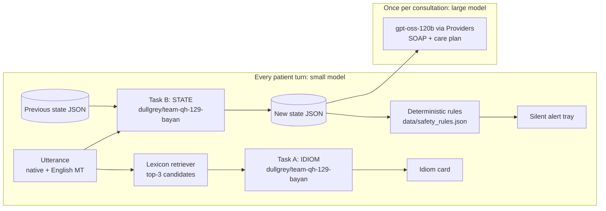
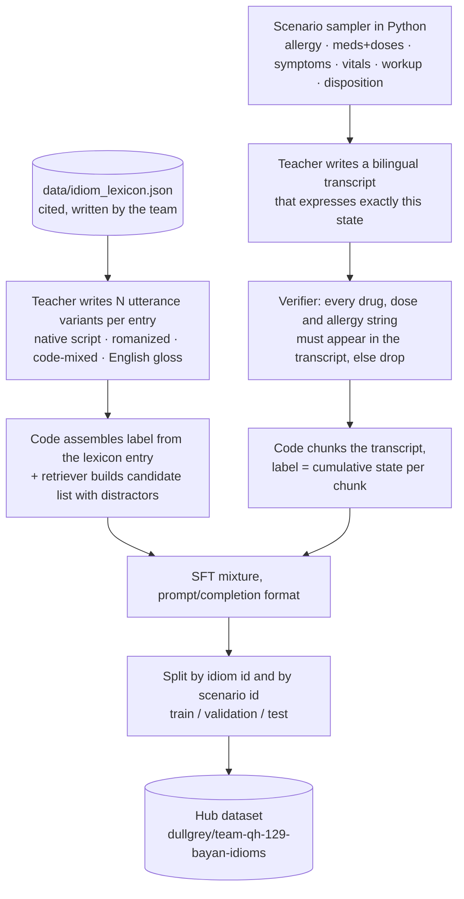

# 06 · Fine-Tuning Plan: What to Fine-Tune, How, and When to Stop

> **Question from the team:** "How would we fine-tune a model? What should we fine-tune?"
> **Short answer:** fine-tune **one small model, Qwen3-4B-Instruct-2507, with a LoRA adapter on HF Jobs** so that it does Bayan's two most frequent background tasks: reading cultural idioms and keeping the consultation state up to date. Build the training data **label-first** from our literature-sourced idiom lexicon and from scenarios our code generates, so no clinical fact is invented by an LLM. Publish the dataset and the model with cards. If any gate below goes red, ship **inference-only**. The product works either way.
>
> **Read with:** [03 Architecture](03-architecture.md) (think loop) · [05 Clinical Safety & Cultural Intelligence](05-clinical-safety-and-cultural-intelligence.md) (lexicon and rules) · [07 Compute Budget & Efficiency](07-compute-budget-and-efficiency.md) (money) · [08 Build Plan](08-build-plan.md) (team schedule)

---

## 0. TL;DR for the team

| | Decision |
|---|---|
| **What** | `dullgrey/team-qh-129-bayan`: a multi-task LoRA on **Qwen/Qwen3-4B-Instruct-2507**. Task A: **idiom → clinical note** (JSON). Task B: **transcript turns → updated consultation state** (JSON). |
| **Why** | These tasks run on **every patient turn**, so they are the calls worth making small, fast and cheap. Both have a fixed JSON schema, which small models learn well. The rare, high-stakes generation (SOAP note, care plan) stays on a large open model, called once per consultation. |
| **Data** | About 3,500–4,500 synthetic examples. **Labels come from `data/idiom_lexicon.json` and from sampled scenarios, not from the LLM.** The teacher LLM (`openai/gpt-oss-120b` via Inference Providers) only writes the surface text: utterances and transcripts. |
| **Compute** | Data: Inference Providers, about $1–3. Training: **HF Jobs `a100-large` ($2.50/h)**, a 20-minute smoke test plus a run of 60 minutes or less. Eval: `l4x1` ($0.80/h). **All-in, about $6–10, capped at $14** (see [07](07-compute-budget-and-efficiency.md)). |
| **Serving** | A scale-to-zero Inference Endpoint (L4), or ZeroGPU if the captain's account qualifies, or GGUF + llama.cpp for the offline story. The fallback is the same prompt on `gpt-oss-120b` via Providers. |
| **Time** | About 7 focused hours for one engineer, run **in parallel** with the main build. Hard stop for new training jobs: **Sat 03:00 Doha**. |
| **Fallback** | Inference-only: lexicon RAG plus a large model via Providers. We still publish the **dataset** (Use-of-HF points) and the eval harness. |

---

## 1. Should we fine-tune at all?

Fine-tuning is optional in this hackathon ([handbook](https://huggingface.co/spaces/qai-hackathon/handbook): *"Fine-tune only if your project needs it"*). Bayan has a real reason to, but not for the reason most teams assume.

- **Not for knowledge.** A 4B model will not learn medicine from 4,000 synthetic rows, and we have no clinician to validate it. All clinical meaning stays in the **cited lexicon** and the **deterministic rules** ([05](05-clinical-safety-and-cultural-intelligence.md)).
- **For behaviour on a narrow, repeated task.** The task is: always emit valid JSON in our schema; copy red flags from the retrieved lexicon entry instead of paraphrasing them away; say "no match" instead of inventing an idiom; and carry an allergy from turn 2 to turn 30 without dropping it. This is format and attention discipline, which is exactly what LoRA SFT is good at.
- **For efficiency.** The think loop runs on every utterance ([03 §2](03-architecture.md)). A 4B model that uses **incremental state** sends about 700 input tokens per call, compared with about 3,000 when the whole transcript is re-sent to a 120B model. A 4B model also runs on one hospital GPU or a laptop, which is the sovereign / on-prem story (Qatar's Personal Data Privacy Protection Law, [Law No. 13 of 2016](https://www.dlapiperdataprotection.com/?c=QA&t=law), treats health data as a special category).

Judging criteria this touches: **Use of HF** (Jobs, TRL, PEFT, Hub datasets and models, Endpoints, cards), **Efficiency** (right-sized model, measured cost), and **Technical execution** (a real eval, not vibes).

---

## 2. Candidates, evaluated

Scores run from 1 (poor) to 5 (strong). "Cost" and "Time" are estimates for *our* 20-hour window.

| Option | Demo value | Cost | Time | Risk | Data availability | Use-of-HF | Verdict |
|---|---|---|---|---|---|---|---|
| **(a) Idiom → clinical interpreter** (LoRA, 4B) | **5**: the visible "wow" card | ~$5–8 | ~6 h | Medium: labels must come from the cited lexicon | Synthetic, from our seed lexicon | 5 (dataset + model + Jobs) | **Yes, merged with (b)** |
| **(b) Clinical state extractor** (LoRA, 4B) | 4: invisible, but it powers the silent alerts and the cost story | shared with (a) | +1 h on top of (a) | **Low**: labels are generated by code, so they are correct by construction | Synthetic, label-first | 5 | **Yes, merged with (a)** |
| (c) Whisper ASR fine-tune (Nepali / Malayalam) | 2–3 | Several GPU-hours plus data prep (unverified) | 10 h+ | **High** | Yes, but read-speech and license-mixed (see below) | 4 | **No.** Evaluate existing checkpoints instead |
| (d) TTS fine-tune (e.g., Sinhala voice) | 2 | High (many GPU-hours) | 12 h+ | **High** | Partial | 3 | **No** |
| (e) Distil the care-plan writer | 2 | ~$5 | 6 h | **High**: native-language quality is unverifiable without speakers | Synthetic | 4 | **No** |

### Why not (c), ASR

- **Data exists, but it is not our domain.** [google/fleurs](https://huggingface.co/datasets/google/fleurs) (CC-BY-4.0) has `ne_np` and `ml_in` configs, but they are read Wikipedia sentences. [OpenSLR SLR54](https://www.openslr.org/54/) (Nepali, ~157K utterances) and [SLR63](https://www.openslr.org/63/) (Malayalam) are CC BY-SA 4.0. [ai4bharat/IndicVoices](https://huggingface.co/datasets/ai4bharat/IndicVoices) (CC-BY-4.0, gated) covers Nepali and Malayalam. **Common Voice is no longer on the Hub:** [since October 2025 it is distributed only via the Mozilla Data Collective](https://huggingface.co/datasets/mozilla-foundation/common_voice_17_0).
- **We cannot measure the gain.** Word error rate (WER) on clinical, accented, noisy speech needs a native-speaker-transcribed test set. We do not have one, and we cannot build one in 20 hours.
- **Community fine-tunes already exist**, for example [vrclc/Whisper-small-Malayalam](https://huggingface.co/vrclc/Whisper-small-Malayalam) and [aamoshdahal/whisper-small-nepali](https://huggingface.co/aamoshdahal/whisper-small-nepali). The cheaper move is to **A/B them against `whisper-large-v3`** on 20 recorded golden-path utterances. We have not checked their quality.
- The LLM layer already absorbs some ASR noise: it sees ASR confidence and asks for clarification.

### Why not (d), TTS

[MMS-TTS has no Sinhala, Nepali or Pashto checkpoint](https://huggingface.co/facebook) (checked via the Hub API on 2026-11-06; see [04 §4.4](04-models-and-languages.md)). [ai4bharat/indic-parler-tts](https://huggingface.co/ai4bharat/indic-parler-tts) covers Nepali officially, so the Tier-1 gap is closed without training. A Sinhala voice could be trained on [OpenSLR SLR30](https://www.openslr.org/30/) (Sinhala multi-speaker TTS, CC BY-SA 4.0). That needs many GPU-hours and native-speaker listening tests, so it is out of scope. The product falls back to large-type native script plus the PDF ([03 §9](03-architecture.md)).

### Why not (e), care-plan distillation

The care plan is generated **once per consultation**. With a large open model that costs about $0.002 (see [07](07-compute-budget-and-efficiency.md)), so there is little to save. Its output is patient-facing text in Nepali or Malayalam, and nobody on the team can judge a small model's fluency in those languages. This is the wrong place to cut.

---

## 3. Recommendation: one model, two tasks



**Base model: [`Qwen/Qwen3-4B-Instruct-2507`](https://huggingface.co/Qwen/Qwen3-4B-Instruct-2507)**, checked on 2026-11-06 via the Hub API:

- **Apache-2.0** and ungated, so there is no license friction for a public model.
- A text-only `Qwen3ForCausalLM` with 4.02B parameters. It is the best-trodden path for TRL, PEFT, vLLM and llama.cpp. GGUF builds already exist (for example [unsloth/Qwen3-4B-Instruct-2507-GGUF](https://huggingface.co/unsloth/Qwen3-4B-Instruct-2507-GGUF), where Q4_K_M is 2.5 GB), so our merged model will convert the same way.
- **Non-thinking only.** Its card says it "does not generate `<think></think>` blocks". That means no reasoning tokens are billed or awaited on every turn, which matters for the think-loop latency budget (≤ 5 s).
- Its card cites gains in "long-tail knowledge coverage across multiple languages". We do **not** depend on its Nepali or Malayalam skill: the input always includes the English machine translation.

| Alternative base | Why not first choice |
|---|---|
| [Qwen/Qwen3.5-4B](https://huggingface.co/Qwen/Qwen3.5-4B) (Apache-2.0, claims 201 languages) | It is an `image-text-to-text` model with a vision encoder and **thinks by default**. It is newer, with more tooling risk at 2 a.m. It is a good v2 candidate if multilingual input matters more. |
| [google/gemma-3-4b-it](https://huggingface.co/google/gemma-3-4b-it) | Gated (license acceptance) under the Gemma license, so it adds friction for judges and for re-use. |
| [meta-llama/Llama-3.2-3B-Instruct](https://huggingface.co/meta-llama/Llama-3.2-3B-Instruct) | Gated. Its official languages are en, de, fr, it, pt, hi, es, th. |
| [QCRI/Fanar-1-9B-Instruct](https://huggingface.co/QCRI/Fanar-1-9B-Instruct) (Apache-2.0, ar/en) | It is the best **Qatar** story, but it is 8.8B parameters (about 2× the train and serve cost) and its card lists only Arabic and English, while our input includes Nepali, Malayalam and other languages. **Use Fanar at inference time for the Arabic doctor side** ([04](04-models-and-languages.md)) instead. |
| [Qwen/Qwen3-1.7B](https://huggingface.co/Qwen/Qwen3-1.7B) | Keep it as a **CPU fallback** if the 4B GGUF is too slow on CPU. The same recipe applies; change `BASE_MODEL`. |

**Why one model and not two:** one training run, one eval, one endpoint, one model card. A task tag in the system prompt (`TASK: IDIOM` or `TASK: STATE`) switches the behaviour.

---

## 4. Output contracts (what the model must emit)

These schemas are the contract with the app ([03](03-architecture.md)) and with the rules engine ([05](05-clinical-safety-and-cultural-intelligence.md)). Keep the key names exactly as written here.

### Task A: IDIOM

Input (user message, JSON):

```json
{
  "utterance": "मेरो मुटु थिचिए जस्तो छ",
  "lang": "ne",
  "translation_en": "My heart feels like it is being pressed",
  "context": {"symptoms_so_far": ["chest discomfort"], "age_band": "30-39", "sex": "M"},
  "candidates": [
    {"id": "ne-001", "literal_en": "...", "clinical_interpretations": ["..."], "masks_red_flags": ["..."], "clarifying_questions_en": ["..."]},
    {"id": "hi-014", "...": "..."},
    {"id": "ne-007", "...": "..."}
  ]
}
```

The Nepali utterance above is a placeholder shape, not a vetted lexicon entry. Real strings come from `data/idiom_lexicon.json`.

Output (assistant message, JSON only):

```json
{
  "idiom_id": "ne-001",
  "literal_translation": "My heart feels pressed/squeezed",
  "clinical_note": "Possible idiom ne-001. In the cited sources this expression is commonly used for ... Consider ... This is not a diagnosis.",
  "differential": ["<copied from lexicon clinical_interpretations>"],
  "red_flags": ["<copied verbatim from lexicon masks_red_flags>"],
  "ask_next": ["<1-2 items from lexicon clarifying_questions_en>"]
}
```

Rules the data teaches:

1. `idiom_id` must be one of the candidate ids, or `null`. When it is `null`, `differential`, `red_flags` and `ask_next` are `[]` and the `clinical_note` says "No lexicon match. Literal meaning only."
2. `red_flags` are **copied verbatim** from the matched entry. Red-flag recall is our primary safety metric.
3. Hedged language only ("may", "consider", "commonly used for"). Never "the patient has ...".

### Task B: STATE

Input: `{"state": <previous state JSON>, "new_turns": [{"speaker": "patient", "lang": "ne", "text": "...", "en": "..."}, {"speaker": "doctor", "lang": "ar", "text": "...", "en": "..."}]}`

Output: the **full updated state**. A full state is easier to validate than a diff and is still short.

```json
{
  "allergies": [{"substance": "penicillin", "reaction": "rash", "evidence_turn": 3}],
  "medications": [{"name": "amoxicillin", "dose": 500, "unit": "mg", "route": "oral", "frequency": "TID", "status": "proposed", "evidence_turn": 28}],
  "symptoms": [{"name": "chest pain", "onset": "2 days", "severity": "severe", "idiom_id": "ne-001", "evidence_turn": 5}],
  "vitals": {"bp": null, "hr": null, "temp_c": null, "spo2": null, "rr": null},
  "investigations": [{"name": "ECG", "status": "not_done"}],
  "disposition": "discharge"
}
```

`status` for medications is one of `current | proposed | stopped`. For investigations it is one of `ordered | done | not_done`. `disposition` is one of `null | discharge | admit | refer | observe`. The rules engine, not the model, decides whether amoxicillin plus a penicillin allergy is an alert.

---

## 5. Data recipe: label-first synthetic generation

The team has no medical person. So **the LLM never decides what is clinically true**. It only writes text that *expresses* labels which our code already holds.



### Target sizes (scale with the lexicon size)

| Slice | Count | Purpose |
|---|---|---|
| A1. Idiom positives | entries × ~24 variants (for example 60 × 24 ≈ 1,440) | Map many surface forms to the right entry |
| A2. Correct entry **absent** from candidates | ~15% of A | Teach `idiom_id: null` (no hallucinated idioms) |
| A3. Literal, non-idiomatic symptom talk | ~400 | Do not over-fire |
| A4. Red-flag contrast pairs | ~200 | For example "pressing heart" with exertional sweating: the red flags must survive |
| B1. State chunks | ~300 scenarios × 4–6 chunks ≈ 1,500 | Incremental state tracking |
| B2. Traps (subset of B1) | ~30% | Allergy said early in the patient's language; negations ("no allergies", "I stopped metformin"); doses in words ("five hundred milligram"); mg vs g; Arabic doctor lines; corrections ("sorry, 250 not 500") |

**Splits:** hold out **whole idiom ids** (about 15% of entries) and **whole scenarios**, so the test set measures generalisation, not memorisation. Report "seen idiom, new phrasing" and "unseen idiom (must return null)" separately.

**Generation cost:** about 1M input and 1.5–3M output tokens with `gpt-oss-120b`. That is about $0.80 on Novita or $2.40 on Groq at the live router prices on 2026-11-06 (see [07](07-compute-budget-and-efficiency.md)). Reasoning tokens count as output, so we set `reasoning_effort` low where the provider supports it.

### `training/gen_data.py` (outline you can run)

Run it locally with `LIMIT=5` first. Then run the full job on HF Jobs `cpu-basic` ($0.01/h) so laptops can close.

```python
# /// script
# requires-python = ">=3.11"
# dependencies = ["huggingface_hub>=1.0", "datasets>=3", "rapidfuzz>=3"]
# ///
"""Bayan SFT data, label-first.
Clinical content comes ONLY from the lexicon (cited) and from the Python scenario sampler.
The teacher LLM writes surface text (utterances, transcripts); it never writes labels."""
import json, os, random, re
from concurrent.futures import ThreadPoolExecutor
from datasets import Dataset, DatasetDict
from huggingface_hub import InferenceClient
from rapidfuzz import process, fuzz

random.seed(13)
TEACHER  = os.getenv("TEACHER", "openai/gpt-oss-120b")
PROVIDER = os.getenv("PROVIDER", "novita")        # check live prices: https://router.huggingface.co/v1/models
REPO     = os.environ["DATASET_REPO"]             # dullgrey/team-qh-129-bayan-idioms
LEXICON  = os.getenv("LEXICON", "data/idiom_lexicon.json")
N_VAR    = int(os.getenv("N_VARIANTS", 24))
N_SCEN   = int(os.getenv("N_SCENARIOS", 300))
LIMIT    = int(os.getenv("LIMIT", 0))             # >0 = smoke test
client = InferenceClient(provider=PROVIDER, api_key=os.environ["HF_TOKEN"])

SYS_IDIOM = "TASK: IDIOM. You are Bayan's idiom reader. Output JSON only, schema v1. Use only the candidate entries. Hedge; never diagnose."
SYS_STATE = "TASK: STATE. Update the consultation state from the new turns. Output the full state JSON only, schema v1. Never invent facts."

def teacher_json(system, user, schema, max_tokens=6000):
    r = client.chat_completion(
        model=TEACHER, max_tokens=max_tokens, temperature=0.9,
        messages=[{"role": "system", "content": system}, {"role": "user", "content": user}],
        response_format={"type": "json_schema", "json_schema": {"name": "out", "schema": schema, "strict": True}},
    )
    return json.loads(r.choices[0].message.content)

# ---------- Task A ----------
VARIANTS_SCHEMA = {"type": "object", "additionalProperties": False, "required": ["variants"],
  "properties": {"variants": {"type": "array", "items": {"type": "object", "additionalProperties": False,
    "required": ["text", "form", "translation_en"],
    "properties": {"text": {"type": "string"}, "translation_en": {"type": "string"},
                   "form": {"type": "string", "enum": ["native", "romanized", "code_mixed", "english_gloss"]}}}}}}

def variants_for(entry):
    prompt = (f"Language: {entry['language']}. Idiom (native): {entry.get('native')}. Romanized: {entry.get('romanized')}. "
              f"Literal English: {entry['literal_en']}.\nWrite {N_VAR} different ways a patient might say this in a clinic, "
              "mixing native script, romanized, code-mixed with English, and an English gloss. Vary register and add "
              "short everyday context. Do NOT add any medical interpretation. Give a faithful English translation of each.")
    return teacher_json("You write realistic patient speech. No medical advice.", prompt, VARIANTS_SCHEMA)["variants"]

def label_from_entry(e, translation_en):
    interp = [i if isinstance(i, str) else i.get("meaning", str(i)) for i in e.get("clinical_interpretations", [])]
    return {"idiom_id": e["id"], "literal_translation": translation_en,
            "clinical_note": (f"Possible idiom {e['id']} ({e.get('romanized') or e.get('native')}, literally "
                              f"'{e['literal_en']}'). In the cited sources it is commonly used for: {'; '.join(interp)}. "
                              "Clarify before concluding. This is not a diagnosis."),
            "differential": interp, "red_flags": list(e.get("masks_red_flags", [])),
            "ask_next": list(e.get("clarifying_questions_en", []))[:2]}

NULL_LABEL = lambda tr: {"idiom_id": None, "literal_translation": tr,
    "clinical_note": "No lexicon match. Literal meaning only.", "differential": [], "red_flags": [], "ask_next": []}

def candidates(lex, query, gold=None, k=3, drop_gold=False):
    # same cheap retriever as the app (swap for intfloat/multilingual-e5-small embeddings if the app uses them)
    keys = {e["id"]: f"{e.get('native','')} {e.get('romanized','')} {e['literal_en']}" for e in lex}
    ranked = [key for _, _, key in process.extract(query, keys, scorer=fuzz.token_set_ratio, limit=k + 3)]  # dict -> (text, score, key)
    ids = [i for i in ranked if not (drop_gold and i == gold)][:k]
    if gold and not drop_gold and gold not in ids:
        ids[-1] = gold
    random.shuffle(ids)
    by_id = {e["id"]: e for e in lex}
    keep = ("id", "literal_en", "clinical_interpretations", "masks_red_flags", "clarifying_questions_en")
    return [{f: by_id[i].get(f) for f in keep} for i in ids]

def idiom_rows(lex):
    rows = []
    entries = lex[:LIMIT] if LIMIT else lex
    with ThreadPoolExecutor(8) as ex:
        for e, vs in zip(entries, ex.map(variants_for, entries)):
            for v in vs:
                drop = random.random() < 0.15                         # A2: gold absent -> must say null
                inp = {"utterance": v["text"], "lang": e["language"], "translation_en": v["translation_en"],
                       "context": {}, "candidates": candidates(lex, v["text"] + " " + v["translation_en"], e["id"], drop_gold=drop)}
                out = NULL_LABEL(v["translation_en"]) if drop else label_from_entry(e, v["translation_en"])
                rows.append({"task": "idiom", "group": e["id"], "prompt": [
                    {"role": "system", "content": SYS_IDIOM}, {"role": "user", "content": json.dumps(inp, ensure_ascii=False)}],
                    "completion": [{"role": "assistant", "content": json.dumps(out, ensure_ascii=False)}]})
    return rows   # add A3 (literal talk -> NULL_LABEL) and A4 (red-flag contrasts) the same way

# ---------- Task B ----------
ALLERGIES = [None, ("penicillin", "rash"), ("sulfa drugs", "hives"), ("ibuprofen", "wheeze")]
FORMULARY = [("amoxicillin", [250, 500]), ("paracetamol", [500, 1000]), ("omeprazole", [20, 40]), ("metformin", [500, 850])]
# Doses here are only extraction targets. Dose CEILINGS live in data/safety_rules.json (cited), never in the model.

def sample_state():
    a = random.choice(ALLERGIES)
    meds = []
    for name, doses in random.sample(FORMULARY, k=random.randint(1, 3)):
        dose = random.choice(doses) * (10 if random.random() < 0.1 else 1)  # 10% deliberate 10x anomaly
        meds.append({"name": name, "dose": dose, "unit": "mg", "route": "oral",
                     "frequency": random.choice(["OD", "BD", "TID"]), "status": random.choice(["current", "proposed"])})
    return {"allergies": [{"substance": a[0], "reaction": a[1]}] if a else [], "medications": meds,
            "symptoms": [{"name": random.choice(["chest pain", "epigastric pain", "fever", "back pain", "headache"])}],
            "vitals": {"bp": None, "hr": None, "temp_c": None, "spo2": None, "rr": None},
            "investigations": [{"name": random.choice(["ECG", "troponin", "urinalysis"]), "status": random.choice(["ordered", "not_done"])}],
            "disposition": random.choice([None, "discharge", "admit", "refer"])}

TRANSCRIPT_SCHEMA = {"type": "object", "additionalProperties": False, "required": ["turns"],
  "properties": {"turns": {"type": "array", "items": {"type": "object", "additionalProperties": False,
    "required": ["speaker", "lang", "text", "en"],
    "properties": {"speaker": {"type": "string", "enum": ["doctor", "patient"]}, "lang": {"type": "string"},
                   "text": {"type": "string"}, "en": {"type": "string"}}}}}}

def transcript_for(state, patient_lang, doctor_lang):
    p = (f"Write a 16-24 turn outpatient consultation. Doctor speaks {doctor_lang}; patient speaks {patient_lang}. "
         f"Every fact in this JSON must be stated explicitly (doses as numbers or words), facts may come in any order, "
         f"allergy early, prescriptions late; include at least one negation or correction. Do not add other drugs, "
         f"allergies or doses. Give an English translation 'en' for every turn.\nSTATE: {json.dumps(state)}")
    return teacher_json("You write realistic clinic dialogue for software testing.", p, TRANSCRIPT_SCHEMA)["turns"]

def verify(state, turns):
    blob = " ".join(t["en"].lower() for t in turns)
    names = [m["name"] for m in state["medications"]] + [a["substance"] for a in state["allergies"]]
    return all(n.split()[0] in blob for n in names)       # drop the sample if any fact is missing

# state_rows(): for each sampled state -> transcript_for -> verify -> split turns into 4-6 chunks ->
#   label for chunk k = facts whose evidence turn <= end of chunk k (track evidence_turn by locating each fact's
#   first mention in the 'en' text) -> rows {"task": "state", "group": scenario_id, "prompt": [...SYS_STATE...], "completion": [...]}

if __name__ == "__main__":
    lex = json.load(open(LEXICON))
    rows = idiom_rows(lex)  # + state_rows()
    held = {g for g in {r["group"] for r in rows} if random.random() < 0.15}   # group-level holdout
    ds = DatasetDict({
        "train": Dataset.from_list([r for r in rows if r["group"] not in held]),
        "test":  Dataset.from_list([r for r in rows if r["group"] in held]),
    })
    ds.push_to_hub(REPO, config_name="idiom_sft", private=False)   # push state rows with config_name="state_sft"
```

Launch the full generation on HF Jobs, with the local `data/` folder mounted ([Jobs guide](https://huggingface.co/docs/huggingface_hub/guides/jobs)):

```bash
export DATASET_REPO=dullgrey/team-qh-129-bayan-idioms
hf jobs uv run --flavor cpu-basic --timeout 60m --secrets HF_TOKEN \
  -e DATASET_REPO=$DATASET_REPO -e LEXICON=/data/idiom_lexicon.json \
  -v ./data:/data --name bayan-gen --detach training/gen_data.py
```

**Quality gate (human, 20 minutes):** two engineers each read 25 random rows. A row passes only if (1) the label matches the lexicon entry or sampled state exactly, (2) the utterance or transcript actually expresses it, and (3) the teacher text adds no medical claim. Any failure pattern goes into the prompt, and that slice is regenerated.

### Dataset card (`README.md` of `dullgrey/team-qh-129-bayan-idioms`)

```markdown
---
license: cc-by-4.0
language: [en, ar, ne, hi, ur, bn, tl, ml]
task_categories: [text-generation]
tags: [qai-hf-hackathon-2026, synthetic, healthcare, medical-interpretation, cultural-idioms, qatar, structured-output]
size_categories: [1K<n<10K]
configs:
  - config_name: lexicon
    data_files: lexicon/*.json
  - config_name: idiom_sft
    data_files: [{split: train, path: idiom_sft/train-*}, {split: test, path: idiom_sft/test-*}]
  - config_name: state_sft
    data_files: [{split: train, path: state_sft/train-*}, {split: test, path: state_sft/test-*}]
---
# Bayan Cultural Idioms & Consultation-State SFT (Qai x HF Hackathon 2026, Doha)

**What:** (1) a cited lexicon of somatic and cultural idioms used by migrant-worker communities in Qatar
(Nepali, Hindi, Urdu, Bengali, Tagalog, Malayalam, ...); (2) synthetic SFT pairs for idiom -> clinical-note JSON
and bilingual transcript -> consultation-state JSON.

**How it was made (label-first):** clinical content comes only from the lexicon, where every entry cites its source,
and from a Python scenario sampler. `openai/gpt-oss-120b` (via HF Inference Providers) wrote only surface text:
utterance variants and transcripts. A verifier dropped any transcript missing a labelled fact.
Splits hold out whole idiom ids and whole scenarios.

**Not reviewed by clinicians.** Decision-support research data, not medical advice. Native-language text is
machine-generated unless marked `verified_by_native_speaker: true`.

**Intended use:** training and evaluating small models that flag idioms and track consultation state, with a doctor in the loop.
**Out of scope:** diagnosis, triage without a clinician, any real patient data (none is included).

**Built with:** HF Inference Providers, HF Jobs, `datasets`. Part of Bayan AI: [dullgrey/team-qh-129-bayan-app](https://huggingface.co/spaces/dullgrey/team-qh-129-bayan-app).
```

---

## 6. Training on HF Jobs

### Hardware choice (live prices from `hf jobs hardware`, 2026-11-06)

| Flavor | GPU | $/h | Fit for a 4B LoRA (bf16) |
|---|---|---|---|
| `a10g-large` | A10G 24 GB | 1.50 | Fits with gradient checkpointing (Unsloth lists **8 GB for 3B and 19 GB for 7B** with 16-bit LoRA, [requirements](https://unsloth.ai/docs/get-started/fine-tuning-for-beginners/unsloth-requirements)). Slower. |
| `l40sx1` | L40S 48 GB | 1.80 | Good middle option |
| **`a100-large`** | **A100 80 GB** | **2.50** | **Pick this one.** It should be well over 1.7× faster than A10G on this workload, so it is cheaper per run *and* saves wall-clock time, which is our scarcest resource (estimate, confirmed by the smoke test). |
| `h200` | H200 141 GB | 5.00 | Overkill |

**Time and cost estimate (unverified until the smoke test):** about 3,600 train rows × 2 epochs ÷ effective batch 16 = **450 steps** at about 600–800 tokens per row. On an A100 we expect roughly **20–40 minutes**, which is **$0.85–1.70**. The smoke test prints seconds per step. Multiply by 450 and add about 5 minutes for model download and push before you set `--timeout`.

### `training/train.py`

```python
# /// script
# requires-python = ">=3.11"
# dependencies = ["trl>=1.17", "peft>=0.17", "transformers>=5.0", "datasets>=3", "accelerate", "trackio"]
#
# [tool.hf-jobs]
# flavor = "a100-large"
# timeout = "90m"
# secrets = ["HF_TOKEN"]
# ///
import os, torch
from datasets import load_dataset, concatenate_datasets
from peft import LoraConfig
from trl import SFTConfig, SFTTrainer

BASE  = os.getenv("BASE_MODEL", "Qwen/Qwen3-4B-Instruct-2507")
DATA  = os.environ["DATASET_REPO"]                 # dullgrey/team-qh-129-bayan-idioms
OUT   = os.environ["MODEL_REPO"]                   # dullgrey/team-qh-129-bayan
STEPS = int(os.getenv("MAX_STEPS", "-1"))          # 30 = smoke test
SMOKE = STEPS > 0

def load(cfg):
    d = load_dataset(DATA, cfg)["train"].train_test_split(test_size=0.05, seed=13)  # validation from train; 'test' stays untouched
    return d["train"], d["test"]
(ia, iv), (sa, sv) = load("idiom_sft"), load("state_sft")
cols = ["prompt", "completion"]                    # conversational prompt-completion -> loss on completion only (TRL default)
train = concatenate_datasets([ia, sa]).shuffle(seed=13).select_columns(cols)
val   = concatenate_datasets([iv, sv]).select_columns(cols)

args = SFTConfig(
    output_dir="bayan-lora",
    model_init_kwargs={"dtype": torch.bfloat16},   # TRL loads float32 unless told otherwise
    num_train_epochs=2, max_steps=STEPS,
    per_device_train_batch_size=4, gradient_accumulation_steps=4,      # effective batch 16
    learning_rate=2e-4, lr_scheduler_type="cosine", warmup_steps=20, weight_decay=0.0,
    max_length=2048, bf16=True, gradient_checkpointing=True,
    logging_steps=5, eval_strategy="steps", eval_steps=50, per_device_eval_batch_size=8,
    save_strategy="steps", save_steps=100, save_total_limit=2,
    push_to_hub=True, hub_model_id=OUT + ("-smoke" if SMOKE else "-lora"),
    hub_strategy="checkpoint",                    # last checkpoint survives a timeout (Job disk is wiped)
    report_to="trackio" if os.getenv("TRACKIO_SPACE_ID") else "none",
    run_name=f"bayan-{os.getenv('JOB_ID', 'local')}",
)
peft_cfg = LoraConfig(r=16, lora_alpha=32, lora_dropout=0.05, target_modules="all-linear", task_type="CAUSAL_LM")

trainer = SFTTrainer(model=BASE, args=args, train_dataset=train, eval_dataset=val, peft_config=peft_cfg)
trainer.train()
trainer.push_to_hub(commit_message="Bayan LoRA adapter")          # adapter repo: <OUT>-lora

if not SMOKE:                                                     # merged weights = the official model repo
    merged = trainer.model.merge_and_unload()                     # easier to serve: vLLM, Endpoints, GGUF
    merged.push_to_hub(OUT, commit_message="Merged Bayan weights (bf16)")
    trainer.processing_class.push_to_hub(OUT)
print("DONE", trainer.state.global_step, "steps")
```

Notes on the choices:

- **Prompt-completion format**, so TRL computes loss on the completion only by default ([SFT docs](https://huggingface.co/docs/trl/sft_trainer)). There is no chat-template patching to debug.
- **`r=16`, `all-linear`, LR `2e-4`**. This is a standard LoRA recipe (TRL's docs suggest about 1e-4 for adapters). If the validation loss is still dropping at the end, a second run at 3 epochs is cheap.
- **`max_length=2048`**: STATE prompts carry the previous state plus 2–4 turns. Long transcripts are never sent whole, which is the efficiency point.
- **`hub_strategy="checkpoint"`** follows the handbook's warning that the Job's disk is wiped when it ends ([TRL Jobs guide](https://huggingface.co/docs/trl/main/en/jobs_training)).

### Launch commands (copy and paste)

```bash
export DATASET_REPO=dullgrey/team-qh-129-bayan-idioms
export MODEL_REPO=dullgrey/team-qh-129-bayan

# 0) see prices and the flavor list (prints $/min and $/hour)
hf jobs hardware

# 1) smoke test: 30 steps, hard 20-minute ceiling (~$0.83 max on a100-large)
hf jobs uv run --flavor a100-large --timeout 20m --secrets HF_TOKEN \
  -e DATASET_REPO=$DATASET_REPO -e MODEL_REPO=$MODEL_REPO -e MAX_STEPS=30 \
  --name bayan-smoke --detach training/train.py

# 2) full run: set the timeout from the smoke test (s/step x 450 + 10 min), never "just make it huge"
hf jobs uv run --flavor a100-large --timeout 75m --secrets HF_TOKEN \
  -e DATASET_REPO=$DATASET_REPO -e MODEL_REPO=$MODEL_REPO \
  -e TRACKIO_SPACE_ID=dullgrey/team-qh-129-bayan-trackio \
  --name bayan-sft --detach training/train.py

# 3) watch, and kill if stuck
hf jobs logs -f <job_id>
hf jobs ps
hf jobs cancel <job_id>
```

If `a100-large` sits in scheduling for more than about 10 minutes, cancel it and relaunch on `a10g-large` with a doubled timeout. Trackio creates a public Space on the captain's account for the loss curves (the captain can create Gradio Spaces, see [07 §7](07-compute-budget-and-efficiency.md)). If that Space fails to start, drop `TRACKIO_SPACE_ID`. The logs still show the loss.

**Coding-agent shortcut:** `hf skills add huggingface-llm-trainer --global` installs the official HF skill that drives TRL on Jobs ([HF Skills](https://huggingface.co/docs/hub/en/agents-skills)). It is useful, but read every command it proposes before it spends credits.

**Unsloth?** TRL documents an Unsloth integration ("up to 2× faster with up to 70% less VRAM", [TRL docs](https://huggingface.co/docs/trl/sft_trainer)). At about $1–2 per run the saving is small and the dependency risk at night is not, so we use plain TRL + PEFT. Revisit for v2.

---

## 7. Evaluation (what makes this fine-tune credible)

We compare **three systems on the same held-out test split**, with the same prompts:

1. **Base** `Qwen/Qwen3-4B-Instruct-2507` (zero-shot with schema, run in the eval Job)
2. **Fine-tuned** `dullgrey/team-qh-129-bayan`
3. **Teacher** `openai/gpt-oss-120b` via Providers (the inference-only fallback)

| Metric | Task | How | Ship bar for FT |
|---|---|---|---|
| JSON validity | both | `json.loads` + required keys + enums | **≥ 98%** |
| `idiom_id` accuracy (seen idioms, new phrasing) | A | exact match | ≥ base + 15 pts |
| Null precision on unseen / absent idioms | A | predicted `null` when gold is `null` | ≥ teacher − 5 pts |
| **Red-flag recall** | A | normalised exact match of each gold red flag | **≥ 0.95 and ≥ teacher** (safety metric) |
| Field micro-F1 | B | set F1 over normalised tuples: (allergy substance), (med name, dose, unit, status), (symptom), (investigation, status), (vital key=value), (disposition) | ≥ base + 10 pts |
| **Allergy recall** | B | gold allergies found in the final state | **= 1.0 on the trap slice**, or fall back for allergies |
| Dose exact match | B | numeric dose and unit equal | ≥ 0.95 |
| LLM-as-judge (n=100) | A | `gpt-oss-120b` rubric: faithful to the candidate entry (0/1), hedged / no diagnosis (0/1), harmful omission (0/1), overall 1–5 | mean ≥ 4, harmful = 0 |
| Latency p50 / p95 and $ per 1k calls | both | measured on the serving target | report it (feeds [07](07-compute-budget-and-efficiency.md)) |

### `training/eval.py` (outline)

```python
# /// script
# requires-python = ">=3.11"
# dependencies = ["transformers>=5.0", "torch", "accelerate", "datasets>=3", "huggingface_hub>=1.0"]
#
# [tool.hf-jobs]
# flavor = "l4x1"
# timeout = "45m"
# secrets = ["HF_TOKEN"]
# ///
import json, os, time, torch
from datasets import load_dataset, concatenate_datasets
from huggingface_hub import HfApi, InferenceClient
from transformers import AutoTokenizer, AutoModelForCausalLM

MODEL, DATA, N = os.environ["EVAL_MODEL"], os.environ["DATASET_REPO"], int(os.getenv("N", 400))
test = concatenate_datasets([load_dataset(DATA, c, split="test") for c in ("idiom_sft", "state_sft")]).shuffle(seed=1).select(range(N))

tok = AutoTokenizer.from_pretrained(MODEL); tok.padding_side = "left"
model = AutoModelForCausalLM.from_pretrained(MODEL, dtype=torch.bfloat16, device_map="cuda")

def gen(prompts, bs=16):
    outs = []
    for i in range(0, len(prompts), bs):
        texts = [tok.apply_chat_template(p, tokenize=False, add_generation_prompt=True) for p in prompts[i:i + bs]]
        enc = tok(texts, return_tensors="pt", padding=True).to("cuda")
        with torch.no_grad():
            o = model.generate(**enc, max_new_tokens=512, do_sample=False)
        outs += [tok.decode(x[enc["input_ids"].shape[1]:], skip_special_tokens=True) for x in o]
    return outs

def parse(s):
    try: return json.loads(s.strip().strip("`").removeprefix("json"))   # tolerate a fenced reply
    except Exception: return None

norm = lambda s: " ".join(str(s).lower().split())
def tuples(st):
    t = {("allergy", norm(a.get("substance"))) for a in st.get("allergies", [])}
    t |= {("med", norm(m.get("name")), str(m.get("dose")), norm(m.get("unit")), m.get("status")) for m in st.get("medications", [])}
    t |= {("sym", norm(s.get("name"))) for s in st.get("symptoms", [])}
    t |= {("inv", norm(x.get("name")), x.get("status")) for x in st.get("investigations", [])}
    t |= {("vital", k, str(v)) for k, v in (st.get("vitals") or {}).items() if v is not None}
    t |= {("disp", st.get("disposition"))}
    return t

t0 = time.time(); preds = gen([r["prompt"] for r in test]); secs = time.time() - t0
m = {"model": MODEL, "n": N, "gen_seconds": round(secs, 1), "valid": 0, "idiom_acc": [], "rf_recall": [], "f1": [], "allergy_recall": []}
for r, p in zip(test, preds):
    gold, pred = json.loads(r["completion"][0]["content"]), parse(p)
    m["valid"] += pred is not None
    pred = pred or {}
    if r["task"] == "idiom":
        m["idiom_acc"].append(pred.get("idiom_id") == gold["idiom_id"])
        if gold["red_flags"]:
            g = {norm(x) for x in gold["red_flags"]}
            m["rf_recall"].append(len(g & {norm(x) for x in pred.get("red_flags", [])}) / len(g))
    else:
        g, q = tuples(gold), tuples(pred) if pred else set()
        tp = len(g & q); prec = tp / max(len(q), 1); rec = tp / max(len(g), 1)
        m["f1"].append(0 if tp == 0 else 2 * prec * rec / (prec + rec))
        ga = {x for x in g if x[0] == "allergy"}
        if ga: m["allergy_recall"].append(len(ga & q) / len(ga))
avg = lambda xs: round(sum(xs) / len(xs), 4) if xs else None
report = {k: (avg(v) if isinstance(v, list) else v) for k, v in m.items()}
report["valid"] = round(m["valid"] / N, 4)
print(json.dumps(report, indent=2))
name = MODEL.split("/")[-1]
HfApi().upload_file(path_or_fileobj=json.dumps(report, indent=2).encode(), path_in_repo=f"eval/{name}.json",
                    repo_id=DATA, repo_type="dataset")
# LLM-as-judge: send 100 idiom (input, candidates, prediction) triples to gpt-oss-120b via InferenceClient with a
# json_schema rubric {faithful:0|1, hedged:0|1, harmful_omission:0|1, overall:1-5}; store as eval/<name>-judge.json.
# Teacher baseline: same prompts through InferenceClient(provider="groq").chat_completion(model="openai/gpt-oss-120b").
```

```bash
for M in Qwen/Qwen3-4B-Instruct-2507 dullgrey/team-qh-129-bayan; do
  hf jobs uv run --flavor l4x1 --timeout 45m --secrets HF_TOKEN \
    -e EVAL_MODEL=$M -e DATASET_REPO=$DATASET_REPO --name eval-$(basename $M) --detach training/eval.py
done
```

**Be honest in the card.** The test set is synthetic and made by the same pipeline. It measures **schema discipline and lexicon fidelity**, not clinical accuracy. Say exactly that.

---

## 8. Model card (`dullgrey/team-qh-129-bayan`)

The handbook requires a card and the tag `qai-hf-hackathon-2026` on the model, and the Space must link to it.

```markdown
---
license: apache-2.0
base_model: Qwen/Qwen3-4B-Instruct-2507
library_name: transformers
pipeline_tag: text-generation
language: [en, ar, ne, hi, ur, bn, tl, ml]
datasets: [dullgrey/team-qh-129-bayan-idioms]
tags: [qai-hf-hackathon-2026, trl, sft, lora, peft, healthcare, medical-interpretation, structured-output, qatar]
---
# Bayan-4B: idiom reader + consultation-state tracker (Bayan AI)

Small background model for **Bayan AI**, a doctor-in-the-loop interpretation and safety bridge for multilingual
clinics in Qatar. Two JSON tasks, chosen by a system tag:
- `TASK: IDIOM`: patient idiom + retrieved lexicon candidates -> {idiom_id, literal_translation, clinical_note, differential, red_flags, ask_next}
- `TASK: STATE`: previous state + new bilingual turns -> full consultation state (allergies, meds+doses, symptoms, vitals, investigations, disposition)

**Decision support only. Not a diagnostic device. Not clinically validated.** Safety alerts are produced by
deterministic, cited rules on top of this model's extraction, never by the model alone.

## Training
LoRA (r=16, alpha=32, all-linear) SFT with TRL on HF Jobs (`a100-large`), 2 epochs, LR 2e-4, max_length 2048.
Adapter: `dullgrey/team-qh-129-bayan-lora`. This repo: merged bf16 weights.
Compute: <minutes> min on A100 = $<x.xx>. Data generation: $<y.yy> via Inference Providers.

## Evaluation (held-out synthetic split; whole idioms and scenarios held out)
| System | JSON valid | idiom acc | red-flag recall | state F1 | allergy recall | p50 latency | $/1k calls |
|---|---|---|---|---|---|---|---|
| Qwen3-4B-Instruct-2507 (base) | | | | | | | |
| **team-qh-129-bayan (this)** | | | | | | | |
| gpt-oss-120b (teacher, Providers) | | | | | | | |

## Limitations
Synthetic data, with clinical content limited to a cited lexicon that is not clinician-reviewed. Native-language
coverage depends on the base model; the app always supplies an English translation. Unknown idioms should return
`idiom_id: null`. Monitor this. Do not use with real patients without clinical validation and a data-protection review
(Qatar PDPPL, Law No. 13 of 2016).

## Use
Space: [dullgrey/team-qh-129-bayan-app](https://huggingface.co/spaces/dullgrey/team-qh-129-bayan-app). Serving: Inference Endpoint (vLLM, L4, scale-to-zero) or GGUF (llama.cpp).
```

Also add `models: [dullgrey/team-qh-129-bayan]` and `datasets: [dullgrey/team-qh-129-bayan-idioms]` to the Space README metadata, so the Hub links them ([Spaces overview](https://huggingface.co/docs/hub/spaces-overview)).

---

## 9. Serving it cheaply

Pick the first option that works for the captain's account. All prices are from the HF docs on 2026-11-06.

| Option | Cost | Latency | Notes |
|---|---|---|---|
| **A. Inference Endpoint, vLLM, 1× L4, scale-to-zero** | $0.80/h AWS, $0.70/h GCP ([pricing](https://huggingface.co/docs/inference-endpoints/pricing)), billed by the minute, $0 when scaled to zero | Fast once warm. A **cold start takes minutes, and the proxy returns 503** meanwhile ([autoscaling](https://huggingface.co/docs/inference-endpoints/guides/autoscaling)) | Default idle timeout is 1 h. Scheduled entries allow 15 min to 12 h. **Pre-warm 15 minutes before judging.** Send `X-Scale-Up-Timeout: 600` from the app. |
| **B. ZeroGPU Space** (Gradio) | $0 | Queue-dependent | Free personal accounts in good standing (verified email, **account older than 30 days**) can host up to 2 ZeroGPU Spaces. Quota is per *caller*: 5 min/day for free accounts, 40 min/day for PRO ([ZeroGPU](https://huggingface.co/docs/hub/spaces-zerogpu)). Hardware is half an RTX Pro 6000 (48 GB). |
| **C. GGUF + llama.cpp** | CPU Endpoint from $0.134/h (aws `intel-spr` x4), or the Space CPU, or a laptop | **Unverified. Measure before relying on it.** Expect CPU decoding of a 4B Q4 model to be much slower than a GPU | Convert the merged repo with [ggml-org/gguf-my-repo](https://huggingface.co/spaces/ggml-org/gguf-my-repo) (Q4_K_M). Inference Endpoints auto-select the [llama.cpp engine](https://huggingface.co/docs/inference-endpoints/engines/llama_cpp) for GGUF repos. Best used for the **"runs offline in the hospital"** slide, not the live think loop. |
| **D. Fallback: Providers** | per token | Fast | The same prompts on `openai/gpt-oss-120b`. The app switches by env var. |

Endpoint deploy (check the exact vendor, region and instance strings with `hf endpoints hardware`; the token needs Inference Endpoints permissions):

```bash
hf endpoints deploy bayan-4b --repo dullgrey/team-qh-129-bayan --framework vllm \
  --vendor aws --region us-east-1 --accelerator gpu --instance-type nvidia-l4 --instance-size x1 \
  --min-replica 0 --max-replica 1 --scale-to-zero-timeout 15
hf endpoints pause bayan-4b        # whenever nobody is testing
```

Bayan already needs one self-hosted GPU voice worker, because no Inference Provider serves Indic ASR/TTS ([04 §0](04-models-and-languages.md)). [07 §2](07-compute-budget-and-efficiency.md) budgets this model's Endpoint as a **second** L4. Co-locating both on one L40S (48 GB) is possible but untested.

App side: a single `small_llm(task, payload)` function with `BAYAN_SMALL_BACKEND=endpoint|zerogpu|provider`, a **4 s timeout** and **automatic fallback to D**. The think loop must never block the talk loop ([03](03-architecture.md)).

---

## 10. Timeline with go/no-go gates

T−20h ≈ **Fri 18:00 Doha**. Shift everything if you start later, but **gates G3 and the hard stop are absolute.** One engineer ("ML") owns this track. Everyone else follows [08](08-build-plan.md). The GPU training job waits for the main pipeline's Phase-1 checkpoint ([08 §4](08-build-plan.md)), but data generation does not, because the test set is also needed by the inference-only path.

| Time (Doha) | ML engineer does | Gate |
|---|---|---|
| Fri 18:00–19:00 | Captain checks: positive credit balance; whether the account can create Endpoints (Gradio Spaces on `cpu-upgrade` are already confirmed, [07 §7](07-compute-budget-and-efficiency.md)); token scopes (Endpoints need `inference.endpoints` permissions). Freeze the JSON schemas in §4 with the Brain owner. Create the dataset and model repos. | **G0:** Jobs run (`hf jobs run python:3.12 python -c "print(1)"`). Schemas frozen. |
| 19:00–20:30 | Write `gen_data.py`. Run `LIMIT=5` locally and review the rows. Start the **STATE** slice first, because it does not need the lexicon. | |
| 20:30–21:30 | Run full generation on Jobs (`cpu-basic`). Add the IDIOM slice as soon as `data/idiom_lexicon.json` has ≥ 30 cited entries. Do the 50-row human check. Push the dataset with its card. | **G1 (21:30):** ≥ 2,000 valid rows; spot-check pass rate ≥ 90%. **Red → inference-only. Still publish the dataset.** |
| 21:30–22:00 | Smoke test (30 steps, `a100-large`, 20 min timeout). | **G2 (22:00):** no OOM, loss going down, a `-smoke` repo was pushed. One fix allowed. A second failure means inference-only. |
| 22:00–23:15 | Full training run (detached). Meanwhile, write `eval.py` and run the **base** and **teacher** evals. | Friday-night soft submission: Space + dataset links. |
| 23:15–00:30 | Run the FT eval and the judge. Fill in the model card table. | **G3 (00:30):** ship bars in §7 met → FT becomes the primary think-loop model. Otherwise publish FT as "experimental" and run the demo on D. |
| 00:30–01:30 | Deploy (A or B). Convert to GGUF (C). Measure latency. Then **pause the Endpoint, `hf jobs ps` → nothing running.** | |
| **Sat 03:00** | **Hard stop: no new training jobs after this, whatever happens.** | |
| Sat 07:00–10:00 | Integrate behind the env switch. Golden-path rehearsal with the FT backend and the fallback backend. | 10:00 feature freeze ([08](08-build-plan.md)) |
| Sat 10:00–13:00 | Video uses whichever backend is green. Cards final. Links in the Space README. | Submit by 13:00 |

**Retry budget:** at most **one** extra full training run (for example 3 epochs, or fixed data), and only if it can finish before 03:00.

---

## 11. Fallback: inference-only (fully supported)

If any gate is red, Bayan keeps every feature:

- **Idioms:** the same retriever plus the same IDIOM prompt and JSON schema on `gpt-oss-120b` via Providers, triggered **only when the retriever's score passes a threshold**. That is a few calls per consultation, not one per turn.
- **State:** the same STATE prompt on a fast provider (for example `gpt-oss-120b` on Groq or Cerebras, whose router listings show ~420 and ~1,170 tokens/s). It still uses incremental state, so the token cost stays low.
- **What we still publish:** the dataset (lexicon + SFT + eval splits), the eval harness, and the base-vs-teacher numbers. That is a public good for Qatar's multilingual clinics, and it still earns Use-of-HF points.

---

## 12. Risks and mitigations

| Risk | Mitigation |
|---|---|
| The teacher invents clinical content | Label-first design. The verifier drops transcripts with missing facts. Lexicon entries must cite sources. Human spot-check at G1. |
| The model memorises idioms and hallucinates matches | Group-level holdout plus 15% "gold absent" rows. Track null precision. |
| Red flags are dropped (a safety regression) | Red-flag recall is a ship bar. The app also **unions** the model's red flags with the matched entry's `masks_red_flags`, so a regression can only add flags. |
| The job hangs and bills all night | Timeout from measured s/step. `--detach` plus `hf jobs ps` before sleeping. `hub_strategy="checkpoint"`. |
| A100 not available | Switch to `a10g-large` with a 2× timeout. |
| Endpoint cold start during the pitch | Pre-warm, `X-Scale-Up-Timeout`, a 4 s app timeout, then fall back to Providers. |
| The account cannot create Endpoints (Gradio Spaces on `cpu-upgrade` are confirmed) | Use ZeroGPU (if eligible), a GPU Space, or Providers. See [07 §7](07-compute-budget-and-efficiency.md). |

---

## Sources

- Hackathon handbook (rules, Jobs tips, naming, tag): https://huggingface.co/spaces/qai-hackathon/handbook
- HF Jobs guide (CLI, `uv run`, volumes, timeouts, secrets): https://huggingface.co/docs/huggingface_hub/guides/jobs · Jobs pricing: https://huggingface.co/docs/hub/jobs-pricing · live list: `hf jobs hardware` / `GET https://huggingface.co/api/jobs/hardware`
- TRL training on Jobs: https://huggingface.co/docs/trl/main/en/jobs_training · SFTTrainer (TRL v1.17.1): https://huggingface.co/docs/trl/sft_trainer
- Unsloth VRAM requirements: https://unsloth.ai/docs/get-started/fine-tuning-for-beginners/unsloth-requirements
- HF Skills: https://huggingface.co/docs/hub/en/agents-skills
- Inference Providers structured outputs: https://huggingface.co/docs/inference-providers/guides/structured-output · live model and price listing: https://router.huggingface.co/v1/models
- Inference Endpoints pricing: https://huggingface.co/docs/inference-endpoints/pricing · autoscaling / scale-to-zero: https://huggingface.co/docs/inference-endpoints/guides/autoscaling · llama.cpp engine: https://huggingface.co/docs/inference-endpoints/engines/llama_cpp
- ZeroGPU: https://huggingface.co/docs/hub/spaces-zerogpu · Spaces overview (paid-plan note): https://huggingface.co/docs/hub/spaces-overview
- Base model card: https://huggingface.co/Qwen/Qwen3-4B-Instruct-2507 · GGUF example: https://huggingface.co/unsloth/Qwen3-4B-Instruct-2507-GGUF · GGUF converter: https://huggingface.co/spaces/ggml-org/gguf-my-repo
- ASR data: https://huggingface.co/datasets/google/fleurs · https://www.openslr.org/54/ · https://www.openslr.org/63/ · https://huggingface.co/datasets/ai4bharat/IndicVoices · Common Voice move: https://huggingface.co/datasets/mozilla-foundation/common_voice_17_0 · Sinhala TTS data: https://www.openslr.org/30/
- Qatar PDPPL (Law No. 13 of 2016), summary: https://www.dlapiperdataprotection.com/?c=QA&t=law
