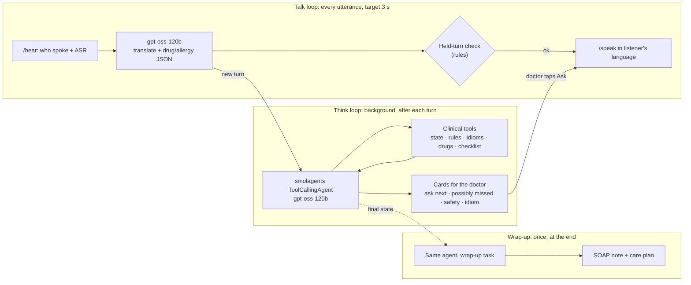

# 11 · The Clinical Copilot Agent: Bayan Thinks, Not Just Translates

> **One line:** besides translating, `gpt-oss-120b` runs as a **tool-using agent** built with Hugging Face's [**smolagents**](https://github.com/huggingface/smolagents). Like a coding agent working through a repo, it reads the consultation, keeps a checklist, calls grounded clinical tools, and **proposes** next steps: questions to ask, workup that may be missing, safety concerns. The doctor approves each one with one tap. It never speaks to the patient, prescribes, or diagnoses on its own.
>
> **Read with:** [03 · Architecture](03-architecture.md) (where the loops run) · [05 · Clinical Safety](05-clinical-safety-and-cultural-intelligence.md) (the rules and idioms it is grounded in) · [04 · Models](04-models-and-languages.md) · [07 · Budget](07-compute-budget-and-efficiency.md)
>
> **Status:** design. The talk loop (translation) is live; the agent is the next build step ([§11](#11-build-order)).

---

## 1. Why an agent, not just a translator

A perfect translator still leaves the doctor alone with the hard part: a rushed 5-minute consultation in which an idiom hides chest pain, an allergy mentioned at minute 1 collides with a prescription at minute 6, and nobody asked whether the pain spreads to the arm. Bayan's value is that it **notices**.

| Translation only | With the copilot agent |
|---|---|
| Says what was said | Also says **what wasn't**: "radiation of pain not asked", "no ECG yet" |
| Doctor must remember the allergy | Agent tracks it in the clinical state, and the rule engine flags the conflict |
| Idiom passed through literally | Agent looks it up and explains the clinical meaning and what it can mask |
| Doctor composes every follow-up question | Agent proposes the question, and **one tap** has Bayan ask it in Nepali |
| Notes written afterwards | Agent drafts the SOAP note and care plan from the state it has been keeping |

## 2. Where the agent runs: three loops, one brain

The **talk loop** stays fast and simple. The agent lives in the **think loop** and the **wrap-up loop**, so it can never slow the conversation down.



| Loop | Model use | Latency rule |
|---|---|---|
| Talk | One plain `gpt-oss-120b` call (translation + extraction) | Must finish in ~3 s; never waits for the agent |
| Think (agent) | `gpt-oss-120b` with tool calls, **at most 4 steps** per run | Cards arrive a few seconds after the turn; slow is fine, blocking is not |
| Wrap-up (agent) | Same agent, a different task | ~10–30 s, once per consultation |

## 3. How the agent works (the coding-agent analogy)

| A coding agent… | Bayan's copilot… |
|---|---|
| reads the repository | reads the **new transcript turns** plus the **structured clinical state** |
| keeps a todo list | keeps a **consultation checklist** (e.g. chest pain → ECG ☐ · troponin ☐ · BP ☐ · radiation asked ☐ · allergies asked ☑) |
| runs tools (search, tests) | runs **clinical tools** grounded in our curated data |
| proposes a diff for you to accept | proposes **cards** the doctor accepts or dismisses |
| never pushes without permission | **never speaks to the patient, prescribes or diagnoses** without the doctor's tap |
| remembers what you rejected | **dismissed cards are not repeated** |

**One run, step by step** (triggered after a turn, debounced ~1.5 s, at most one run in flight per session):

1. **Observe:** receive the new turns since the last run, the current state, the checklist and the list of dismissed cards.
2. **Update:** call `update_state` to merge new facts (allergies, meds and doses, symptoms, vitals, tests, disposition).
3. **Check:** call `check_safety_rules` (deterministic, 81 rules) and `lookup_idiom` for any idiom the patient used.
4. **Reason:** compare the state against the checklist and decide what is missing or worth asking.
5. **Act:** call `post_card` for each suggestion (deduplicated), then stop. The agent has a **hard cap of 4 steps per run**.

## 4. Tools

Every tool is a plain Python function registered with smolagents' `@tool` decorator. **Tools return data from our files, not from the model's memory**, which is what keeps the agent grounded.

| Tool | Signature (simplified) | Returns | Grounded in |
|---|---|---|---|
| `update_state` | `(new_turns: str) -> dict` | Merged clinical state: allergies, meds and doses, symptoms with first-mention time, vitals, investigations, disposition | Transcript (LLM extraction, strict JSON schema from [05 §2](05-clinical-safety-and-cultural-intelligence.md)) |
| `check_safety_rules` | `() -> list[dict]` | Fired rules with severity, message, quoted evidence and source URLs | `data/safety_rules.json` (deterministic engine) |
| `lookup_idiom` | `(phrase: str, lang: str) -> dict` | Literal meaning, likely clinical meanings, red flags it can mask, questions to ask, sources | `data/idiom_lexicon.json` (59 entries) |
| `lookup_drug` | `(name: str) -> dict` | Generic name, class, dose ceilings, key interactions, pregnancy notes | `safety_rules.json` meta and rules (FDA labels, NICE, etc.) |
| `get_checklist` | `() -> list[dict]` | Open and closed checklist items for the presenting complaints | Missing-workup rule family (chest pain, heat illness, abdominal pain 12–55, fever after travel, headache red flags, syncope…) |
| `post_card` | `(kind, title, body, evidence, ask_text=None) -> str` | Card ID, or "duplicate" | Shown on the doctor's screen only |
| `draft_note` | `() -> str` | English SOAP note from the final state (wrap-up only) | State + transcript |
| `draft_care_plan` | `(lang: str) -> dict` | Plain-language plan (meds and times, avoid, red flags, 999), translated with back-translation | State + rules (doses must pass `check_safety_rules`) |

Deliberately **not** tools: web search, free-form medical lookup, or anything that writes to the patient. The agent cannot reach outside our curated data during a consultation.

### Example tool (smolagents style)

```python
from smolagents import tool

@tool
def lookup_idiom(phrase: str, lang: str) -> dict:
    """Look up a patient's cultural idiom of distress in Bayan's curated lexicon.

    Args:
        phrase: The idiom as the patient said it (native script or romanized).
        lang: ISO 639-1 code of the patient's language, e.g. "ne".
    """
    entry = IDIOM_INDEX.best_match(phrase, lang)          # embedding + romanization match
    if entry is None:
        return {"match": None}
    return {k: entry[k] for k in ("id", "literal_en", "clinical_interpretations",
                                  "masks_red_flags", "clarifying_questions_en", "source_urls")}
```

## 5. What the doctor sees: cards

One sidebar on the single screen. Every card shows **why**: the quoted words plus the rule, lexicon entry or checklist item behind it.

| Card | Example (golden path) | Action |
|---|---|---|
| 💡 **Ask next** | "Does the burning spread to your arm, jaw or back? Do you sweat or feel short of breath with it?" | **[Ask in Nepali]** speaks it through the normal TTS path · Dismiss |
| 🟠 **Possibly missed** | "Chest burning (*gyastrik*, can mask cardiac pain) after outdoor work in August: no ECG or troponin yet; consider heat illness too." | Accept (ticks the checklist) · Dismiss |
| 🔴 **Safety** | "Penicillin allergy (min 2) vs amoxicillin (min 9)" from `ALG-PEN-01` | Acknowledge / override with a reason (audit log) |
| 📖 **Idiom** | "*gyastrik* (ग्यास्ट्रिक): usually dyspepsia or reflux; can mask cardiac ischaemia" from `npi-005` | Dismiss |
| 📝 **Draft** (wrap-up) | SOAP note · Nepali care plan | Edit · Approve & send |

**Anti-fatigue rules:** at most 3 open "ask next" cards; identical cards are merged; a dismissed card never returns in that consultation; info-level items collapse into one line.

## 6. Guardrails: what the agent may and may not do

With no clinician on the team, the authority boundaries are explicit and enforced in code, not just in the prompt.

| Action | Agent may… | Enforced by |
|---|---|---|
| Suggest a question to ask | ✅ propose it | `post_card(kind="ask")` |
| Ask the patient anything | ❌ only after the **doctor taps "Ask"** | The UI owns the TTS call, not the agent |
| Raise a **critical** alert | ❌ only the **rule engine** can | `post_card` rejects `severity="critical"` unless it carries a fired rule ID |
| Suggest a differential ("consider heat illness") | ✅ as **caution**, with the evidence quoted | Card requires `evidence` |
| Prescribe, change a dose, diagnose | ❌ never | No such tool exists |
| Look things up outside our data | ❌ | No web tool; tools read only `data/*.json` and the session |
| Run forever or spend freely | ❌ | `max_steps=4` per run · one run in flight · per-consultation token cap · 20 s timeout per run |
| Fail loudly | ❌ | Errors are logged, and the run is silently skipped; the talk loop is unaffected |

### System prompt (sketch)

```text
You are Bayan's clinical copilot in a clinic in Qatar. You assist a licensed doctor; you never
diagnose, prescribe or speak to the patient. Each run: call update_state with the new turns,
then check_safety_rules, then lookup_idiom for any idiom the patient used, then compare the
state with get_checklist. Post at most 3 cards with post_card. Only suggest what the tools
support, and always quote the evidence. Do not repeat dismissed cards. Stop when done.
```

## 7. Code skeleton

```python
import os
from smolagents import InferenceClientModel, ToolCallingAgent

model = InferenceClientModel(
    model_id=os.getenv("BAYAN_LLM", "openai/gpt-oss-120b"),
    provider=os.getenv("BAYAN_LLM_PROVIDER", "cerebras"),   # HF Inference Providers
    api_key=os.environ["HF_TOKEN"],
)

copilot = ToolCallingAgent(
    tools=[update_state, check_safety_rules, lookup_idiom, lookup_drug,
           get_checklist, post_card],
    model=model,
    max_steps=4,
    instructions=COPILOT_PROMPT,
)

def think(session, new_turns: str) -> None:
    """Runs in a background thread after a turn; never blocks the talk loop."""
    with session.agent_lock:                        # one run in flight per consultation
        copilot.run(
            f"New turns:\n{new_turns}\n\nState summary:\n{session.state_summary()}",
            reset=True,                             # compact state each run, not a growing memory
            additional_args={"session_id": session.id},
        )
```

`reset=True` with a compact state summary keeps each run small and predictable. The session state, not the agent's chat memory, is the source of truth.

## 8. Cost & latency (estimates, to be measured)

| Item | Estimate | Basis |
|---|---|---|
| One agent run | ~3–6k input tokens (tool schemas + state + new turns), ~300–600 output | 4 steps max |
| Runs per consultation | ~20 (patient turns plus key doctor turns, debounced) | 12-min consultation, ~40 turns ([07](07-compute-budget-and-efficiency.md) profile) |
| Cost per consultation (Cerebras $0.35/$0.75 per 1M) | **≈ $0.03–0.05** | 20 × (4.5k × $0.35 + 0.45k × $0.75) / 1M |
| Same on Groq ($0.15 in) | ≈ $0.02–0.03 | Same profile |
| Time to a card | ~1–4 s after the turn | 1–4 fast tool-calling steps at ~1,000 tok/s |

This is more than the translation-only estimate in [07](07-compute-budget-and-efficiency.md) (≈ $0.015) and **must be updated once the cost meter measures it**. Planned levers if it runs high:
- run the agent only on patient turns and on doctor turns that mention drugs or disposition;
- move `update_state` to the fine-tuned 4B extractor from [06](06-fine-tuning-plan.md);
- use Groq for the agent.

## 9. Evaluation

| What | How | Bar |
|---|---|---|
| Golden path cards | Replay the scripted consultation ([09](09-pitch-and-demo.md)) and compare cards with the expected set: the gyastrik idiom card, an "ask about radiation and sweating" card, a missing ECG/troponin card, the penicillin card | All expected cards; ≤ 1 extra |
| Grounding | Every card cites a rule ID, lexicon ID or checklist item | 100% |
| Authority | No critical card without a fired rule; no patient speech without a doctor tap | 0 violations (enforced in code) |
| Latency | Turn end → first card | p50 ≤ 4 s ⟨measure⟩ |
| Cost | Cost meter per consultation | ⟨measure⟩ vs the §8 estimate |

## 10. Why this scores well

- **Use of Hugging Face:** smolagents (HF's agent framework), plus a model on HF Inference Providers, plus open data on the Hub. It's an HF-native agent, not a wrapper around a closed API.
- **Technical execution:** a real tool-using agent with enforced guardrails, separate from a latency-critical loop.
- **Impact:** it catches the omissions that harm patients, the core problem in [01](01-problem-and-impact.md), not just the words.
- **Efficiency:** step caps, debouncing, deterministic rules for anything critical, and a clear path to a 4B fine-tuned extractor.

## 11. Build order

| # | Step | Est. time |
|---|---|---|
| 1 | Session state + `update_state` (JSON schema from [05](05-clinical-safety-and-cultural-intelligence.md)) | 45 min |
| 2 | Rule engine for the golden-path rules (`ALG-PEN-01`, `WORK-CHEST-01…04`) behind `check_safety_rules` | 45 min |
| 3 | `lookup_idiom` (romanization + keyword match first; embeddings later) and `get_checklist` | 30 min |
| 4 | `post_card` + the cards sidebar with Ask / Dismiss / Acknowledge | 45 min |
| 5 | smolagents `ToolCallingAgent` wiring, background thread, debounce, caps | 30 min |
| 6 | Wrap-up task: `draft_note` + `draft_care_plan` → feeds the PDF / WhatsApp / SMS / MP3 outputs | 45 min |

**Total ≈ 4 h.** Steps 1–5 replace the "think loop" work in [08](08-build-plan.md) Phase 2; step 6 is the start of Phase 3.
